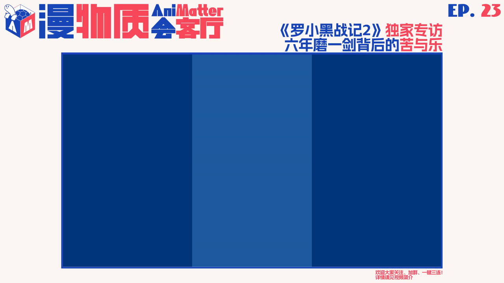

# 视频剪辑：模板、素材框、头像、渲染管线

> 读这份回答：**视频是怎么从「一份 PSD 模板 + 一条剪好的音频」合成出来的，以及踩过哪些坑。**
> 改 `media/template.py`、`media/video.py`、`media/box_track.py`、`core/video_avatar.py`、
> `services/video_render.py` 前读。§19.11 是 26 条实测过的坑，逐条对一遍比读十页设计快。
>
> 验收记录在 `docs/milestones.md` §13，逐轮的「为什么」在 `docs/CHANGELOG.md`。
> 章节号 `§N` 全局唯一，源码注释里的 `AGENTS.md §N` 指的就是这里。
>
> **本文引用的 `.tmp/xxx.py` 脚本都是一次性验证脚本，`.tmp/` 已按约定清空**（第 133 轮）。
> **结论与判据不受影响**——每个结论旁边都写着它量的是什么、量出多少；要复现就照正文重写脚本，
> 不要去找那些文件。**常驻验收脚本在 `scripts/`**（`verify-e1-plate.py`、`verify-e3-workers.py`、
> `verify-p1-consistency.py` 与 `check-p*.mjs`），那些才是入库的。

---

## 19. 视频剪辑（播客视频化）

这一章是**实现与实测记录**，不是提案。§19.1–§19.9 是边界、数据模型、渲染管线（开工前的设计，
现在都跑在真实项目上）；§19.10 是分四步的交付顺序；§19.11 是 26 条踩过的坑；§19.12 是四条已
拍板的决策；§19.13 起逐轮记「这一轮改了什么、为什么」。

**§19.31–§19.34 是「实时预览 + 导出提速」那一轮（第 127–132 轮）的落点**：这两件事原先有一份
方案文档 `docs/video-preview-and-export.md`（章节号 §20），七个阶段全部落地或判定之后，还成立的
结论并进了本章，那份文档已删除（第 133 轮）。**源码里的 `§20.x` 已全部改指本章的 `§19.x`。**

**§19.35–§19.38 是「模板」那四期工程**（第 137–140 轮）：编译产物拆分成三张图（§19.35）、
`.template` 模板包与默认模板（§19.36）、十八个取舍（§19.37）、布局覆盖层与画布编辑器（§19.38）。
当时排期里还留着「第四期：文档（§19.13 重写、新决策进 `decisions.md`、`CHANGELOG`）」——
**它是分次落地的，没有单独的一节**：D25–D28 写进了 `docs/decisions.md`，P8–P10 写进了
`docs/milestones.md`，第 137–140 轮写进了 `docs/CHANGELOG.md`，而 §19.13 的过时说法在第 141 轮
统一清掉（`§19.13` 只讲**模板怎么导入与怎么改**，布局在 §19.38）。

### 19.1 边界：这个视频是什么

它不是一个剪辑器，是**把已经剪好的音频套进一个模板**，产出一条能上传的视频：

```
┌──────────────────────────────────────────────────────────┐
│  模板背景（PSD 一次性压平）                                │
│   ┌────────────────────────────────┐                     │
│   │  素材框                         │                     │
│   │   ├ 图片 / 视频 / 画廊 / 演示稿  │                     │
│   │  （循环或截断，自动适配框）       │                     │
│   └────────────────────────────────┘                     │
│   ○ 头像A（说话时亮，不说话时暗）  ○ 头像B                 │
│              ┌ 字幕（可配位置/色/字号）┐                   │
└──────────────────────────────────────────────────────────┘
```

**不做**：转场特效库、关键帧曲线编辑器、多轨叠加、调色、蒙版、画中画之外的合成。
理由和你给的一致——「完全为播客服务」。上面那张图里每一层都是「一次性决定、长时段静止」的，
这决定了整个技术选型（§19.2）。

### 19.2 核心结论：PSD 只做一次导入，之后不再碰它

这是整份提案里最重要的一条，也是我实测之后才知道必须要这么做。

#### 三条硬事实

1. **psd-tools 写不了文字。** `TypeLayer.text` 是只读 property（`AttributeError: property 'text'
   of 'TypeLayer' object has no setter`，1.26.0 / Python 3.13.5 实测）。官方 README 的
   「Not supported」里明确写着 *Editing of texts in type layers*。
2. **绕过它也没用。** 直接改底层 tagged block（`Tag.TYPE_TOOL_OBJECT_SETTING`）能让
   `layer.text` 变、能存盘、能重开读出来——但 `composite()` 出来的像素**一个字节都不变**
   （0.00% 差异）。psd-tools 里没有字形光栅化器，你看到的那行字是 Photoshop 烤进去的位图。
3. **它的 `composite()` 默认返回的是 Photoshop 的缩略预览，不是它自己合成的。**
   源码里 `if not (ignore_preview or force or layer_filter) and self.has_preview(): return self.topil()`。
   实测：我们这版模板 `composite()` 的结果与 `topil()` **逐字节相同**，656ms。
   一旦强制真合成（`ignore_preview=True`）就是 **17.9 秒**，而且与本机 Photoshop 预览差
   0.55% 的像素（最大 77/255），加 `force=True` 直接 `ImportError: ... aggdraw`
   ——因为模板里有矢量描边的形状图层。

#### 所以

**导入 = 一次性把 PSD 编译成一个「视频模板」**，之后所有渲染都只用编译产物：

| 编译产物 | 内容 | 怎么来 |
|---|---|---|
| `background.png` | 模板外观，**没有**头像、**没有**素材框内容（含底板；第 137 轮起只作兼容与裁剪来源） | `composite(layer_filter=..., ignore_preview=True)` |
| `background_open.png` | 同上但**去掉**素材框底板，底板单独一张（§19.35） | 同一 filter 再加 `id(layer) != id(plate)` |
| `plate.png` | 素材框的白色底板，1444×815，放在 rect `(238,206)` | 从含底板的 poster 按差异 bbox 裁、alpha 强制 255 |
| `overlay.png` | 素材框的边框/描边（z 序在素材框**之上**的图层），裁到自身 bbox | 同一棵树里取 z 序在框上方的那几层，再按 alpha bbox 裁 |
| `box_rect` | 素材框矩形 | 框所在组的 bbox（这版：(320,278)-(2240,1358)） |
| `avatar_slots[]` | 每个头像位的 rect / 照片 rect / 名牌 rect / 圆环图 | 头像组里的子图层逐个给 |
| `text_slots[]` | 标题/期号/脚注的框 + 字体 + 字号 + 颜色 | type layer 的 `bbox` + `typesetting` |
| 内嵌素材 | 头像照片、海报（smart object 里的字节） | `layer.smart_object.data` |

**文字全部由我们自己画。** PSD 里的 type layer 只用来告诉我们
「这块区域、这个字体、这个字号、这个颜色」——那是**排版参数**，不是可编辑的文本对象。
这条契约必须第一天就定死，否则会出现「在界面上改了标题、导出还是旧标题」这种最难查的 bug。

**头像位和素材框让用户确认一次。** 自动识别能给出很好的初值（这版全部正确），但任何 PSD
都可能长得不一样，猜错的表现是「画面里有个框框歪了」——用户没法解释也没法修。所以导入后弹一个
「确认版式」界面：显示压平结果，把识别到的框和头像位画上去，可拖可改。**不做魔法，只做初值。**

### 19.3 时间轴：锚在**句子边界上的原始毫秒**

用户说「两者时间轴完全绑定」。要绑就得先说清楚绑在哪个时间上——这个项目里**存在两条时间轴**：

- **原始时间**：波形画的是它，`token.start_ms` 是它，删除区间标在它上面。
- **成片时间**：字幕导出、成片播放、`TimeMap.to_new()` 之后的世界。

**结论：视频块的边界是「原始毫秒」，但取值被量化到句子起点网格上。**

- 存绝对值，**不存**句子引用。两者都是原始时间，但引用会失效，绝对值不会（见下）。
- 拖动时吸附到句子起点；拖完存下来的就是这个起点的毫秒数。
- **音频编辑完全不写 `video_item`。** 这是本节最重要的一条：删词、删句、批量清理、
  调边界，没有一条路径需要碰视频轨。

#### 为什么不存「这是第几句的边界」

三个候选身份实测都不稳定，存任何一个都会静默跳到别的句子上：

| 候选 | 实测结论 |
|---|---|
| `sentence.id` | `_persist_spans` 按 `ord` 复用行，id 跟的是**位置**不是句子。切一刀，下面每句的 id 都换了主人 |
| `token.idx` | 379 次文字修改里 31 次 token 数变化（−1..−4），idx 会移位 |
| `token.src_word_idx` | 8180 个 token 只有 83 个不同值——它是「第几个 ASR 词」不是唯一地址 |
| **原始绝对毫秒** | 只有 `align.apply_shift` 会动它（±1000 ms，全片刚性平移），平移时一起平移即可 |

所以 `video_item.start_ms/end_ms` 就是 `[start, end)` 的原始毫秒，和 `deletion` 同一套时间。

#### 块的时长语义：连续播放，内容循环/裁剪

**这是和「跟着音频被剪」相反的选择，而且这边是对的。** 一个 10 秒的视频块，如果它覆盖的
区间里删掉了 2 秒音频：

| | 视频块在成片里 |
|---|---|
| 跟着音频被剪（错） | 出现 10 秒，中间跳切 2 秒 |
| **连续播放（对）** | 出现 **8 秒**，内容自动循环或截断，中间不跳 |

跳切是硬伤——观众看到的是画面「闪了一下」，不是「剪掉了」。所以：

- **视频素材**：块长改成 8 秒，短于块长就循环（`-stream_loop -1`），长于就截断（`-t`）。
- **图片**：单张直接铺满新时长。
- **画廊**：**每张图的时长按比例缩放，轮数不变**（见 §19.3.1）。

UI 上「成片比原始短」这件事必须看得见，但**不是两个数字并排**（第 104 轮改）：块底部一条
填充条画成片占比（`keptPercent`），块上的文字写 `起–止`。原来那行「原始 10.0s / 成片 8.0s」
跟着「选中 …」一整行一起删了——用户要的是「这个块在哪」，占比一条就够，两个数反而没人读。

#### 边界「失效」不拦删除，而是自动重吸附

我一开始建议「跨锚点的删除必须拒绝」。**实测证明这条是多余的，而且方向是错的。**

拿真实的 583 句项目，把删除区间放在块边界上跨过去，用真实 TimeMap 算每个块的成片跨度：

| 情形 | 结果 |
|---|---|
| 删除在两个块边界**之间**（不碰锚点） | 块不变；中间那个块按删除量变短 |
| 删除**跨越**块边界 | 两侧块各变短 420 ms，**仍然首尾相接（delta 0）**，渲染完全正常 |
| 删除**吞掉整个块** | 该块 `map_range` 返回 `None`，成片时长 0 —— **这才是真正会坏的** |

也就是说跨锚点只是让「边界不再落在句子起点上」，不是渲染问题。而**禁止删除是拿视频内容去
否决音频剪辑**，用户会撞一堵说不出理由的墙。所以规则改成：

1. **任何删除都不拒绝。**
2. 编辑后重算网格（当前所有句子起点 + `0` + `duration_ms`），把落在失效边界上的块边界
   **重新吸附到最近的存活边界**。这与「边界编辑后重吸附」是同一条路径，只需要实现一次。
3. 重吸附后 `start >= end` 的块 = **整块被吞掉**。不静默丢行：标 `orphaned`，UI 上写
   「这个素材块对应的音频已删除」并给两个动作（删掉它 / 挪到别处）。用户可能只是暂时删了那句，
   自动删行就等于替他把决定做了。

历史数据里「整句音频被删光」的比例：1074 句项目 **81 句（7.54 %）**，583 句项目 3 句
（0.51 %）。所以 orphaned 不常见但会发生，必须有处理路径——它正是唯一会真正坏掉的那种情况。

**`merge` 仍然要拦。** 合并两句话会消灭它们之间的接缝，那是**主动删掉网格点**，不是删除音频的
副作用。实测只用了 2 次，提示「先把这个边界上的素材块挪开」是合理的。

#### 锚点维护：只有一条路径

上面 2 和「边界编辑后重吸附」是同一件事——**每次可能改变句子起点集合的操作之后，跑一次
`renormalize`**：

| 触发 | 频率（实测） |
|---|---|
| `new_sentence` / `to_prev` / `to_next` / `merge` 边界编辑 | 62 次 |
| 删除/恢复（改变 keeps，进而改变块时长） | 400+ 条删除行 |
| `align.apply_shift`（整片平移 ±1000 ms） | 极少 |

`apply_shift` 特殊一点：它是**刚性平移**，所以直接平移 `video_item` 的毫秒值即可，不需要
重算网格——语义完全一致。其余情况走 `renormalize`。

#### 渲染时用 EDL 的实际 keeps，不用锚点值

吸附到静音 + `GUARD_MS = 20` 会让实际切点偏离锚点最多 20 ms 或一整个静音段。所以块的
成片时长**不能用锚点值相减**，必须用编译后 EDL 的实际 keeps 求和，否则画面和字幕差一帧，
而且只在有静音吸附的项目里出现——是最难查的那种。

#### 网格形状（三个真实项目实测）

| 项目 | 句数 | 重复起点 | 零长句 | 句间重叠 | 起点严格递增 |
|---|---|---|---|---|---|
| 1h45m | 1074 | 0 | 0 | 0 | 是 |
| 1h01m | 583 | 0 | 0 | 0 | 是 |
| 1m15s | 10 | 0 | 0 | 0 | 是 |

网格本身是干净的。但 **tile 尺寸极不均**（583 句项目）：

```
min 160 ms | p10 1080 ms | 中位 5520 ms | p90 12338 ms | max 37810 ms
< 500 ms: 19 个 | < 1 s: 48 个 | > 15 s: 35 个 | > 30 s: 1 个
```

19 个 160–500 ms 的 tile 对 3 秒的素材块没有意义，拖起来还会抖。所以：

- **吸附半径内才吸**（默认 ±120 ms，可关）。
- **< 500 ms 的相邻边界在 UI 上合并成一个吸附点**；数据上仍然各自有效，只是不显示为可落点。
- 首句之前（实测 240–5100 ms）和末句之后（576–2109 ms）不属于任何 tile，边界允许取
  `0` 和 `duration_ms` 两个额外落点。

**相邻块不会闪背景。** 实测：以句子起点切块，`map_range` 映射后相邻块**无缝隙、无重叠，
0 violations**，包括一个正好跨在切点上的删除。

#### 19.3.1 画廊：删除时**按比例缩放每张图的时长，轮数不变**

用户拍板选 B。删 1 秒 → 每张图时长 `× (新时长/旧时长)`，总轮数不变。

代价要写在实现里：一次 3 秒的删除会让 8 张图各压掉 12 %，观感上接近「误触倍速」。
所以 UI 上画廊块要显示「8 张 · 每张 1.9s（原 2.2s）」，让速度变化是**可见**的，
而不是让人以为画面坏了。

### 19.4 数据模型

```sql
-- 视频模板：一个项目一份（换模板 = 重编译，视频轨保留）
video_template(
  id TEXT PK, project_id TEXT,
  source_path TEXT,            -- 用户导入的 .psd（只留档，渲染不读它）
  source_sha256 TEXT,          -- 重复导入同一份时直接复用编译产物
  canvas_w INT, canvas_h INT,  -- PSD 画布尺寸
  background_path TEXT,        -- 编译产物：海报（头像压平、无框内容、含底板）。
                               -- **同目录还有三个 twin**：background_open（无头像）、
                               -- background_bare（无头像、含底板）、background_bare_open
                               -- （无头像无底板，第 137 轮起渲染与预览都用它）。
                               -- 这一列同时是其他编译产物的**锚点**（都在它的 parent 里）。
  overlay_path TEXT,           -- 编译产物：框的描边，盖在框内容上方（第 137 轮起**裁到自身 bbox**，
                               -- 所以要配 slots_json.art.stroke 的 rect 才能摆对）
  box_rect TEXT,               -- json {"x","y","w","h"}，画布坐标
  box_fit_default TEXT,        -- contain|cover|blur_fill|stretch
  slots_json TEXT,             -- json: 头像位 + 文本位 + art（plate/stroke 的文件名与 rect，§19.35）。
                               -- 这是**编译出来的几何**，不是用户摆的位置——问位置要过
                               -- services/video_layout.py（§19.38）
  bindings_json TEXT,          -- json {"<槽名>": <speaker local_id>}（§19.14）。单独一列因为
                               -- slots_json 每次编译都会被 PSD 重写
  edits_json TEXT,             -- json {"texts":{...}, "photos":{...}, "layout":{...}}（§19.12、§19.38）。
                               -- **三个写者共享这一列**（改文字 / 换头像 / 挪位置），
                               -- 每个写者都必须保留另外两个键
  status TEXT,                 -- pending|compiling|ready|failed
  error TEXT,                  -- status=failed 时的人话原因
  compiled_at TEXT
)

-- 素材库
video_asset(
  id TEXT PK, project_id TEXT,
  kind TEXT,                   -- image|video
  path TEXT, sha256 TEXT,      -- path 是哈希名（去重 + 原片只读需要）
  original_name TEXT,          -- 导入时的文件名；空串 = 这一行早于这一列
  width INT, height INT, duration_ms INT,   -- 图片 duration 为 0
  created_at TEXT
)

-- 演示稿：我们自己的模型，不是 pptx
deck(id TEXT PK, project_id TEXT, title TEXT, created_at TEXT)
slide(
  id TEXT PK, deck_id TEXT, ord INT,
  title TEXT, body TEXT,       -- 纯文本，人工可改
  layout TEXT,                 -- title|title_body|quote
  source_ord INT,              -- 由哪一句字幕生成，用于「跳到该段」
  start_ms INT                 -- 原始时间：这一页从什么时候开始显示
)

-- 视频时间轴
video_item(
  id TEXT PK, project_id TEXT,
  kind TEXT,                   -- media|gallery|slide
  start_ms INT, end_ms INT,    -- **原始时间毫秒**，拖动时吸附到句子起点（§19.3）
  z INT,                       -- 素材框内的层次（画廊/多素材同时出现时用）
  fit TEXT,                    -- contain|cover|blur_fill|stretch
  motion TEXT,                 -- none|kenburns
  asset_id TEXT, deck_id TEXT, slide_id TEXT,
  gallery_json TEXT            -- 多选图片：json [{asset_id, weight}]
)
```

`start_ms/end_ms` 存的是**绝对值**，不是句子的引用——理由见 §19.3 的表（三种句子身份实测
都不稳定）。吸附发生在拖动时（前端算），落库时已经是量化好的毫秒。

`video_item` 不做子表存画廊成员，因为画廊是**一个**时间轴块、一个整体行为（按权重轮流显示），
拆成多行会让「拖一下整个画廊」变成 N 次更新。

`video_asset.path` 是哈希名，界面上显示的是 `original_name`（§19.17.3）；`video_item` 本身
不存名字，名字在 `GET /video/timeline` 的响应里算成 `label` 一起给出（§19.17.2）。

### 19.5 渲染管线：三层合成，两次 ffmpeg

```
        ┌─────────────────────────────────────────────┐
 输入    │ background.png         (1920×1080, 静态)     │
        │ box content track      (1440×810, 可变)      │
        │ overlay.png            (框的描边, 静态)       │
        │ avatar tracks ×N       (小尺寸 RGBA, 可变)    │
        │ subtitles.ass          (1000 条量级)          │
        └─────────────────────────────────────────────┘
                            ↓  一次 ffmpeg（-filter_complex_script 文件）
                       video-only.mp4
                            ↓  一次 ffmpeg（-c copy 混流，实测 0.24s / 60s）
                       成片.mp4（视频 + 已渲染好的音频）
```

**为什么音频不在这里一起编。** 音频渲染已经有自己的 EDL hash 缓存、后台任务、进度条
（`services/renders.py`）。视频再算一遍音频是白烧 CPU：一条 105 分钟的片，音频编码本来就要
十几分钟。所以视频管线只产出**无声视频**，最后一步 `-c copy` 把已有的成片音频贴上去。
实测这一步 60 秒素材只要 **0.24 秒**。

**素材框内容怎么来。** 按 `video_item` 生成一条 1440×810 的「框内轨」：

| item 类型 | 框内轨怎么生成 |
|---|---|
| 图片 | 一张 PNG，`-loop 1 -t 时长`；fit 决定缩放策略 |
| 视频 | 直接 `-i`，`fit` 用 `scale` + `crop`/`pad`；**短于块长就循环**（`-stream_loop -1`），**长于块长就截断**（`-t`） |
| 画廊 | 每张图先做成小段，再 `concat` 成一条（实测 3 张 4 秒 → 12 秒，1.21s） |
| 演示稿 | 每页一张 PNG，同样 `concat` |

**五个 fit 策略**（图片进框时必选其一，默认 `blur_fill`）：

| fit | 表现 | 用在哪 |
|---|---|---|
| `contain` | 完整显示，留边 | 海报、图表（不能被裁） |
| `cover` | 填满，裁掉溢出 | 视频素材（默认） |
| `blur_fill` | 模糊放大作底 + 完整显示 | 竖图放进 16:9 框（§19.9 有实拍） |
| `blur_crop` | **不缩放**，顶边中点对齐，溢出裁掉，没满处模糊填充 | 截图、UI 稿、必须保持像素清晰的东西（§19.21） |
| `stretch` | 拉伸 | 只给「我知道我在干什么」的人 |

`blur_fill` 要成为图片默认：播客素材大量是竖屏截图和海报，`contain` 留两条白边很丑，
`cover` 会把字裁掉。实测效果见 §19.9 的图。

**头像亮/暗怎么做（关键）。** 直觉做法是一个头像一个 `overlay` + `enable='between(t,a,b)+...'`
拼出所有说话区间。**实测这条路会死**：1000 段区间拼出来的表达式把命令行撑到 79KB，
ffmpeg 进程根本起不来（Windows 32,767 字符上限），报的是 `The filename or extension is too
long`——看起来像路径 bug，不是图大小 bug。

改成：**每个头像先生成一条自己的「明暗轨」**——把「亮」和「暗」两张小 PNG 按说话区间
用 concat demuxer 拼成一条 236×250 的 RGBA 小视频，然后整条只 `overlay` 一次。
实测 600 秒 / 1200 段 → **3.7 秒**生成。这样不论多少段，filtergraph 里永远只有 N 个头像位
（这版 4 个）。

**字幕烧入用 libass，但有三个必踩的坑**（都实测过）：

1. **ASS 不写 `PlayResX/PlayResY` 会被当成 384×288**，1080p 下字号放大 5.6 倍，糊满屏。
   必须显式写 `PlayResX: 1920 / PlayResY: 1080`。
2. **字体名写错/没装，libass 静默替换，日志里一个字都没有。** 必须用 `fontsdir=` 指向
   项目内置的字体目录，并在开渲染前断言字体文件存在。
3. **libass 不会给中文断行。** `WrapStyle: 0` 只在**空格**处断；中文没有空格，于是一整句
   被画成一行任它溢出画布——88px 时第一个字和最后一个字都被裁掉，**而且不报错**。
   52px 时溢出量小，看起来只是「有点宽」，所以这个坑一直到真机渲染大字号才暴露。

   **必须自己断行。** CJK 一字一个 em，ASS 的字号单位就是 PlayRes 单位，所以每行容量是
   除法而不是测量：`chars_per_line = (play_w - margin_l - margin_r) // font_size`。实测
   1920 宽、左右各 120、52px → `1680 // 52 = 32` 字，与真实渲染逐字对得上。断行优先在
   标点后（「，」后断开远比句中断开自然），没标点就按宽度硬断，**绝不为了放下而丢字**。
   写成 `\N` 拼进 `Dialogue`，并在每一行上分别做转义。

   顺带解释了 `margin_v` 的语义：它是**字幕块底边**到画面底边的距离，两行字幕从底部往上
   堆，所以调大就是整块往上抬——不是「行间距」。

### 19.6 演示稿：自己的模型，不碰 pptx 渲染

你要求「根据播客字幕自动生成 ppt，ppt 放入素材框中显示，与字幕进度保持一致，文本可人工编辑」。

**不能走 .pptx 当渲染源。** 实测/查证：

- `python-pptx` 只写 OOXML，**完全没有渲染能力**；
- LibreOffice 的 `soffice --convert-to png` **只导出第一页**（LO bug 67614 / 48015，2013 年开到现在）；
- 本机**没装 LibreOffice**，装一个几百 MB 的办公套件只为把幻灯片转成图，和「本地优先、轻」相悖；
- 微软 Graph / Aspose 是云/商业，直接排除。

**方案：幻灯片是我们自己的数据（`deck` + `slide`），我们自己渲染成 PNG。**
`.pptx` 只作为**导入**（`python-pptx` 抽文字）和**导出**（给想在 PowerPoint 里继续改的人）的
格式，永远不是渲染源。这样：

- 「文本人工编辑」= 编辑我们的 `slide.title/body`，改完立刻重渲染那一页 PNG，一条 RPC；
- 不用等套件启动（LibreOffice 冷启动是秒级）；
- 导出 `.pptx` 时用同一份数据生成，两边不会漂。

**渲染用什么：**

| 方案 | 优点 | 缺点 | 结论 |
|---|---|---|---|
| **PIL** | 无新依赖、**确定性**（同输入同像素）、CJK 字体实测正常 | 排版要自己写（换行、自动缩字号、项目符号） | **v1 用这个** |
| Headless Chrome + HTML | CSS 排版直接可用 | 每帧 87ms、要引 Playwright + 浏览器进程、**不保证跨机器像素一致**（GPU/版本差异，实测报告里有 70/216 帧不同） | 备选，等排版需求超出 PIL |

「同项目 → 同视频」是这个产品的底线（用户会反复导出对比），所以确定性优先于排版表现力。

**自动生成的粒度。** 第一版（第 100 轮之前）按「一整段口播」分页，不看话题。实测一期 61.5 分钟、
17,294 字、583 句的节目：

| 规则 | 页数 | 每页时长 | 结论 |
|---|---|---|---|
| 遇到 ≥1.5 s 的停顿就断 | **238** | 15 s | 幻灯片，不是演示稿 |
| 超过 90 字就断 | 241 | 15 s | 同上 |
| **跑满 60 s 就断，或跑满 45 s 且后面有 ≥700 ms 停顿** | **60** | 62 s | 已降级为兜底 |

238 页的成因不是阈值取错，是**规则本身错**：那期节目句间停顿 p50 只有 320 ms，1.5 s 以上的
停顿一小时只有 12 次，所以「遇停顿就断」实际上退化成「遇长度上限就断」。真正的分页依据是
**时长**：一页讲一分钟，正好是一段能读完的字（60 s × 4.69 字/秒 ≈ 290 字，在 1267×712 的框里
排到 44–48 px）。所以：

- `TARGET_PAGE_MS = 60_000` —— 到点就断，保证页数随时间线性增长而不是随停顿数量爆炸；
- `SEAM_AFTER_MS = 45_000` + `PAGE_GAP_MS = 700` —— 页已经够长时，**优先断在自然的停顿上**
  而不是断在硬上限上；两个阈值合起来，实测页长 p10 54 s / p50 63 s / p90 71 s；
- `MAX_PAGE_CHARS = 480` —— 防止一句不停的话把一页撑成一面墙（480 字排到 32 px / 13 行，
  这是 1080p 下还读得清的下限）；
- `MIN_PAGE_MS = 8_000` —— 短于这个的页会闪，向前合并。

**说话人变化不是分页依据。** 那期节目轮流发言 320 多次，按人断会得到每几秒一页，同样不可读。
问答是一段话题，不是两段；对话感由正文本身呈现，演示稿是摘要不是逐字稿。

**第 100 轮改掉了「内容」这一半**：分页仍然不该按停顿算，正文也不该是逐字稿。现在是模型找
话题转折、每页写 2–4 条小话题（§19.15）。上面那套阈值保留为兜底路径（没有 Key、调用失败、
或者用户明确选「按字幕分页」），所以这一节仍然描述真实存在的代码。

**标题 = 这一页的第一个短句** —— 这只在兜底路径上成立（取最早的 `。！？；，` 之一，上限 26 字）。
模型路径的标题是模型写的「这一段叫什么」，不是「刚才说了什么」的开头几个字。

**兜底路径为什么不要 LLM。** 确定性、免费、秒出，而且「重新生成」不会给你一份和刚才不一样的稿子
—— 这是它作为兜底的全部价值，也是它作为主路径的全部问题：一页幻灯片要的是「这一段在讲什么」，
而「刚才说了什么」正是第 100 轮要删掉的那件事。

生成后有一栏「逐页校对」：左边是这一页覆盖的字幕原文，右边是可编辑的标题/正文。

### 19.7 前端结构

```
┌ 视频剪辑 ───────────────────── 模板已套用 · 2 个素材块  [展开] ┐  ← 面板，**默认收起**
│ ┌── 16:9 预览 ──────────┐ ┌ 模板 │ 字幕 │ 素材库 │ 演示稿 ┐ │
│ │ （实时 DOM 舞台）      │ │  （只渲染选中的那一页）        │ │
│ └───────────────────────┘ └────────────────────────────────┘ │
│ （没有导出按钮：成片视频在「导出」菜单里）                       │
│ ┌── 视频轴（与下方波形共用同一个窗口）──────────────────────┐  │
└──────────────────────────────────────────────────────────────┘
┌ 音频剪辑 ───────────────────── 成片 61:36 / 原始 61:36  [收起] ┐  ← 面板，默认展开
│ 09:45.217  583 句 · 8180 词 · 1 小时 1 分                     │
│ 音频波形（现有 Waveform）                                       │
│ [▶][⟨ 上一句][下一句 ⟩]              [删除选中][恢复删除]        │
└──────────────────────────────────────────────────────────────┘
```

**两个面板平级、chrome 一致，都用 `CollapsiblePanel`。** 视频那个默认收起，音频那个默认
展开。旧的「`设置 → 显示视频区`」入口已经删掉：一整个功能藏在菜单里，屏幕上没有任何地方能
看出它存在，只能靠开菜单猜。收起状态仍然占一行标题 + 摘要，所以「这个项目用不用视频」
不用打开就能知道。左侧工作区另有抽屉把手（`docs/frontend.md` §7.2），视频排版时可以整栏让位。

**面板内部是「预览左、设置右」，设置靠标签页切。** 四段设置竖着堆的时候，要够到下面的视频轴
得先滚过四屏和自己目标无关的东西。现在设置是一张 320px 的卡片，四个 `.tab` 切换；「演示稿」
那页单独放宽到 560px，因为它是双栏编辑器而不是表单，320px 会把页标题截成六个字。

**视频轴是面板的最后一行，紧挨着音频轴。** 两条轴画的是同一个时间轴，问题是「这个素材块落在
哪句话上」——把视频轴放最底、音频轴放最顶，中间只隔面板边框和标题行，竖着扫一眼就能对齐。
**导出不在这两个面板里，在 `导出` 菜单里。** 视频面板原来底部有一行
`[导出视频] 下载成片 成片 1 小时 1 分 / 原始 1 小时 1 分`，音频 transport 里有一个
`导出成片`。三处都是重复：那行时长和 `音频剪辑` 的摘要、以及它上面的「583 句 · 8180 词 ·
1 小时 1 分」说的是同一件事；而交付物的出口本来就在菜单里（字幕 / Audacity 标签 /
ShowNotes / 文稿 / 导出成片音频）。第 102 轮把它们全部收敛成 `导出 → 导出成片视频…`，
面板只负责**摆放**片子，交付归菜单。

**两条轴共用一个窗口。** `VideoPanel` 原来自己持有 `{from: 0, to: 60_000}`，波形持有另一个
（可以是整段 61 分钟），于是屏幕上同一个横坐标在两条轴上代表两个不同的时刻——这正是「导入素材
不知道放哪」的根因。窗口现在提到 `App`（`apps/web/src/timelineView.ts` 的 `useTimelineView`），
`Waveform` 和 `VideoTrack` 都从它渲染，滚轮缩放、滚动条、跟着播放头全走同一个 `zoomAt` /
`panTo`。`VideoTrack` 的滚轮监听必须 non-passive（React 合成事件不能 `preventDefault`）。

对齐还有一个 7px 的坑：波形的 canvas 在 `.waveform` 里被 6px padding + 1px border 内缩，视频轴
原本贴着内容边缘。实测 canvas `left 452 / width 956`，轨道 `left 445 / width 970`——号称同一条
时间轴的两条轨道起点差 7px。`.video-track-wrap { padding: 0 7px }` 之后逐像素一致。

验证方式是走查里点两次：在同一个横向比例上分别点视频轴和波形，读 `aria-valuenow`，两个数必须
相等。实测 `trackTime 2734987 / waveTime 2734987`，`deltaMs 0`。

**时间轴组件不重写。** 现有的 `Waveform.tsx` 已经解决了「缩放锚点、自定义滚动条、
播放头跟随、边界手柄命中」这一堆问题（§7.1）。视频轴是**同一套手势、不同内容**：
它复用 `waveView.ts` 的纯函数（`zoomAt`/`panTo`/`msToX`/`xToMs`），只换绘制和命中。
`waveView.ts` 里那几个函数已经是纯的、有 174 条单测托着，正好直接借。区别只有一处：窗口不再由
各自持有，而是由 `useTimelineView` 统一管（见上）。

**块上写什么。** 每个块两行：素材原名（或演示稿标题）、`起–止`。选中块时它上方出现一个气泡，
里面只有「填充」下拉和「删除素材」——原来那一行「选中 xx–xx（nn.ns）」已经删除，理由见 §19.17.1。

**预览怎么对齐。** 预览不另开视频播放器，播放头仍由现有 `playback` 驱动——「拖音频、拖视频块、
看预览」是同一个时钟。

> **这一段的结论已经被后续三轮改写过两次，现在的实现见 §19.31–§19.33**，不要按这里的旧方案做：
>
> 1. **不做「服务端渲染低分辨率预览版」**（原文的 540p/15fps 方案）。实测 540p 只有 1.74× 实时、
>    1080p 0.49×——服务端渲染永远追不上播放（§19.31）。
> 2. **不做「只做静帧」**。静帧确实先做了（第 128 轮，§19.33），但它是**过渡态**；第 129 轮就换成了
>    服务端出 plan + 浏览器 6 层 DOM 合成（§19.31），实测 45.8 fps / 0 丢帧。
> 3. **「约 200 ms」这个数在真实样片上是 1020–1330 ms**（§19.33），差 6 倍——当初是在很小的项目上
>    量的。任何拿它做设计输入的判断都要重测。

### 19.8 关于「有没有成熟开源项目可借用」

按需求逐条回答，带结论。★/许可证截至 2026-11，实际可用性都在本机验过。

#### PSD 解析

| 项目 | 许可 | 能解决 | 不能解决 | 结论 |
|---|---|---|---|---|
| [psd-tools](https://github.com/psd-tools/psd-tools) 1.26.0 | MIT | 图层树、bbox、kind、透明度、混合模式、mask、smart object 字节、type layer 的字体/字号/颜色/字距 | **写不了文字**；真合成慢且要 `aggdraw`；效果图层保真差 | **用**，但只用来「编译模板」 |
| [ag-psd](https://github.com/ag-psd/ag-psd)（JS） | MIT | 能读写文字层 | 不重绘位图，Photoshop 打开会提示；要 Node 进程 | 不用 |
| [psd2svg](https://github.com/CyberAgent/psd2svg) | MIT | PSD→SVG | 依赖同一套 psd-tools 保真度；要再引一个光栅化器 | 只做备选 |
| psd.js | **无 LICENSE 文件** | 只解析 | — | **不用**（许可不明） |
| pytoshop | BSD | 低层读写 | 2018 年停更，Python 3.6 为止 | 不用 |

#### 视频合成

| 项目 | 许可 | 结论 | 理由（实测） |
|---|---|---|---|
| **ffmpeg filtergraph** | LGPL/GPL 自选 | **用** | 1 小时 1080p：底图+框+字幕 ≈ **11 分钟**，再加 4 个头像明暗轨 ≈ **14 分钟**；两次跑出**逐字节相同**的 mp4；`overlay`/`concat`/`zoompan`/`ass` 全部够用 |
| MoviePy 2.2 | MIT | **不用** | 每帧都是 numpy 全画布，纯合成 22.3ms/帧 → 1 小时要 **40 分钟**，还没编码；分类器只到 3.11，`pillow<12` 与现装 Pillow 13 冲突 |
| Remotion | **自定义商用许可** | 不用 | ≤3 人免费，超过要付费；且它要 Node，我们的后端是 Python |
| Motion Canvas | MIT | 不用 | 是 TS 矢量动画库 + 编辑器，形状不对 |
| GStreamer | LGPL | 不用 | Windows 上 `gst-python` 没有 wheel，装不上 |
| libass（ffmpeg `ass`/`subtitles` 滤镜） | ISC | **用** | 本地 ffmpeg 已带；CJK + 描边 + 折行实测正确 |

#### 整机开源剪辑器：为什么一个都借不来

「有没有现成的」我先按整机找过一遍，结论是**没有能嵌进这个产品的**：

| 项目 | 许可 | 为什么不能借 |
|---|---|---|
| [OpenCut](https://github.com/OpenCut-app/OpenCut) | MIT | 是 CapCut 形态的**通用网页剪辑器**（Next.js + Rust GPU 合成器）。它要的是浏览器里拖轨道的完整编辑器，我们要的是「模板 + 一次渲染」；借它的结果是把整个产品改造成通用剪辑器。 |
| MLT（Shotcut/Kdenlive 的引擎） | LGPL | `mlt` 在 PyPI **没有任何发行版**（本机实测 `No matching distribution found`），Windows 要自己编 C 库。 |
| Kdenlive / Shotcut | GPL | 是**应用**不是库；GPL 还会传染整个后端。 |
| Remotion / Motion Canvas | 见上 | 都要 Node 运行时。 |

「按需求找一个成熟项目来借用」这个方向，在**整机层面不成立**，在**零件层面成立**：
PSD 解析借 psd-tools，合成借 ffmpeg，字幕借 libass。这三件事加起来才是这套功能剩下的部分——
而剩下的部分（时间轴交互、说话人绑定、模板编译、演示稿）恰好是这个产品**独有**的，也没有别人替我们做过。

**所以这不是「从零造轮子」，是「三个成熟零件 + 一层我们自己的胶水」。**
胶水部分的每一处风险都在 §19.11 列了，且都已经实测过。

#### PPTX

| 项目 | 许可 | 结论 |
|---|---|---|
| python-pptx 1.0.2 | MIT | **只作导入/导出**，不能渲染 |
| LibreOffice `--convert-to` | MPL2 | 转 PDF 可靠，**转 PNG 只能导一页**；本机未安装 |
| pypdfium2 | BSD/Apache | 若要 PDF→PNG 就用它（配 LO 转 PDF） |
| Aspose / MS Graph | 商业/云 | 排除 |

**最终新增依赖（后端）**：`psd-tools`（MIT，只解析）+ `Pillow` + 已有的 `numpy`。
**不新增**：MoviePy、Remotion、python-pptx（第一版连它也不要，先只做自有模型）、
Playwright（第一版不要）。

### 19.9 实测数据

全部在本机跑（AMD RX 580 / Windows / ffmpeg 7.1.1-full / Python 3.13.5）。素材来自
`samples/播客模板.psd`（2560×1440，58 层）。

#### 渲染速度

| 场景 | 结果 | 外推 1 小时 |
|---|---|---|
| 纯 x264 编码 60 秒（`veryfast`） | 10.95 s | ≈ 11 min |
| 底图 + 素材框 + 字幕烧入 60 秒 | 10.85 s | ≈ 11 min |
| **完整合成 60 秒**（底图+框+字幕+头像明暗） | **14.19 s** | **≈ 14 min** |
| 同上，`ultrafast` / `superfast` / `veryfast` | 8.06 / 8.69 / 9.42 s | 8–9 min |
| 混流（`-c copy`）60 秒 | **0.24 s** | 可忽略 |
| 1000 条 ASS 字幕烧 120 秒 | 23.17 s | ≈ 12 min |
| 单帧静态预览（含字幕） | **约 200 ms** | 交互可用 |

**确定性**：同一条命令跑两遍，输出 mp4 的 SHA-256 **完全相同**
（`71ABB254…D457`）。这条很重要——它意味着「同一个项目导出两次，用户能逐帧对比」成立，
也意味着渲染结果可以拿哈希做缓存键，和现有 `render.edl_hash` 是同一个思路。

**结论**：一条 1 小时播客导出视频约 14 分钟。和音频导出（105 分钟片 ≈ 12 分钟）同一量级，
所以后台任务 + 进度条那一套照搬 `services/renders.py` 就行，不需要新机制。

**时间花在哪：几乎全在编码。** 空底图只编码不合成是 10.95 s/60s，加上素材框、字幕烧入、
四个头像明暗轨之后是 14.19 s/60s——也就是说**所有合成加起来只占 3.2 秒**，其余 11 秒是
x264 在压 1500 帧 1080p。这决定了两件事：

- 想提速只能动**编码参数或分辨率**，优化 filtergraph 没有意义；
- `ultrafast`（8.06 s）比 `veryfast`（9.42 s）只快 15%，但体积是 3 倍（相对 1.1MB → 3.1MB）。
  **选 `veryfast`**，那 15% 不值得。


#### PSD 编译耗时

| 步骤 | 耗时 |
|---|---|
| `PSDImage.open` | 490 ms |
| `composite()`（无 filter，走预览捷径） | 46 ms |
| `composite(layer_filter=...)`（真合成） | **4.9 s**（同一份文件另一次测得 16.3 s） |
| 单个头像组 `composite()` | 52 ms |
| 素材框 plate `composite()` | 1.6 s |
| 缩放 2560×1440 → 1920×1080 | 161 ms |

**结论**：一次模板编译 5–20 秒，**明确要做「导入时编译一次 + 落盘缓存」**，
不能每次渲染都重算。

#### 素材框 / 头像的实测效果

下面两张是用 `samples/播客模板.psd` 编译出的背景 + 海报填框 + 头像位实拍的 1080p 帧
（图片存成 1280 宽以控制在仓库里的大小）：

**同一对头像的两个状态：上一位说话人亮、另一位暗**


两种状态只差「照片那个矩形」的颜色，承板、圆环、名牌都不动。第二张里能清楚看到承板仍然是
不透明白色——这正是第一版做法（整组压暗 / 整组降 alpha）做错的地方。

**图片竖图进 16:9 框，`blur_fill`**：底图模糊放大 + 原图完整居中，无白边、不裁字。



**头像「暗」的三种做法，前两种都是错的**（都实拍了）：

| 做法 | 结果 |
|---|---|
| 整组压暗 | 头像位背后那块白色承板一起变灰，兜出一个灰方块 |
| 整组降 alpha | 承板变半透明，海报从后面透出来，还是方块 |
| **只对照片像素去饱和 + 压暗**（alpha 不动） | **正确**：承板保持不透明，白底上白承板本来就看不见；脸明显变暗但仍认得出是谁 |

这条要写进实现说明：**「暗」不是「透明」，是照片本身变灰变暗**。渲染时就是一张预生成的
dim PNG 和 lit PNG 轮流出现（`§19.5` 的明暗轨），ffmpeg 不需要做任何实时调色。


### 19.10 分四步做，一步一个可验收的交付物

**这一节只留阶段划分和顺序理由。每一步验收了什么、落在哪个文件，记在
`docs/milestones.md` §13 的「视频 P1–P4 交付清单」里——不在这里重复。**

每步都能单独跑起来、单独验收、单独回滚。**建议按这个顺序，因为风险和价值都是递减的。**

| 阶段 | 交付物 | 验收标准 | 预估 |
|---|---|---|---|
| **P1 模板 + 字幕** | 导入 PSD → 编译模板（背景/框/槽位）→ 确认版式界面 → 导出带背景和烧入字幕的视频 | 用 `播客模板.psd` 导出一条 1 小时的片子，字幕位置/颜色/字号可在「字幕」tab 调，导出后像素位置与预览一致 | 最大 |
| **P2 素材库 + 素材框** | 素材库 tab、导入图片/视频、拖到时间轴、调整长度、循环/截断、四种 fit、画廊 | 拖一个竖图和一段视频进框，画面正确、时长正确、被删音频处跳切 | 中 |
| **P3 头像亮暗** | 头像位绑定说话人、明暗轨生成 | 对着 583 句的真实项目跑一遍，讲话人切换时头像跟着变；导出与预览一致 | 小（机制已验） |
| **P4 演示稿** | 从字幕自动生成 deck、逐页校对编辑、进素材框、与字幕同步 | 生成 **60 页左右**（一期 61.5 分钟），人工改 3 页文字后重渲染，页切换点与字幕段落对齐 | 中 |

**P1 内部再拆**（因为它是最大的一块）：1a 数据模型 + 迁移 → 1b 模板编译与确认界面 →
1c 视频时间轴组件 → 1d 渲染管线 + 静帧预览 → 1e 导出。

**为什么第一刀切在 P1。** 它已经能产出「一条有背景、有字幕、能上传」的视频，是这个功能的
八成价值；素材框和头像是在这个骨架上加层，演示稿是最后的锦上添花。

**开工前先改文档的三处**（按 `docs/conventions.md` §16.4，都已做完）：把 `psd-tools`、`Pillow`
加进 `docs/architecture.md` §3.3 的允许清单；在 §4 架构图里补 `media/video.py`、`media/template.py`、
`services/video_render.py`、`routers/video.py`；在 `docs/frontend.md` 加一节讲双时间轴。

### 19.11 会咬人的地方（按咬人概率排）

1. **filtergraph 撞 Windows 命令行上限。** 实测 12,307 字符能跑，38,187 字符报
   `The filename or extension is too long`——它长得像路径错，其实是 `CreateProcess` 的
   32,767 限制。**必须**把图写进文件传。本机 ffmpeg 7.1.1 上两条路都验过：
   `-filter_complex_script <file>`（作为**输入选项**，放在 `-i` 之后）可用；
   `-/filter_complex <file>`（作为**全局选项**，必须放在第一个 `-i` 之前）也可用，
   放错位置会报 `' for option 'filter_complex': Invalid argument`。
   一条 1–3 小时的片子，一个块一个 overlay 很容易超。
2. **libass 静默换字体 / 静默 384×288。** 见 §19.5。这两条都不会报错，只会让成片看起来"莫名
   其妙地丑"。开渲染前断言字体存在，ASS 永远写 `PlayRes`。
3. **文字由我们自己画，PSD 里的字是死的。** 如果哪天有人想"让用户在 PS 里改模板文字自动生效"，
   那是做不到的——必须在导入时就把 PSD 的原文当"背景美术"压平，UI 里可改的是**我们的**文本槽。
   这条要写进文档，否则半年后会有人重新试一遍。
4. **`composite()` 的预览捷径。** 不带 `layer_filter` 也不带 `ignore_preview` 时它返回
   Photoshop 缩略图。听起来无害，但它意味着"模板换了之后背景没变"这种 bug 会以最难查的方式出现。
   编译时永远显式传 `ignore_preview=True`。
5. **预览和成片不一致。** 预览是 540p/静帧，成片是 1080p/25fps，缩略图里的字号和边距在成片里
   会略有不同。要接受这个差异，并在 UI 上写明「预览为近似」——比假装精确好。
6. **删除音频让素材块长度变化，但块边界不会跟着删除跳。** 见 §19.3：块在成片里是
   **连续播放**，总长变短，内容循环/裁剪。UI 必须同时显示原始时长和成片时长，否则用户会
   觉得"我明明设了 10 秒"。**绝不能**用锚点值相减当成片时长——要用 EDL 的实际 keeps 求和。
7. **整块音频被删光会让素材块变成孤儿。** 实测「句子音频被全部删掉」占 **7.54 %**（1074 句
   项目，81 句）。这时块的成片时长是 0，`map_range` 返回 `None`。不能静默丢行——标
   `orphaned` 并在 UI 上给「删掉它 / 挪到别处」两个动作，见 §19.3。
8. **跨锚点的删除不拦，只重吸附。** 实测跨界删除后两侧块仍然首尾相接、渲染正常，所以
   拿视频去否决音频剪辑是错的。但 `merge` 要拦——它是主动删网格点。
9. **中文长句在 libass 里不会自动折行。** 见 §19.5 第 3 条。它的可怕之处是**完全静默**：
   52px 时只是「有点宽」，88px 时首尾字直接被裁掉，画面看起来像字体 bug。必须自己算
   `chars_per_line` 并写 `\N`。
10. **`find_font` 用子串匹配会谎报字体缺失。** 「Microsoft YaHei」的文件名是 `msyh.ttc`，
    `"microsoftyahei" in "msyh"` 是 `False`——于是明明装了，却报「找不到字体，请先安装」，
    比不检查更糟，因为给的是错建议。必须有一张 family → 文件名的表，子串匹配只作兜底。
11. **模板资源的 URL 必须带 project_id。** 路由是 `/{project_id}/video/template/asset/{name}`，
    但第一版生成的 URL 漏了 project 段：形状完全合法、响应里也看不出问题，只是取的时候 404。
    测试必须**取响应里返回的那个 URL**，而不是自己拼一个。
12. **框内轨的输入编号由调用方拥有。** 链只写 `[N:v]`，而 `-i` 列表里背景占 0、美术层各占
    一个。偏移算错会把**描边当成框内容**画出来——而这在屏幕上是一个合理的画面，不会报错。
    `BoxChain.text_for(input_base=…)` 专门做这件事，一处算术。
13. **同一个文件可能在一条链里出现两次。** 画廊把同一张图放两遍、空档用三次底图都会这样。
    滤镜标签必须按**位置**取，不能按输入号；共用标签的报错是 "label already used"，指向一个
    变量而不是原因。
14. **空档必须显式填。** overlay 的输入短于成片时，overlay 提前结束、画面冻在最后一帧。
    用底图自身的框内裁剪填空档，既保证不透明、又保证和底板逐像素对齐。
15. **静帧预览只能声明覆盖它的那一段。** 把 plan 里的 `input_index` 直接传进两输入的预览
    命令，会得到 `Error binding filtergraph inputs/outputs: Invalid argument`——这个报错既没提
    素材框也没提预览。预览要重新编号为 0。
16. **头像「暗」不能按照片矩形压。** 那个矩形底下压着头像组自己的白承板，压下去就兜出一个灰
    方块。要先把「去掉 smart object 的组」合成一张底，**颜色或 alpha 变了**的像素才算照片本体。
    只比颜色会漏掉白色描边（那里底图的 RGB 是纯白、alpha 是 0，于是「没变」），出来满身白点。
    实测承板角落 `(129,128,128)` → `(252,247,244)`。
17. **concat demuxer 把每个 duration 向上取整到整帧。** 1.500 秒在 25fps 下变成 1.520。逐段取整
    会在几百段之后累积成秒级漂移，所以要**累计取整**：每一段写的是「两个取整后边界之差」。
    另外最后一段必须**再列一次**（不带 duration），否则它的时长不被采纳——实测 3.00 秒的脚本
    只出 2.56 秒。
18. **concat 脚本里的路径必须是绝对路径。** demuxer 相对的是**脚本所在目录**，不是进程工作
    目录，写相对路径会静默指到 `工作目录/data/...`，报出来是一句笼统的「视频渲染失败」。
19. **concat 脚本不能带 BOM。** 带 BOM 时报的是 `Line 1: unknown keyword 'file'`——它点名的是
    关键字而不是编码，很容易去查路径。
20. **头像轨要用 qtrle 而不是 PNG 编码。** 同为无损，PNG 编码 600 秒 / 1200 段要 5.9 秒、
    **338 MB**；qtrle 只要 **1.5 秒、55 MB**。区别是 PNG 每帧存一张完整无损帧。
21. **`BoxChain.input_count` 曾经是假的。** 它读 `len(self.sources)`，而 `sources` 在媒体层永远
    是空列表（路径在服务层），所以恒为 0。P1/P2 没人读它所以没暴露；P3 要在这个数之后编号头像
    输入，才发现算出来的是 `[2:v]` 而实际是 `[2:v]`/`[3:v]`——差一位的后果是 ffmpeg 报
    `Error binding filtergraph inputs/outputs`，既没提头像也没提框。现在由 segments 自己数。
22. **演示稿 PNG 的缓存键里必须有尺寸。** 同一个页面在两个地方以两个尺寸被要：编辑器要
    1267×712 的预览，素材框要 1440×810 的成片。按 slide id 缓存时先到的那个尺寸会被另一个复用，
    overlay 于是把图放大——正文变软**并且溢出框右缘**（放大后行宽超出渲染时的框宽）。
    `render_slide` 的签名里没有任何东西说「尺寸是身份的一部分」，所以这个错只能靠真机发现。
23. **演示稿正文的底部要给烧入字幕留位置。** 字幕按整帧的 `margin_v`（1080 的 56 px）画，
    对框里有什么一无所知。第一版把正文排到框的padding底边，实测最后一行离字幕顶端只有 ~10 px，
    看起来就是文字压在文字上。现在底部预留 9 % 框高（810 的 73 px）。
24. **静帧的文件名必须包含产生它的输入。** 原来是 `still-{at_ms}.png`——改字幕字号会把新字节
    写进**同一个 URL**，浏览器看到相同的字符串就不会重新请求，用户把字号拖到底画面也不动。
    实测：连着两次出图、中间把字号从 52 拖到 88，`performance` 里 `still-` 只有 **1 条**
    （当时靠手点按钮触发；第 134 轮删了按钮，改成拖滑杆 + 停播放头，同一个键仍然承重）。
    现在文件名带输入摘要（样式 + 时刻 + 覆盖该帧的框段 + 该时刻的头像亮暗 + 绑定），
    改字号换 URL、同输入仍是同一个文件。**这类「缓存键少了东西」的 bug 在截图里看不出来**，
    因为旧画面本身完全合理。
25. **导出的签名里必须有头像绑定。** `_video_signature` 漏了 `bindings_json`。当时没炸，
    因为 `start_export` 每次都排队重新编码、根本不复用——签名是装饰品。等哪天补上复用，
    症状就是「我改了头像绑定，成片没变」，且没有任何报错。已补 `bindings_json`、`deck_id`
    与在场头像的名字。
26. **删页/重新生成必须删图。** 行的 id 是文件的唯一线索，行没了就没有任何东西能再指到那张
    PNG。实测：一次「重新生成」在 60 页的 deck 上留下 **62 个孤儿文件 / 14 MB**。
    只按「要删的那些 id」清还不够——上一次出错时留下的孤儿已经没有行能命名它们了，
    所以「换掉全部页」时直接清空整个目录，只有单页删除才按 id 清。

### 19.12 已拍板的四件事

开工前摆在这里的四个问题，用户已逐条拍板。**不要再拿出来重新讨论**——决策本身与理由记在
`docs/decisions.md` 的 D11–D14。

| 当初的问题 | 结论 | 决策号 |
|---|---|---|
| P1 先做，还是直接做全套？ | P1 先做，按 P1→P2→P3→P4 递减风险推进 | D11 |
| 模板只支持「一个素材框 + 若干头像位」，够不够？ | 够。两个框并排是另一档复杂度（多条框内轨），不做 | D12 |
| 第一版演示稿只做「生成 + 编辑 + 进框」，不做 `.pptx` 导入导出，可以吗？ | 可以。v1 明确不做 `.pptx` | D13 |
| 头像数量上限设几个？ | 4 个（左右各 2） | D14 |

### 19.13 模板导入：可编辑文字与可换头像

**需求**（第 97 轮，用户原话）：「我需要在导入 PSD 时只留下 logo（左上）、播客名（左上）、背景图层、
素材框和头像框，其他是能够编辑的」。当期标题、期号、头像名都要保留**版式位置**但内容可改，字体可设；
头像框里每张头像也要能单独换。

实现分三块：编译时把文字从背景里**挖掉**并记录版式；渲染时用 Pillow 把文字**画回去**；头像带一套
「框 + 蒙版」让照片可以替换。

#### 19.13.1 为什么文字必须自己画

`psd-tools` **不能写**文字层。实测补 PSD 的 tagged block 之后 `layer.text` 变了，像素变化 **0.00%**。
所以「PSD 里有个文字层」对我们是只读的：它要么被烤进 PNG（永远改不了），要么被排除掉由我们重画。
没有第三条路。

编译时把**所有可见文字层**都从背景里排除 —— 包括头像组里的名字。样例 58 层里有 9 个可达文字层，
排除后同一个矩形区域内的墨迹像素从 **39,549 变成 0**（逐个 slot 测的，标题那一块就有 36,774）。
这个数字是这一节的验收标准：少排一层，画面上就会出现两个名字（可编辑的那个 + 底下烤死的那个）。

#### 19.13.2 分类：靠几何 + 一条正则，不靠字号

样例实测：**期号 91.7 px 比标题 75 px 大**。「最大的那个是标题」会把它俩整个对调。规则改成：

| 判据 | 结论 |
|---|---|
| 文字层在头像组里（`parent` 链，不是 bbox） | 那个槽的**头像名** |
| 在页头带（顶部 35% 高度、右半画布）且匹配 `EP.23`/`第12期`/`S02E07`/`Vol.5` | **期号** |
| 页头带剩下的最大一个 | **当期标题** |
| **大半落在素材框内** | **框内文字**：不画（素材会盖住），界面上说明 |
| 其余 | **其他文字**（页脚等），照画 |

用 `parent` 链而不是 bbox 判头像名：样例的 `嘉宾名` 比它所在的组高 3 px，几何判定会漏掉它，
于是它既没被排除也没被重画 —— 名字直接在画面上消失。

键（`episode` / `title` / `avatar:<组名>` / `note:<层名>`）**只由角色和 PSD 自己的名字决定**，
不含序号，所以重新编译不会把用户的改动挪到另一块文字上。

#### 19.13.3 字号、颜色、变换

* **字号** = PSD 的 point size × 图层 transform 的 `xx` × 画布缩放。头像名带 0.849 的 transform，
  所以 25 px 实际画在 21.2 px；直接用 25 会让每个名字大两成。
* **颜色** 读 `engine_dict["StyleRun"]…["FillColor"]["Values"]`，顺序是 `[alpha, r, g, b]`。
  这一点是**对着合成图核对**的：`EP.23` 报 `[1.0, 0.098, 0.278, 0.729]`，画面上是 `#1947ba`
  （r=0.098）。按 `[r,g,b,a]` 读会得到 `#001947`，深得肉眼可见地错。
* `psd_tools` 把这些值解析成自己的 `Dict` 类型，**不是** `dict` 子类 —— 任何 `isinstance(x, dict)`
  判断都会静默失败。第一版就是这么让 9 个槽全变成 `#000000` 的。
* 多段颜色的文字层（样例的标题有三段：蓝、红、再蓝）统一按**第一段**画，并在 `notes` 里说明。
  覆盖模型必须回答「用户改颜色改的是哪一段」，唯一说得通的答案是「整块」。

#### 19.13.4 画在哪：位置是设计，字号会让步

每个 slot 拿到 PSD 的矩形和字号。字号**照用**（版式是设计的事），宽度不能照用：更长的标题会冲出海报，
所以按矩形折行；实在放不下就按 2 px 台阶缩到 `MIN_SCALE=0.5`，下限 `MIN_PX=12`。

折行复用 `core/slide.wrap` 的「行首不能是标点」规则 —— 海报标题和幻灯片是同一套规则，第二份实现会飘。

**宽度也要检查**，不只是高度：折行器为了不让「》」落在行首会返回一行比限制略宽的结果。实测一个
200 px 的槽折出了 224 px 的行 —— 竖向放得下，横向冲出了海报。所以两个方向都算 overflow，取最小的那个。

**单行槽可以向右长**：样例的头像名框只有 30×16 px，`彼方（嘉宾）` 塞进去会折成两行，读起来像两层标签。
`DrawSlot.wrap=False` 让期号和头像名保持一行、向右长到画布边缘（`width - x - 4`）；标题和其他文字
仍然在矩形里折行。

#### 19.13.5 头像是「框 + 蒙版 + 照片」

编译时每个头像组输出四个文件：

| 文件 | 内容 |
|---|---|
| `avatar<N>_lit.png` | 组里除了**名字**的全部内容（亮态） |
| `avatar<N>_dim.png` | 同上，照片去饱和压暗 |
| `avatar<N>_frame.png` | 组里**没有照片、没有名字**的部分：圆环 + 底板 |
| `avatar<N>_mask.png` | 单通道，255 = 照片真正透出来的像素 |

蒙版不是照片的 bbox：smart object 的 bbox 是 213×213，圆环把它裁成 202×202 的圆。
用 bbox 当形状会在圆外面留一圈方形的脸。蒙版由「有照片的合成」减「没照片的合成」**算**出来，
alpha 也参与比较 —— 照片是白色线稿，底板也是白的，只比颜色会把轮廓判成「没变」，留下毛边。

换图（`text_overlay.fit_photo`）= cover 填充进蒙版 bbox → 用蒙版裁 → 合成到 frame 上。
方图进圆洞不会变形，竖图不会拉长。整个操作不需要 PSD、不需要 Photoshop，也不需要知道模板长什么样。

**尺寸用 frame 自己的像素**，不是编译后的 slot rect：样例的 slot 在 1920 空间是 177×187，
而编译出来的 PNG 是 236×249（PSD 的尺度，交给 ffmpeg 去缩）。用 slot rect 会在一张 236 宽的环上贴
一张 177 宽的照片，留一弯透明月牙。frame 的尺寸只能和它自己一致，不会和编译结果脱节。

#### 19.13.6 图层顺序：文字必须在头像**之后**

样例的头像组 `头像1` 从 y=200 开始，它的名字在 y=202 —— **在组内部**，画在不透明白底板上。
所以文字如果作为普通图层（在头像之前合成）就会被头像 PNG 盖住：首次走查里所有名字都不见了，
而「没有头像图层」的那些静帧看起来又是对的。

`video.render` / `render_still` 因此有一个独立的 `text=` 参数，合成顺序是
底板 → 素材框 → 头像 → **文字** → 字幕。它不是 `layers` 里的一项，因为那个列表无法表达
「排在另一个列表之后」这件事。

#### 19.13.7 未绑定的头像：从 P3 起就是「什么都不画」

只要**有一个**头像槽有轨道，底板就切换成**去掉头像的那一版**，而轨道只覆盖**已绑定**的槽。
样例 4 槽绑 2 个说话人 —— 于是另外两个位置在每一帧里都是空的。这不是这一轮引入的：
`_base_background` 从 P3 起就是这个行为，只是没有测试看过未绑定槽的像素。

第 97 轮曾经想「未绑定也画一张静态 lit」，加过一份 `static_avatar_layers`；**第 98 轮按用户的话
删掉了**，而且补上漏掉的一半：名字也是文字层，不画照片还不够，名字也得一起消失（见 19.13.12
第 4 条）。现在的判据是「未绑定槽的矩形里，像素与去头像的底板完全相同」——§19.31.3 有一段
实测（0 px 差）。

底板文件的名字随第 137 轮变过一次：现在是 `background_bare_open.png`（无头像、**也无素材框
底板**），更早叫 `background_bare.png`（无头像，但底板还烤在里面）。两者在素材框矩形内逐像素
相同，差别只在「底板是不是一张能挪的独立图」（§19.35）。

#### 19.13.8 缓存键必须包含「谁画的」

改了折行规则之后，静帧请求返回了**同一个文件名、同样的 312,626 字节** —— 旧画面。
digest 覆盖了数据和样式，但**绘制规则**也是画面的输入。

`text_overlay.RENDER_VERSION` 因此进了 `signature()`，而 `signature()` 同时是文字 PNG 的文件名、
静帧 digest 的一项、导出签名的的一项。这就是 §19.11 陷阱 24 的同一个教训，只是深了一层：
「同一份数据产出同一张图」这个假设，在代码变了以后就不成立。

#### 19.13.9 字体：读字由的缓存，不读注册表

设计指定 阿里妈妈数黑体（标题、头像名）和 Baigo（期号）。Windows 注册表里 175 个族、199 个文件，
**两个都没有**。它们在**字由**（HelloFont）的下载目录里：

```
%APPDATA%\\hellofont\\f\\zy\\<用户 guid>\\0-<字体 id>-<时间戳>
```

**没有扩展名**，靠 SFNT magic bytes 认（`\\x00\\x01\\x00\\x00` / `OTTO` / `ttcf` / `true` / `typ1`）。
`media/fonts.py` 扫系统目录 + 用户字体目录 + 这个 store，实测 **220 个 face / 105 个族 / 0.22 s**
（缓存命中 0.047 s，指纹 = 文件数 + 最新 mtime）。

* 数黑 = `0-10921-20220913094457000`（1.36 MB，全 CJK）；
* Baigo = `0-8325-20210111154032000`（14 KB，**只有拉丁数字**）。实测「小榕」「呆尾」在 Baigo 下
  **0 个墨迹像素** —— 它只配用来画 `EP.23` 这种期号，任何中文都不能用它。

**这两个字体不只在 store 里。** 2026-11-12 03:28 它们也出现在了**当前用户的字体目录**
（`%LOCALAPPDATA%\Microsoft\Windows\Fonts`），而 `discover()` 的扫描顺序是
系统目录 → 用户目录 → 字由 store，按 `(家族, 字重)` 去重时**先到的赢** —— 所以现在
`resolve()` 返回的是用户目录里的那份，两处逐字节相同（sha256 一致）。这不是问题，但要写清楚：
**"注册表里没有"不等于"别处也没有"**，用户自己装过之后，字由那套就不再是唯一来源。
两个位置都在扫描范围内，所以无论字体来自哪条路径都能解析到；`/api/fonts` 把实际扫描到的
220 个 face 列出来，而不是列一份硬编码清单。

`GET /api/fonts` 返回扫出来的族名；前端下拉框把 `preferred`（能解析到的设计字体）排在最前。
找不到字体的渲染请求返回 `503 font_missing` 并列出这台机器上有什么，而不是画成豆腐块。

#### 19.13.10 数据和接口

`video_template.edits_json`（迁移 `e17a4c9d2b58`，接在 `d5f2b8c1e6a3` 之后）：

```json
{"texts": {"title": {"text": "…", "font": "Alimama ShuHeiTi", "font_size": 56}},
 "photos": {"头像2": "vasset_…"},
 "layout": {"texts": {"title": {"x": 827, "y": 185, "w": 617, "h": 109}}}}
```

`layout` 是第 139 轮加的（§19.38）：三个写者共享这一列，每个都必须保留另外两个键。

单独一列，理由和 `bindings_json` 一样：`slots_json` 每次编译都从 PSD 重写，存在那里的覆盖会在
重新导入时**静默消失**，而症状（「我的标题变回设计师的占位符了」）几天后才会被注意到。

接口：

* `PATCH /api/projects/{id}/video/template/texts/{key}` —— 空字符串 = 清除该项覆盖；
  `font_size` 限制 `[6, 400]`（五位数的 point size 会让 Pillow 去分配一个几米高的字形）；
* `PUT /api/projects/{id}/video/template/avatars/{slot}/photo` —— `{"asset_id": null}` = 还原；
* `GET /api/fonts` —— 族名 + 推荐 + face 数；
* `GET /api/projects/{id}/video/template/package` —— 导出 `.template`（zip：
  `manifest.json` + `art/*.png` + `fonts/*.ttf`，§19.36）；`POST` 同名 —— 导入，
  这是全仓库唯一一条「外部字节变成磁盘文件」的路，七类拒绝都在 `read_package` 里；
* `POST /api/projects/{id}/video/template/default` —— 换回程序自带的默认模板
  （**替换**而非合并，旧 build 目录留在磁盘上因为渲染可能还在读）；
* `GET /api/projects/{id}/video/layout` / `PUT` 同名 / `POST …/layout/reset` —— 布局覆盖层
  （§19.38），`PUT` 的 body 是 `{box?, texts?{key}, avatars?{key}, replace?}`。

包与布局为什么是**两件事**：包带走的是模板本身（海报、底板、描边、头像、字体），布局是**这个
项目**对这一份模板的覆盖，存在 `edits_json.layout` 里，导出模板包**不带走**它（换个项目就该
是设计师的原始位置）。

换图写在 **编译目录下的 `edits/`**，不是它旁边：`asset_path` 只在这两个目录里按文件名找，
放到上一层会让 JSON 说成功、图片 404 —— 最糟糕的那种 bug 形状。

#### 19.13.11 这一轮没做的

三条都已经被后续轮次做掉，留在这里只是因为**它们各自有一个「看起来能做、实际不能」的理由**：

* **框内文字不参与渲染**：素材会盖住它们，画出来就是把「本期嘉宾——」印在嘉宾脸上。
  它们仍在 slot 列表里（服务端保留该角色），但**第 99 轮起界面不再列出**。
* **多段颜色**：这一轮只保留第一段；第 98 轮改成用 `**` 标记（19.13.12 第 3 条）。
* **头像名跟随说话人**：第 99 轮起名字牌**就是**绑定说话人的名字（§19.14）。

#### 19.13.12 第 98 轮的四条修改

**1. 头像位的名字改成「主播 / 嘉宾」。** `头像1 拷贝` 是 Photoshop 的复制默认名，用户分不清谁是谁，
「拷贝」也不是人话。**左列是主播、右列是嘉宾**：样例四个组的中心在 1920 里的 x=130 与 x=1800，
960 一刀切毫无歧义。编号按**阅读顺序**（上→下）而不是 PSD 栈顺序（后者是自下而上，会把 主播1
排到 主播2 下面）。PSD 的组名仍然是**键**（`avatar:头像1 拷贝`），只是不再是显示名 —— 这样重新
编译不会把用户的覆盖挪到别的槽上。

**2. 页脚的标签改成「页脚」。** 之前 `label = layer.name`，而 Photoshop 给没改过名的文字层起的名字
就是里面写的字，于是表单名变成了「欢迎大家关注、加群、一键三连！ 详情请见视频简介」。
**用值当标签**的字段，在值被改掉的那一刻就错了。现在备注类按角色命名：底部 10% 里的是「页脚」，
其余是「其他文字」。

**3. 多段颜色用 `**` 标出来。** 格式是 `EP.**23**`：主体用槽自己的颜色，`**` 里的是**另一支品牌色**
（蓝 `#1947ba` / 红 `#f9485c`，都是从 PSD 的 style run 里量出来的）。默认值由编译期**生成**：

| 层 | PSD 的 run | 生成的值 |
|---|---|---|
| `EP.23` | `EP.` 蓝 + `23` 红 | `EP.**23**` |
| 当期标题 | `《罗小黑战记2》` 蓝 / `独家专访` 红 / `六年磨一剑背后的` 蓝 / `苦与乐` 红 | `《罗小黑战记2》**独家专访**\n六年磨一剑背后的**苦与乐**` |
| 页脚 | 全红 | 不变（只有一种颜色就不加标记） |

几条实现上的决定：

* **成对才生效。** 落单的 `**` 按普通文字显示（而且看得见），不会把后半句全吃掉。`****` 是转义。
* **标记不占宽度。** 折行前先 `plain()` 掉，否则标题会比设计的早折一行。实测 `EP.**23**` 与 `EP.23`
  的墨迹右边缘差 ≤2 px。
* **颜色是「另一支」而不是「红色」。** 页脚本来就是红的，`**看这里**` 在页脚里应该是**蓝**的。
  设计只有两个颜色，变化的是「这块字是哪一支」，不是「强调色是哪个」。
* **分类规则读的是去掉标记的文字。** 第一次加完标记，期号和标题**互换**了：`is_episode_number`
  的正则看到 `EP.**23` 里的两个星号就匹配失败，落回了「页头最小的那个是期号」。标记是表现，
  任何读文字的规则都得先剥掉。
* 只有 **2 种**颜色的层才生成标记。1 种、3 种以上、或读不出 run 的，原样返回 —— 编造一个色块
  边界比不编更糟。

**4. 未绑定的头像槽整个消失。** 第 97 轮我加过「未绑定也画一张静态照片」，那是理解反了；这一轮
按用户的话改回来，并且补上漏掉的一半：**名字也要一起消失**。

底板本来就是去头像的那一版（第 137 轮起叫 `background_bare_open.png`；更早的名字
`background_bare.png` 还把素材框底板烤在里面），只有有轨道的槽会画上去，所以照片本来就会消失；
但名字是文字层，还在原地 —— 画面上「彼方」浮在一张空海报上。现在 `draw_slots` 收一个
**可见头像集合**（= 有轨道的槽），不在里面的头像名直接跳过。`None` 表示「全部可见」，也就是
一个都没绑定的时候（那时用的是完整底板）。

可见集合同时进了文字 PNG 的文件名和两处 digest —— 绑定/解绑会改变画哪些名字，散列不跟着变的话
又会返回旧画面。

**演示项目现在的绑定**：主播1 = 马小褂，嘉宾1 = 呈AA，主播2 / 嘉宾2 空着（所以画面里只有两个头像、
两个名字）。

**顺手修的两处「两个真相」**：

* 头像绑定行的小字读的是 `slots_json.avatars[].label`（编译时的值）。改完名字再改绑定，面板写
  「主播1 彼方」而画面是马小褂。现在读**解析后**的名字槽。
* 文字行按几何排序（主播1、嘉宾1、主播2、嘉宾2），绑定行按 PSD 栈顺序（自下而上）。两列挨着却
  互相矛盾。现在两边都是「主播先、嘉宾后、各自从上往下」。

### 19.14 第 99 轮：一个列表、名字来自绑定、说明只留能修的

**1. 模板页只留一个列表。** 上一轮结束后，面板上「主播1」出现两次：`TemplateTexts` 里一个名字
输入框，下面 `VideoPanel` 的 `<ul>` 里一个绑定行。两处还用了两种颜色（`var(--muted)` /
`var(--text)`），读起来像两种不同的字段。现在一个 `.template-form`，行序是

```
期号 / 当期标题 / 主播1 / 主播2 / 嘉宾1 / 嘉宾2 / 页脚
```

全部是 `.template-row` + `.template-row-label`，**同一个标签样式**；差别只在后两列：文字行放
字体和字号，头像行放时长和换图。

**2. 头像名不再是输入框，是绑定推导出来的。** `video_avatars.name_plates` 返回
`{组名: 说话人名}`，`resolved_texts(avatar_names=...)` 把名字牌的文字换掉。这条链有意做成
单向的：

| 用户动作 | 名字牌 |
|---|---|
| 把 主播1 绑到 马小褂 | 变成「马小褂」 |
| 在字幕里把说话人改名 | 跟着变 |
| 解绑 | 退回 PSD 的占位符（而这个槽本来就不画了） |

所以 `doBind` 现在会**同时**重载模板和绑定列表：名字牌是画面上的像素，不只是头像轨的状态。

**存量的 `avatar:` 覆盖被忽略、也被拒绝写入。** 第 98 轮写过这些键；如果只是「让绑定优先」，
它们会在槽被解绑的那一刻**复活**，而界面上没有任何字段能清掉它们。所以 `resolved_texts` 对头像名
直接跳过 override（连字号一起），`update_text` 对头像名返回 `409 template_slot_derived`。
演示项目里那四个死键已经清掉。

**3. 说明文字全删。** 四句被删掉的话，以及为什么：

| 删掉的 | 为什么 |
|---|---|
| 「两边不成对就按普通文字显示」 | 规则的边角，不是操作指南；压成一句「用 `**` 标出要变色的字，例如 `EP.**23**`。」 |
| 「框内有 2 段模板文字（…），素材会把它们盖住，这轮不参与渲染」 | 框内文字**不可编辑也不显示**了，列出来只是在解释一个用户看不见的东西 |
| 「素材框 1440×810 · 4 个头像位」 | 就在画面上，且不可操作 |
| 「PSD 里有 4 个隐藏的头像组，未计入版式」 | 编译期的事实，用户无法处理 |

编译产出的 `notes` 因此只留**能修的问题**：素材框里没有铺满整组的底板、没找到当期标题层、没找到
期号层。样例模板是健康的，所以现在的 `notes` 是**空数组** —— 面板上没有一行灰字，直到真的出问题。
（`素材框尺寸已取偶到 1440×810` 也删了：取偶是渲染的要求，不是需要用户知道的事。）

### 19.15 演示稿改成「按话题分段 + 每页写要点」（第 100 轮）

你这一轮的原话：「重新写视频的演示稿生成功能。目前的演示稿完全是一字一句照搬的字幕，但通常来说
演示稿类似于 ppt，应该是寻找播客中有明显话题转折的分段，每一段为一页，然后总结出该分段有几个
小话题或论点。」

#### 19.15.1 为什么原来的做法一定是错的

不是阈值没调好，是**取错了单位**。第 99 轮之前的演示稿 = 按停顿/时长切开的字幕，正文是原文，
标题是第一个短句。三个后果都可以在样例节目上量出来：

| 症状 | 实测 |
|---|---|
| 一页 = 一分钟口播，和话题无关 | 60 页 / 61.5 分钟，页边界落在句子中间 |
| 正文是逐字稿，观众在读字幕 | 每页 290 字，排到 44–48 px，正好是「读得完」而不是「扫得懂」 |
| 标题不是标题 | 全是「这一期我们」「对，是这样」这种开场半句 |

PPT 的定义不是「有文字的画面」，是**一页一个论点，论点可以被扫读**。逐字稿再怎么切都做不到
第二件事，所以必须让模型来总结；而一旦用了模型，「分页」也得交给同一个判断，否则会出现
「一段话题被切成两页，第二页的三条要点全是同一件事的后半段」。

#### 19.15.2 边界怎么定：模型只回答「从第几行开始」

`services/deck_outline.py` 调一次模型，**只问两件事**：这一页从转写稿的第几行开始，这一页叫什么、
有哪几条要点。时间戳不给模型 —— 和 §6.7 的章节规则同一个理由：模型写 `00:12:34` 会写出一个
看起来完全合理的错数字，而错的时间点会让整页配错一段音频，屏幕上没有任何东西提示你。

所以：

```
model 返回 {"line": 42, "title": "...", "points": [...]}
        ↓
parse_outline   line → turns[42].first_ord + turns[42].start_ms   （绝对 ms，来自转写稿）
        ↓
settle_pages    排序、补第一页、合并过短的页、压到页数上限、套章节标题、算 last_ord
        ↓
slide 行        title / body（要点前加「・」）/ layout / source_ord / start_ms
```

`start_ms` 的契约一个字都没变（§19.6）：它既是渲染触发点，也是成片切换页面的时刻，是**转写稿的
绝对毫秒 + 句子 ord**。所以 `video_item`、时间轴、`spans_of` 全都不需要改。

#### 19.15.3 模型说的不算，落库前还要过五道

模型输出是外部数据：`services/deck_outline.py` 解析，`core/deck.settle_pages` 修。每一条都是
为了拦一种**看起来正常、其实是错的**页：

| 修什么 | 不修会怎样 | 代码 |
|---|---|---|
| 行号不存在 → **丢掉这一页**，不吸附到最近的行 | 吸附会把一页挂到别的话题上，屏幕上没有提示 | `parse_outline` |
| 一页既没标题也没要点 → 丢掉 | 空白页停留几分钟 | `parse_outline` |
| 页起点乱序 / 重合 → 排序、丢弃 | 后一页 0 秒，成片里直接跳过 | `settle_pages` 步骤 1 |
| 第一页不在 0 → 拉回第一句 | 成片前几分钟框里是空的 | `settle_pages` 步骤 1 |
| 一页不足 20 s → 并进邻页，**要点一起并** | 闪一下的页，而且它的要点就此消失 | `settle_pages` 步骤 2 |
| 页数 > 60 → 反复合并最短的相邻两页 | 三小时的节目能返回 200 页 | `settle_pages` 步骤 3 |
| 章节页 → 用人工写的章节标题，差 < 5 s 就换标题；差得多就插一张只有标题的章节页 | 人工结构被模型标题盖掉 | `settle_pages` 步骤 4 |

页数上限选「合并」而不是「截断」是刻意的：截断会静默丢掉节目结尾，合并只是让某几页多一条要点。

**要点数组会被模型改成嵌套的。** 实测一次真实回复：前 9 页是 `["甲", "乙", "丙"]`，从第 10 页起
漂成 `["甲", ["乙"], ["丙"]]` —— 模型自己的计数还是每条，但只认字符串的解析器只留下第一条，
于是 23 页里有 16 页只剩一个要点。`clean_points` 现在递归展开任意深度的
`list`/`tuple`/`dict`，那 20 页从「1 条」回到「4 条」。这类问题的形状是「模型没有变差，解析器
太窄」，而症状（每页一条）看起来像模型偷懒 —— 所以要点数不足 2 条的页仍然会写进 `warnings`，
不假装没发生。

#### 19.15.4 每页写几条、每条多长

| 常量 | 值 | 依据 |
|---|---|---|
| `MAX_POINTS` | 4 | 1440×810 的框里，标题下面四条要点排到 40 px 还看得清；第五条开始正文要降到 32 px 以下 |
| `MAX_POINT_CHARS` | 28 | 再长就是一句话，不是要点；排版会开始缩字号，缩到 22 px 就是「一面墙」 |
| `MAX_TITLE_CHARS` | 26 | 和 ShowNotes 一致（§6.7 的 22 字是另一个场景：播客 App 的列表视图） |
| `MIN_TOPIC_MS` | 20 s | 比兜底路径的 8 s 严：兜底切的是时间，20 s 以下必然闪；话题页 20 s 以下说明模型把一段拆成了两页 |
| `CHAPTER_SNAP_MS` | 5 s | 手写章节离句子起点最远 6 s（§6.7），5 s 足够把标题套到对的那一页 |

要点前面那个 `・` 是**存在 body 字符串里的**，不是渲染时加的：`body` 是用户可编辑的字段，
渲染器只负责逐行画（`slide_render._draw_title_body`）。渲染时加符号，用户一改正文就会和符号打架。

#### 19.15.5 两条路径、一个接口，并在面板上说清是哪条

`POST /api/versions/{id}/deck/generate` 多了 `mode`：

| mode | 走什么 | 什么时候 |
|---|---|---|
| `plan`（默认） | 模型找话题 + `settle_pages` | 正常路径 |
| `transcript` | 停顿/时长切分，正文是原文 | 免费预览、没有 Key、或用户就想看逐字稿 |

**降级是服务端自己做的，不是前端选的**：「这台机器有没有 Key」是配置事实，不是用户偏好。
所以 `mode=plan` 在没有 Key、调用失败、或者返回的页全被丢掉时，会自动跑兜底，并在响应里
`source: "transcript"` + 一条中文 `warnings` 说明原因。

`deck.source` 和 `deck.warnings_json` **落库**（迁移 `f4b8d1c7a2e9`）。这也是第 100 轮唯一的结构
变更。理由：面板每次挂载、每次编辑后都会重新 `GET /projects/{id}/deck`，只在生成响应里给
`source` 的话，刷新一次就丢了；而「这份稿是模型分的段还是按字幕切的」正是这个功能唯一必须能
回答自己的问题。存量 deck 的 `source` 默认就是 `transcript` —— 它们确实是被切出来的，不是占位值。

面板上的三处可见变化：

- 页数旁边一个 4 字标签：`按话题分段` / `按字幕停顿分页`；
- `warnings` 渲染成琥珀色列表（不是红色：稿子能用，只是不是你要的）；
- 空状态两个按钮：「按话题生成演示稿」和「按字幕分页（免费）」，后者带 tooltip 说明它免费但
  翻页不看话题。

#### 19.15.6 实测：同一期节目，两条路径的具体数字

样例节目 61.6 分钟 / 583 句 / 17,294 字，两条路径都从**生产接口**生成：

| | 按字幕停顿分页（兜底） | 按话题分段（第 100 轮） |
|---|---|---|
| 页数 | **60** | **30** |
| 每页时长 p50 | 62 s | 115 s |
| 每页时长 min / max | 20 s / 81 s | 41 s / 282 s |
| 每页正文字数 | 287 字（= 字幕原文） | 54 字（3 条要点） |
| 正文是「・要点」的页 | 0 / 60 | **30 / 30** |

页数减半不是目标本身，是同一个目标的副产品：一页装一段话题，一段话题平均两分钟。

**生成一次约 45–60 秒**（qwen-plus，13.6k 输入 / 1.6–2.0k 输出）。这是「一小时的节目等一分钟」，
所以面板上写的是「一小时的节目大约一分钟」，不是「秒出」。

**「重新生成」不再逐字相同，这是这轮明确放弃的性质。** 旧路径是确定性的；`temperature=0` 实测
两次仍然给出 29 / 31 页，页起点只有 13/29 相同。所以：

- 默认 `OUTLINE_TEMPERATURE = 0.0`（不是 0.1 也不是 0.3）：0.3 时相同页起点只有 3/25，0.0 时
  13/29 —— 分段是结构判断，采样只会把它糊掉，而标题在 0.0 下仍然具体（「《め》创作契机」）；
- 但**不承诺可复现**：温度 0 不等于确定性，文档和界面都不该说「每次一样」。用户要的是「这一版
  比上一版好吗」，而不是「和上一版逐字相同」。


### 19.16 演示稿的字体：标题和正文分开设（第 101 轮）

你这一轮的原话：「目前 ppt 文稿没有字体设置，增加一下。标题和正文可以分开设置字体。」

#### 19.16.1 原来只有一个常量，两个角色共用

`slide_render.FONT_FAMILY = "Microsoft YaHei"` 是模块级常量，`core/slide.layout` 也只有一个
`measure` 可调用对象，标题和正文都拿它量。所以「改字体」在这轮之前不是一个能做的操作，
不是一个做得不好的操作。

模板那边（§19.13）早就分开设了：期号一个字体、标题一个字体、说话人名一个字体。演示稿是
产品里**唯一**一处字体只能全有或全无的地方，而它恰好是最需要分级的地方——一页的标题和它下面
的要点不是同一种文字。

#### 19.16.2 分开不只是两行代码：量宽度那步也要分开

字体的字宽不可互换。同一句标题，用微软雅黑量出来「放得下」，换成黑体画出来就会越过右边界——

因为**排版的宽度判断和实际绘制必须用同一个字体**。所以这轮改了三个地方：

| 位置 | 改动 |
|---|---|
| `core/slide.layout` | 新增 `title_measure: Measure \| None`，`None` = 两者同字体（旧行为） |
| `core/slide._try_layout` | 标题换行、标题缩字号、标题块高度全部用 `title_measure` |
| `media/slide_render.render` | 字体缓存从 `dict[int, Font]` 变成 `dict[(family, size), Font]` |

最后一行是个真陷阱：缓存原来按**像素字号**索引，两个角色各自取字体之后，标题 60 px 和正文
60 px 会撞在同一个键上，于是「标题黑体、正文雅黑」在一页里静默变成同一个字体。症状是设置
看起来生效了（下拉框的值变了）、预览也没报错，只是画出来的字是错的。

实测一页只有标题变化时，像素差异落在 **y=50..155** 这一段（页高 810），正文区域一个像素都不变——
这说明两个角色确实各走各的。

#### 19.16.3 存哪：`deck` 两列，空串表示「跟随默认」

迁移 `a7c3e9f14b26` 加 `deck.title_font` / `deck.body_font`，默认**空串**，含义是"用渲染器的默认
字体"。两个后果是刻意的：

- 存量 deck 像素**逐字节不变**——它们没有被设置过；
- 默认值留在代码常量里，而不是被写进 30 行数据库。以后换掉 `FONT_FAMILY`，没被用户动过的
  deck 会跟着换。

存的是**字体族名**，不是文件路径：字体可能重新装、可能从字由重新下载，路径会变而族名不会。
真正解析成文件是在渲染时（`fonts.resolve`），找不到就 503 并列出这台机器上已有的字体。

`PATCH /api/projects/{id}/deck` 改字体，**不是** `PATCH /api/slides/{id}`：字体是整份演示稿的
属性，像 PPT 的母版。按页设字体只会让 deck 一页一个样子。

#### 19.16.4 缓存：文件名必须带上字体

`image_path` 原来是 `{slide_id}-{w}x{h}.png`，这轮变成 `{slide_id}-{w}x{h}-{标题字体}+{正文字体}.png`。
两个理由，第二个才是真理由：

1. 换了字体，URL 不变、文件不变，浏览器和素材框都会继续给你**旧字体**的画（§19.11 陷阱 24，
   这轮之前已经为「改文本不重画」付过一次账）；
2. `set_fonts` 会**清空整个目录**。旧字体那批文件按新名字再也叫不出来，除了这次清空没有
   第二个地方会收它们。实测生成 2 页 → 换字体 → 目录里 0 个 PNG。

空串在进文件名之前先解析成实际族名（`_resolve_typefaces`），所以「没设过」和「显式选了默认
字体」是**同一个文件**，不是两份一样的像素。这一步不做的话，从下拉框里重新选中默认字体会
被当成变化，30 页 PNG 全部重画一次——为了零个像素的差别。

#### 19.16.5 下拉框只列能画中文的字体

`GET /api/projects/{id}/deck/fonts` 返回 `chinese_families()`，和模板页的 `/api/fonts` **不是
同一份列表**。理由是实测出来的：

| | 数量 |
|---|---|
| 这台机器上的字体族 | **105** |
| 其中能画中文的 | **36** |
| 画不了中文的（纯西文、图标字体） | **69** |

模板页要用那 69 个里的字体——期号是数字，Baigo 正好，而且设计稿本来就是它（实测
`fonts.draws_chinese("Baigo") == False`）。但幻灯片上每个字都是中文，选一个没有中文字形的字体
画出来是**一页空框**，用户会认为是软件坏了。

判定不是「装没装」，是「有没有字形」：同一个 `中` 和一个私用区码位各画一次，比对 bbox 或
advance width，任一不同即认为有字形。整机扫一遍 **176 ms**，与 `discover()` 同一个缓存键，
缓存命中 **47 ms**。

顺带过滤掉一个 `?????-??`（字由里某个字体，PIL 解不出它的 name 表）。它能画中文，但没人能
从下拉框里选中一个自己读不出来的名字。

#### 19.16.6 实测

样例页：标题「《め》创作契机与那个年代的动画」+ 三行要点，1440×810，走生产代码
`slide_render.render`：

| 标题/正文字体 | 墨迹像素 | 与雅黑版的差异像素 |
|---|---|---|
| Microsoft YaHei / Microsoft YaHei | 109,737 | 0（基准） |
| SimHei / SimHei | 65,652 | 119,297 |
| SimSun / SimSun | 41,651 | 117,780 |
| KaiTi / KaiTi | 39,746 | 120,623 |
| Alimama ShuHeiTi / Alimama ShuHeiTi | 107,322 | 122,945 |

三种版式的耗时（1440×810，含解析字体）：`title` **112 ms**、`title_body` **131 ms**、
`quote` **72 ms**。同样的输入画两次字节相同——确定性没被这轮破坏。

#### 19.16.7 静帧的缓存键也要带上素材文件名

`video_render._still_digest` 原来把「当前这一段画的是哪个 segment」记进哈希，但**没记它画的是
哪个文件**。幻灯片的 PNG 名字里现在带字体，所以「换了字体」这件事只能通过文件名传进静帧的
digest；不传的话，静帧的文件名不变，浏览器拿到的还是旧字体那一帧——和「改了字幕字号但 URL 不变」
是同一个坑（§19.11 陷阱 24），只是这次隔了一层。

进哈希的是**文件名**，不是完整路径：数据目录是每次测试运行都不一样的临时目录，路径进哈希会让
同一次运行内的两张同名图算出不同的 key。

### 19.17 第 104 轮：块自己说清「是什么、从哪到哪」，以及开场那一页

用户的四条原话，前两条和后两条是两个不同的问题：

1. 「选中素材块时显示的『选中 01:10.970–03:18.850（127.9s）完整显示（下拉菜单）删掉这个块
   拖一个素材到下面的视频轴上可以加进画廊』整块去掉，改为选中素材块时出现气泡面板
   『完整显示（下拉菜单）/ 删除素材』。『01:10.970–03:18.850』这个信息直接在素材的时间轴上体现。」
2. 「素材库导入以后需要显示原名，而不是生成的随机字符串……此外，时间轴上素材的名称也要显示为
   素材原名或演示稿的标题。」
3. 「视频预览区要居中铺满整个区域，随着宽度改变自适应改变。」
4. 「我目前尝试在 01:10.970 放入演示稿-开场与节目定位，但是生成静帧后看到的是
   演示稿-嘉宾介绍。修复这个 bug。」

#### 19.17.1 那一行字为什么整体删掉，而不是挪个位置

它有三个独立的毛病，任何一个都够它下台：

| 毛病 | 表现 |
|---|---|
| **只描述一个块** | 十个块的轴上，只有选中的那个有「起–止」；要比较两个块必须来回点 |
| **信息是流动的** | 它是面板里的一行，出现在预览和视频轴之间，选中/取消选中让下面所有东西上下跳 40px |
| **动作和对象分家** | 「删掉这个块」在面板底部，被删的块在下面几十像素处——按错的时候看不出来 |

替代品是**贴在块上的气泡**：填充下拉 + 删除素材，锚在该块的正上方。范围不再单独显示，
因为**每个块自己就有**（见 19.17.2）。气泡放在 `.video-track-wrap` 里、给 wrapper 预留 34px
一行，而不是 `position:absolute` 压在轴上：实测浮在轴上时，选中靠右的块会让气泡正好落在右侧
设置栏的「框内默认填充」上，挡住它旁边的控件。

#### 19.17.2 块上的两行字：名字 + 起–止

版面上从原来的

```
[画廊]─────────────────────
```

改成

```
开场片头.mp4
00:00.000–01:10.970
```

名字来自服务端新加的 `video_item.label`，**不是前端拼的**：

| 块的类型 | `label` |
|---|---|
| 单素材（media） | 素材的 `original_name`（= 导入时的文件名），空则哈希名 |
| 画廊（gallery） | 成员只有一个 → 那个素材名；多个 → `开场片头.mp4 等 4 张` |
| 演示稿（slide） | 它覆盖的第一页标题，多页则 `开场与节目定位 等 2 页`（第 107 轮改，见 §19.18.1） |

演示稿那一格原先是 `deck.title`，而每份演示稿的标题都是常量「演示稿」——和前端给空 label
用的回退文案是同一个字符串，所以块上什么都没变。第 107 轮改成按页面命名。

在服务端算而不是前端算，因为前端要拼出来得再请求一次素材列表和演示稿列表，而这两份数据
服务端在 `view_items` 里本来就要读——`IN` 查询取 `VideoAsset.id → original_name`、
`Deck.id → title`、`Slide.deck_id → 各页起点与标题`，三个 dict，ND。`label` 为空串是合法状态
（块建好了但还没挑素材），前端退回「素材 / 画廊 / 演示稿」。

#### 19.17.3 素材名：`video_asset.original_name`

素材导入时按 sha256 改名落盘（`b825e065e6cf9826.png`），这是去重和「原片只读」需要的，但它
让素材库里五个文件长得一样。**文件名不能反推**，所以名字必须存下来：

- `video_asset.original_name`（迁移 `b8d4f1c6a2e7`，`server_default=""`）。
- 空串 = 这一行早于这一列。显示时退回 `Path(path).name`，即哈希名——不是「未知」，是**那个
  文件本来就叫这个**。
- 上传走 `display_name=浏览器给的文件名`。这条必须有：上传接口把文件先落到 `upload{suffix}`，
  不传名字的话库里存的是 `upload.png`，比哈希名还糟。
- 重新导入同一个文件会**回填**空的名字（去重是 sha256，所以「重新导入」就是「补名字」的
  唯一入口）。演示项目里的五个素材因此都是原名。

界面上还有一半：`.asset-item` 从 148px 放到 220px，`＋`/`✕` 两个按钮从并排改成竖排。
148px 时名字只剩 36px，「主持人与嘉宾合照.jpg」渲染成「主…」，而「读不出名字」和「显示哈希名」
是同一个问题。走查断言的是 `scrollWidth <= clientWidth`（真的没截断），不是「文本节点存在」。

#### 19.17.4 01:10.970 显示成嘉宾介绍：`_slide_stretches` 的差一页

`_slide_stretches` 原来这么挑「块里有哪些页」：

```python
inside = [(start, sid) for start, sid in pages if item.start_ms <= start < item.end_ms]
```

读起来是「块里的页」，但它要回答的是「块播放时屏幕上应该是哪一页」。**页占的是
`[start, next_start)`**，所以某一时刻在播的页是**最后一个 start ≤ 该时刻的页**。两条规则
在「块起点落在某页中间」时不同：

| 时间 | 页 | 原规则 | 正确 |
|---|---|---|---|
| 5 100 | 开场与节目定位 | — | 块的起点在这页里 → **这一页** |
| 70 970 | （块起点） | 没有页 start 落在这里 → 取下一页 | 同一页 |
| 132 980 | 嘉宾介绍 | 从这页开始 | 从这页开始 |

演示项目里块是 `70 970–198 850`，页起点是 `5 100 / 132 980 / 181 010`，于是原规则给出
`嘉宾介绍 / 费那奇展映预告`，块一开就跳到了下一段话题。修法两段：

```python
opening = 最后一个 start <= item.start_ms 的页        # 块打开时正在播的那页
inside = [(item.start_ms, opening)]                  # 从块自己的边缘开始
inside += [(start, sid) for ... if item.start_ms < start < item.end_ms]
```

第一页从 `item.start_ms` 起算（而不是它自己的 `start`），否则它的时长会算成负数或盖住块头。
块起点早于第一页时 `opening is None`，deck 从它自己第一页开始——这是「页面还没开始」的
正常情况，不是错误。

被删光的页仍然先过滤掉（`slide_id in slide_images`），否则一个音频全被剪掉的页会把块的头
切走（`test_a_page_that_was_cut_out_of_the_audio_does_not_take_the_block_with_it`）。

**验证是像素级的，不是「看起来对」。** 走查在 01:10.970 请求一次静帧，把素材框区域
（`x 240 y 209 1440×810`，来自模板）裁出来，和演示稿自己的「开场与节目定位」PNG 逐像素比：
`diff 0 / 1 166 400`。比尺寸没有意义——所有页都是 1440×810，比错页也会通过。

#### 19.17.5 预览「居中铺满」

`.video-preview-box` 原来带 `max-height: 260px`。宽度 480px 时 16:9 正好 270px，看起来正常；
窗口一宽，框的高度被 260 截住，框里上下各留一条黑边，图又按 `contain` 缩进框里——**两层留白**。
现在只留 `aspect-ratio: 16/9 + width: 100%`，高度跟着宽度走。`object-fit: contain` 保留：
9:16 的竖图不能被裁成 16:9 去「铺满」。

走查量的是「框宽 = 栏宽」「框宽高比 = 1.778」「图 = 框的内容区（去掉 1px 边框）」，
并在 1100px（面板折成一列、栏宽 630）再量一次：`630×354`、图 `628×352`。
只量 1440px 会漏掉 `max-height` 这类「窄的时候碰巧对」的写法。

### 19.18 第 107 轮：演示稿块按「它播哪几页」命名，两页动作归位，Ctrl+←/→ 贴齐

#### 19.18.1 「演示稿」不是标题，它是 `deck.title` 这个常量

第 104 轮把演示稿块命名成 `deck.title`，看起来对得上用户那句「素材原名或演示稿的标题」。
实际上**每一份演示稿的标题都是「演示稿」**：`decks.DEFAULT_TITLE` 是唯一的写入口，
`create_deck` 之外没有任何代码路径改过它，界面上也没有编辑它的字段。实测库里只有一行 deck，
`title = '演示稿'`。

于是前端拿到的 `label` 和它给空 label 用的回退文案**是同一个字符串**，块上写的和上一轮
写的完全一样——功能「做了」，屏幕上没变。这一轮改成按**它播哪几页**命名：

| 块的类型 | `label` |
|---|---|
| 单素材（media） | 素材的 `original_name`（= 导入时的文件名），空则哈希名 |
| 画廊（gallery） | 成员只有一个 → 那个素材名；多个 → `开场片头.mp4 等 4 张` |
| 演示稿（slide） | 它覆盖的第一页标题，多页则 `开场与节目定位 等 2 页` |
| 演示稿（一页都没有） | `deck.title`（此时它是唯一还能用的名字） |

「块覆盖哪几页」用的是**和渲染器同一条规则**（§19.17.4）：页占 `[start, next_start)`，所以
块打开时在播的是最后一个 `start ≤ item.start_ms` 的页。块自己的起点落在页中间时，命名和
画面对得上——这正是第 104 轮那个 bug 的另一半。

计数在**原始时间轴**上算，不过 EDL：名字说的是「这一段是哪几页」，剪掉几秒音频不会改变它，
而一个每次删句都跟着变的名字比一个旧名字更糟。

删掉页标题为空的情况：否则会出现「 等 2 页」这种读起来像坏了的前缀。

代价是一次额外查询（`Slide.deck_id.in_(...)`，按 `ord` 排序）。`_labels_for` 从「两次查询」
变成「三次」，仍然是常数次，而时间轴每个拖动帧都要重画。

#### 19.18.2 两页动作移到「版式 / 上移 / 下移」那一行

「跳到这句字幕」「放进素材框」原来在标题/正文**下面**那一行，和「保存这一页」并排；中间隔着
版式、上移、下移、删掉这页。它们和保存不是一类东西：保存属于上面两个输入框，而这两个动作
属于**这一页在成片里的位置**——和页序、和「放进素材框」是同一件事的连续动作。

现在一行是 `版式 / 上移 / 下移 / 跳到这句字幕 / 放进素材框 ……（推到最右）删掉这页`，
下面一行只剩保存。走查断言的是**纵向顺序**（三个按钮的 `top` 相同，且都在标题输入框之上，
保存按钮在标题之下），不是「按钮存在」——这一轮改的就是位置。

`margin-left: auto` 而不是插一个占位元素：这一行会换行，占位元素在窄栏里会变成独立的一行。

#### 19.18.3 Ctrl+←/→：贴到前一个 / 后一个素材

拖动可以靠近，但**不能精确对齐**：吸附网格间距约 500 ms，手拖落在「差不多那里」，两个本该共享
边界的块会差几百毫秒，而两个块之间凭空出现一道缝，读起来就是「这一段没有视频」——最前面的块
明明还在播。

规则在纯函数 `abutNeighbour(block, direction, others, durationMs)`：

- **长度不变。** 贴齐只挪位置，不拉伸——长度是用户亲手设的数。
- **返回 `null` 表示什么都不做**：那一侧没有邻居、已经贴齐、会压到另一侧的块、或会移出片长。
  快捷键按一下没反应是对的；每次没反应都弹一条提示，第二下就成了噪音。
- **跳过自己用身份而不是坐标**：同一时刻可以叠两个块，按坐标跳过会把两个都跳掉，于是找不到
  邻居。

键盘监听挂在 `window` 上，不挂在轨道上：轨道是个 `role="presentation"` 的 div，给它加
`tabIndex` 会在页面中间插一个 Tab 停靠点和一个 56px 高的焦点框。代价是要挡输入框——`INPUT` /
`TEXTAREA` / `contenteditable` 里的 Ctrl+←/→ 是「按词移动光标」，必须留给它自己。

面板里加了一行灰字说明这些手势（含这个快捷键）。**拖块的规则从没写在屏幕上过**，而一个没人
找得到的快捷键等于不存在。

走查是**只读**的：演示项目在这轮期间被手工从 2 个块改成 14 个，所以断言的是「快捷键发出的
PATCH」——`window.fetch` 拦下 PATCH 并记录（不转发），面板随后自己重读数据库回到真实状态。
实测 `Ctrl+←` 发出的 body 是 `{start_ms: 145572, end_ms: 160053}`，起点正好是左邻居的终点，
长度 14481 一个数没变。

### 19.19 第 108 轮：填满裁切只裁下面、素材块自己的声音、说明行只说快捷键

用户三条：

1. 「填充方式里『填满裁切』不应该居中，而是只留上面的部分，裁切的是下面超出画框的部分。」
2. 「视频素材块在时间轴上的气泡面板，在『删除素材』旁边加一个 M 小按钮，用来静音视频素材。」
3. 「素材块上按 Shift+Left/Right 会让它边界延长到贴到前一个 / 后一个素材上（长度改变）。
   去掉说明『拖块两端改时长，拖块身挪位置，滚轮缩放（Shift+滚轮平移）。』拖块操作符合直接
   不需要说明，缩放操作和音频一样，也不需要说明。」

#### 19.19.1 `cover` 锚在左上角，不居中

ffmpeg 的 `crop=w:h` 默认取中间。对着截图和海报，这是**正好相反**的选择：主体在上面
（标题栏、人脸、logo），溢出的是页脚和空白，居中裁把上面裁掉了、把下面那块空白留着。

规则改成一条：**锚点固定在左上角**（`crop=w:h:0:0`）。横向同理——比框宽的截图丢右边而不是
两边都丢。

`blur_fill` 的模糊背景也是 `cover`，一起改了：它是同一种取景，两处不一致会让背景和前景
显示同一张图的不同部分。

**这是渲染事实，不是字符串事实。** 走查 `.tmp/o1_covercheck.py` 用真实链路渲一帧：一张
1080×1920 的图，上 40% 红、下 60% 蓝，进 1440×810 的框。

| 规则 | 平均 RGB |
|---|---|
| 居中（旧） | (47, 0, 207) — 大面积蓝，主体已经没了 |
| 左上角（新） | (253, 0, 0) — 全红，上面保住了 |

#### 19.19.2 `M` 按钮：素材自己的声音默认不进成片

在此之前，**视频素材自己的声音从来没进过成片**：视频轨只产出无声视频（`-map [vout]`），
最后 `-c copy` 贴上的是播客成片音频。所以一个只写标记的「M」会是一个什么也不做的按钮。

默认是**静音**（`video_item.muted` 默认 `True`）：成片的声是播客，素材的声是额外要的。
于是没按过 M 的项目，导出的听感和以前**一模一样**。

**全静音仍然走 `-c copy`。** 混音要重编码，而那条路径存在的全部理由就是不重编码。所以只有
真的有人按了 M，音频才会被重编一次（192k，与音频渲染的默认一致）。

技术上三件事值得记下来，都是实测的：

| 问题 | 实测 | 处理 |
|---|---|---|
| `amix` 默认按输入数平分 | 一按 M 播客音量减半 | `normalize=0` |
| 两个满幅信号直接相加 | 96000 个采样里 **36000 个**顶在 16 bit 天花板 | `alimiter=limit=0.95`（峰值 31130，0 个顶死） |
| `alimiter` 默认延迟 | 冲激测得 **239 采样 = 5 ms** | `:latency=1`（实测延迟 0） |

5 ms 很小，但它是素材画面和声音之间一个**系统性**偏移——这个项目在别处（guard band、PTS
位移）恰恰最不肯将就的就是这一类。

**素材有没有声音是导入时问 ffprobe 的**（`video_asset.has_audio`）：渲染时再探意味着每次
导出对每个不同片段起一个进程，而界面根本猜不出来。所以气泡里的 M **只在有声音的块上出现**
——一个永远灰着的按钮等于在问「这块哪里坏了」，而答案是「没坏」。

`muted` 进了导出签名：否则按下 M 之后，缓存会把上一版音频原样还给你，而且没有任何提示。

#### 19.19.3 说明行只剩快捷键

原来那行讲「拖块两端改时长，拖块身挪位置，滚轮缩放（Shift+滚轮平移）」——全都能靠试出来，
而且缩放手势和**正下方那条波形完全一样**：那半句是在给已经在那儿学会的人解释音频编辑器。
能试出来的不写，写不出来的是修饰键——屏幕上没有任何东西提示 Ctrl 和 Shift 存在。

### 19.20 第 108 轮：Shift+←/→ 把这一边拉过去

`Ctrl+←/→` 挪整块（长度不变），`Shift+←/→` 只动一边（长度改变）。同一个邻居搜索，相反的
动词，所以两个键在键盘上相邻、在代码里共用 `neighbourOf`。

- `Shift+→` 把**终点**拉到后一个块的起点；`Shift+←` 把**起点**拉到前一个块的终点。
- **只会变长**：邻居的定义就是完全在一侧，够到它永远是向外。这也正是用户说的「延长到贴到」；
  一个时而不动、时而悄悄吃掉一截的键，比一个时而没反应的键更糟。
- 返回 `null` 表示不动：那一侧没有邻居、已经贴齐、会移出片长、或会**新盖住**别的块。

**「新盖住」是这一轮踩到的坑。** 第一版守卫检查的是新的整段跨度，而真实数据里存在只重叠几
毫秒的块（演示项目 141700–145572 落在 119681–141993 的尾巴里），于是这些块上两个键全死了
——包括第 107 轮本来能用的 `Ctrl+→`。规则改成只检查「这一边**新**覆盖的区域」：已经重叠的
不许变得更糟，本来干净的不能被盖住。走查实测：`Shift+→` 发出
`{start_ms: 141700, end_ms: 145579}`（起点没动、终点贴上邻居），`Ctrl+→` 随后发出
`{start_ms: 141707, end_ms: 145579}`（长度不变，只补上那 7 ms 的缝）。

### 19.21 第 109 轮：第五种填充方式「模糊裁切」

用户：「增加一个新的填充方式：模糊裁切。是按原图片像素宽度摆放，以顶边中点为锚点，超出部分裁掉，
同时素材框里没满的部分用模糊填充。」

三条规则，每一条都是对已有策略的一次**刻意偏离**：

| 规则 | 和谁不一样 | 为什么 |
|---|---|---|
| **完全不缩放**（`scale` 不出现） | 其余四种都会缩放 | 这是唯一为「必须保持像素清晰」存在的模式。1080 宽的截图进 1440 的框，多出的 180 给背景，而不是放大 1.33 倍糊掉 |
| **顶边中点对齐** | `cover` 是左上角 | 宽图两边各裁一半，高图只裁下面。左上角会只剩右边那半 |
| **没满处用模糊填充** | — | 截图旁边一条纯黑读起来像渲染坏了；模糊的同一张图读起来是有意的画框 |

实现就三步：

```
split ─┬─ [bccg] blur 作底（和 blur_fill 同一条链）        → bcbase
       └─ [bcfg] setsar=1（不缩放）                        → bcimg
[b5base][bcimg] overlay=(W-w)/2:0
```

`overlay` 自己会裁：落在框外的部分根本不画，这就是「超出部分裁掉」那一半。前景那句
`setsar=1` 不是装饰——像素宽高比未知时 `overlay` 会**重新缩放**输入，而「1:1 摆放」正是这个
模式的全部意义。

**背景链抽成了一个函数** `_blurred_backdrop`。`blur_fill` 和 `blur_crop` 只在前景上不同，两份
拷贝迟早会漂成两个功能（半径不同、压暗不同、裁切锚点不同）。抽出来时还顺手抓到一个 bug：
helper 原来自己拼输出标签，而 `blur_fill` 的下游引用的是 `[bgbase{label}]`——一个没人定义的
标签，报错发生在编码时，也就是二十分钟之后。

#### 19.21.1 验的是像素，不是字符串

字符串匹配只能证明参数写下来了，证明不了它指着图的上边。`.tmp/s2_blurcrop.py` 用真实链路渲一帧，
拿一张 700×600 的 2 像素竖条纹图（锐利内容 = 高频，模糊一次就没了），量**锐利区在哪、有多宽**：

| fit | 锐利列 | 宽度 |
|---|---|---|
| `blur_crop` | 369..1069 | **701** ← 原图像素宽度，一像素没缩放 |
| `blur_fill` | 246..1191 | 946（被放大到框内） |
| `cover` | 3..1435 | 1433（铺满，所以被放大近一倍） |

369 也正好是 `(1440 − 700) / 2`，也就是顶边中点对齐后左边缘该在的位置。同时断言两侧
（x=30 / x=1410）**不是纯黑**——那就是「没满的部分用模糊填充」。

对面那个对照组是必要的：没有它，「不缩放」这句话只是在读自己的代码。

### 19.22 第 110 轮：随时可以导出

用户：「现在导出音频和视频都要求先删除要剪掉的内容。这是个不合理的要求，用户可能用软件只是做
字幕校对然后直接做视频，不一定非要剪音频。应该允许用户随时导出音频和视频。（而且去掉相关的
说明）」

三处「要求」，三种不同的东西，所以三种改法：

| 在哪 | 原来是 | 现在 |
|---|---|---|
| 导出菜单 · 成片音频 | `disabled: ... \|\| deletions.length === 0`，提示「先删除要剪掉的内容」 | 只等 EDL；提示回到格式 |
| 导出菜单 · 成片视频 | `videoExportEntry` 里 `deletionCount === 0` 的分支 | 分支删掉，入参里的 `deletionCount` 一起删掉 |
| 服务端视频导出 | 找不到同 EDL 的成片音频就抛 409「先在导出里导出成片音频」 | 没有就自己渲染一份 |

前两条是纯 UI 的墙——EDL 本身一直是对的：**没有删除就是一条覆盖全片的 keep**。第三条是
真的依赖（混流需要一个音频文件），所以拆墙必须同时把那份音频做得出来。

`_audio_for` 现在：先按 EDL 签名找已有的 `render` 行并复用（这是 `-c copy` 便宜、且成片声音
和用户已经认可的那条音轨**逐位一致**的原因），找不到就调 `_render_audio` 现场渲一条，并把
它记成一行 `render`。记这一行不是留痕，是为了让之后手动点「导出成片音频」时**立刻命中缓存**，
而不是把同一件事再编一遍。

**音频在 worker 里解析，不在请求里。** `PreparedVideo` 因此不再带 `audio_path`——它在排队那一刻
根本不存在。这是这一轮唯一真正的设计决定：把 `_audio_for` 放进 `prepare()` 会让 POST 阻塞整个
一期节目的编码时长，也就是第 42 轮那个「点击后无反应」和 12 分钟持有 SQLite 写锁换成第 110 轮的
衣服。单测钉了这一条（`test_queueing_the_film_does_not_render_audio_inline`）。

#### 19.22.1 验的是一个真的文件

用演示项目自己的数据：`data/app.db` 复制到临时目录，把那版的 `deletion` 行全删掉（= 只做过
字幕校对的状态），然后调生产函数。

| 步骤 | 实测 |
|---|---|
| EDL | `keeps=1`，`removed_ms=0`，`out == original == 3 695 928 ms` |
| `_audio_for`（原来抛 409 的那个函数） | 写出 89.7 MB 的 m4a |
| ffprobe | 3695.90 s，EDL 说 3695.93 s |
| 再调一次 | 复用同一个文件，没有第二次编码 |
| 整片 `start_export` | 见下 |

整片那条是同一份数据走**公开入口** `start_export`：编码、混流、字幕烧入全部跑一遍，再拿
ffprobe 量。这一条慢（一期节目十几分钟 x264），但它证明的是「不许导出」这条规则真的没了，
而不只是某个函数不再 raise。

### 19.23 顺手抓到的「这段文字排不下」

给第 110 轮取证时踩到的，和导出那条改动无关。

`text_overlay._fit` 的算法是「从 `base_size` 往下试到 `floor`」。而
`floor = max(MIN_PX=12, round(base_size * 0.5))`——**当 `base_size < 12` 时 `floor > base_size`，
循环一次都不跑**，`best` 保持 `None`，函数抛「这段文字排不下」。这句话既不说是哪个槽，也
不说为什么，而且是在成片音频已经渲染完之后才抛。

触发它的是**旧的 `slots_json`**：2026-11-10 编译的那份模板里每个文字槽只有 `text / rect /
colour / font`，没有 `key / role / font_size`。`draw_slots` 把缺失的 `font_size` 读成 0，于是
必然踩中。同一份代码对 2026-11-11 编译的模板完全正常——所以它一直没暴露。

三处改动，按发现顺序：

1. **`floor` 不得大于起始字号。** 这是真正的 bug：调用方要求的字号总该被试一次。
2. **缺字号时按槽高兜底**，而不是按 6 px 地板兜底。第一版只做了「不许崩」，渲出来是一个
   617×109 的标题里塞着 6 px 的字——导出「成功」了，但没人看得清。按槽高起步，让后面那个
   「缩到装下为止」的循环自己算出真实字号，这也是一个人手工会做的事。
3. **兜底出来的字号不受 0.5 地板限制。** 这个地板保护的是**作者写下的**字号不被缩到看不清；
   兜底字号没有任何作者意图可保护，留着地板的结果是标题被撑成三行、194 px 高、溢出自己的
   矩形。没有意图要保护时，目标就只是「尽量大且装得下」，所以它可以一路降到 12 px。

修完的实测（同一份旧模板，同一句标题）：从 6 px 的看不清、到 54 px 的三行溢出、到最终
30 px 两行正好装进 617×109。三次都是渲出 PNG 之后看的，不是算出来的。

`_footnote`：这条缺陷之所以值得单独一节，是因为它的失败方式——**一个被界面列为「可编辑」的
槽，导到最后一分钟才失败，而且提示里既没有槽名也没有原因**。


### 19.24 第 111 轮：素材块的「S」——把播客那一段挖掉换成素材自己的声音

用户：「视频素材块除了 M 之外再加入 S 按钮。S=Solo / M=Muted，默认为 M，但 S 按过之后只处理
视频素材块的音轨，将它替换对应的音频区域。（这个叫法来自于 Adobe Audition）。不要求混音，只是
把原音频中间挖掉一部分替换视频音轨。」

两个字母是**同一个问题的两个强度**，不是两个开关：

| 状态 | 成片里这一段的声音 |
|---|---|
| 两个都不亮（默认） | 只有播客。素材块自己的声音根本不存在 |
| **M** 亮 | 播客 **+** 素材的声音，叠加（§19.19 的 `amix` 那条路） |
| **S** 亮 | 只有素材的声音。播客在这段时间里是**零** |

「替换」是照字面实现的：给播客加 `volume=enable='between(t,a,b)':volume=0`，再把素材的声音
和它相加。这不是取巧——正因为两路信号在这段时间里必有一路是零，才不需要 ducking、交叉淡化，
也不需要为了「不要爆音」去动限幅器。用户要的就是这个：**不要求混音，只是把原音频中间挖掉
一部分**。

用 `volume=enable` 而不是「切开播客、丢掉中间、再把两段拼起来」，是因为后者会改变播客流的
**长度**，而 `amix=duration=first` 正是靠播客的长度决定成片长度。挖 30 秒就要在图上减 30 秒，
这个账迟早算错一次；`volume=enable` 一个采样都不动，只是把中间的值乘 0。

#### 19.24.1 恰好一个亮，这条规则写在写入端

`muted` 和 `solo` 是一对反义字段，而界面只有两个字母。**恰好一个亮**：M 亮 = 这块静音，只有播客
的声音（默认）；S 亮 = 这块的声音顶替这一段的播客。

禁止的两个状态，理由不同：

| 状态 | 为什么不许 |
|---|---|
| `solo && muted` | 自相矛盾：成片该用**静音**顶替播客吗？渲染器只能猜 |
| `!solo && !muted` | 界面给出两个暗字母，成片里这段的声音却仍然叠加着——没有任何东西说得出它是哪种状态 |

所以规则是：**按下的那个赢，落到「都不亮」时回退到 M。** 写在 `update_item`（服务端），不是 UI
——API 是**第二个写入者**：手搓 `{"solo": false, "muted": false}` 不该造出一个界面解释不了的
状态。`create_item` 也有同一条兜底，因为它会被直接调用。单测钉的是请求，不是按钮。

界面上还有一层：按 S 时如果 S 已经亮着，发出去的不是 `{solo:false}`，而是
`{solo:false, muted:true}`——回到默认，而不是落到「都不亮」。服务端会兜，但界面不该依赖兜底。

**两个字母因此都是「目的地」，不是开关。** 按 M 就是「回到 M」，已经亮着就什么都不发（否则会闪
一条什么都没改变的通知）；按 S 同理。

**代价说清楚：混音（素材声音叠加在播客下面）从界面上没有了。** 导出链路还留着这条路——
`AudioMix(solo=False)` 仍然是叠加，`test_video_mute.py` 里那几条过滤器断言也还在——只是没有按钮
能走到它了。之所以接受这个代价：把「两个都不亮」解释成混音，等于让**同一个视觉状态**同时表示
「这块被忽略」和「这块叠在下面」，第 116 轮那个 bug 的根源正是「同一个状态有两种说法」。真要
混音，正确做法是加第三个字母，不是把两个都按灭。

**没有声音的块两个按钮都不画**（不是画成灰的）——一个永远灰着的 M 会被读成「这个块怎么了」，
而答案是「没怎么」，这和第 99 轮把说明行砍掉是同一条理由。

#### 19.24.2 验的是振幅，不是过滤器字符串

`.tmp/f3_solo.py`（真实 ffmpeg，走 `video_media.mux` 生产函数）里放一段 6 秒 440 Hz 播客、
一段 2 秒 1500 Hz 素材，素材落在 2.0–4.0 s。然后解出成片的 PCM，用**窄带** 440 Hz 滤波把
播客从素材里分出来，逐秒量振幅：

| 版本 | 2–3 s（素材在说话） | 0、1、4、5 s（素材不说话） |
|---|---|---|
| 只按 M（叠加） | 737 | 731 |
| 按 S（顶替） | **31** | 731 |
| 对照：只有素材、没有播客 | 30 | — |

31 对 30 是关键：S 之后段内剩下的那点能量**全部**是 1500 Hz 素材漏过窄带滤波的泄漏，也就是
说播客被挖到测不出来了。段外 731 和 M 版逐样本一致，说明挖的位置和宽度都对着自己的那一段。

第一版这个证明是错的，值得记下来：我用 300–600 Hz 的宽带来分离播客，段内读到 125，于是判
「没挖掉」。其实 1500 Hz 的方波边带在那个宽带里也有 116 —— 我量到的是**素材**，不是播客。换了
窄带（`bandpass=f=440:width=40`）并加了一条「只有素材」的对照组，数字才说话。

#### 19.24.3 更硬的一条：整片导出的相关性

`.tmp/g4_export_proof.py` 在 17.6 秒的小项目上走**真的导出接口**导出四次（基线 / 只按 M /
按 S / 全屏），再用归一化互相关对比「和只有播客那版有多像」：

| 段 | 相关系数 |
|---|---|
| 0.4–3.8 s（素材块说话处）· 按 S | **-0.003** |
| 0.4–3.8 s · 只按 M | 0.953 |
| 4.4–7.8 s（素材不说话）· 按 S | **1.000** |

归一化互相关是刻意的：只降音量的做法会让相关系数保持接近 1，只有真的把播客拿掉才会塌到 0。
第三行是另一半：S 一点都没有溢出到它自己那一段之外（1.000，逐样本一致）。

#### 19.24.4 第 116 轮：M 和 S 一起亮，因为高亮用的是反过来的条件

用户：「我最开头那个『开场片头.mp4』点S以后M也一起亮起来了。」

`aria-pressed` 一直是对的（那个块是 `M=false / S=true`），两个都亮的是**高亮**。原因一句话：

```tsx
className={`ghost small icon${bubbleItem.muted ? "" : " is-on"}`}
```

这是第 108 轮写下的，当时只有 M 一个字母，而它的语义是「把这块静音」，所以作者选了一个双重否定：
按钮按下 = 静音，但**亮**表示「这块有声音」。没有第二个字母时这只是一个读起来别扭的写法；第 111
轮加了 S 之后，S 亮 → `muted=false` → M 也亮，屏幕上同时写着「静音」和「顶替」两个互相矛盾的
结论。

修法是把那个双重否定删掉：**高亮和 `aria-pressed` 读同一个字段。** M 亮就是静音，S 亮就是顶替。
三态控件因此变成两态——「两个都不亮」这个状态从界面上根本到不了（`doSolo` 的关闭分支直接发
`{solo:false, muted:true}`），服务端再兜一次。

这类 bug 值得单独记一节，因为它的失败方式：**屏幕上的两个控件互相矛盾，而每个控件的无障碍属性
都是对的**。读屏用户听到的是正确的状态，看屏幕的人看到的是错的——一条只在目视走查里才暴露的
缺陷，`check-r116.mjs` 现在同时读 `classList` 和 `aria-pressed`，并断言两者一致。

### 19.25 第 111 轮：「素材框 / 全屏」——展现方式

用户：「图片/视频素材块在下拉菜单『模糊填充/模糊裁切等』之前做另一个下拉菜单『素材框/全屏』
（展现方式）。默认『素材框』展现，也就是目前的做法，但可以选择『全屏』展现，即超出素材框按
整个屏幕来填充。（另外去掉下拉菜单之前的『填充』这两个字，气泡面板上不要出现说明，否则太长了）」

三件事，分开说。

**一、两个下拉，顺序是信息量。** 展现方式回答「画在哪个矩形里」，填充方式回答「怎么填满那个
矩形」，所以展现方式在前。`全屏 + 完整显示` 和 `素材框 + 填满裁切` 都是合理的组合，两者不是
上下级。

**二、气泡上的字全部去掉。** 原来填充下拉前面有个「填充」，加上第四个控件之后气泡换行了。
两个词自己就说清了（「模糊填充」/「全屏」），标签只是重复。解释搬进 `title`——不打开就一分钱
不花。这是第 99 轮「说明行只说快捷键」的同一条原则：能用控件的形状说清的，不要用句子说。

**三、默认值必须是「现在的做法」。** `video_item.placement` 默认 `'box'`，而且**没有任何
全屏块时，渲染链路走的是原来那条一模一样的链**。这不是优化，是要求：已有项目重新导出必须逐帧
一致，否则这个功能就是一次静默的全局改版。

#### 19.25.1 两条链，因为顺序只能有一个

最初这一节写的是「一条链里放两种几何」：全屏段归一化到画布，框内段归一化到框再 `pad` 成画布大小
的 RGBA，一起 `concat`，最后 `overlay` 到 (0,0)。那个做法是对的，但它只解决了**几何**。

第 115 轮用户补了一句：「全屏要连头像和文字一起盖住，要放在最顶层。」这就不是几何问题了：

```
background → artwork → 素材 → 头像 → 文字 → 字幕
```

全屏块如果还夹在「素材」那个位置，头像和文字永远压在它上面。要盖住它们，它必须落在 `text`
之后。而一条链只有一个覆盖点，所以**必须拆成两条**：

```
background → artwork → box(只有框内块) → 头像 → 文字 → top(只有全屏块) → 字幕
```

两条链各自跨满整部片子，段边界逐个对齐；某一半在这一段没有东西可画时，填一个**透明占位段**。
于是「第 N 段在这条链里是哪个时刻」两边永远一致，不需要在别处维护一张对照表。

```
框内段  →  归一化到 1440×810, pad=1920:1080:240:209:black@0  →RGBA   （下层）
全屏段  →  归一化到 1920×1080                                  →RGBA   （顶层）
另一半 →  color=black, colorchannelmixer=aa=0                 →RGBA   （占位）
```

`pad` 的颜色是 **`black@0`**（全透明）而不是黑色：框外要让模板自己的背景透出来，而这正是原来
那条不透明链靠「在框外重画背景」达到的效果。全透明的 pad 只在 RGBA 里有意义，这也是为什么它是
另一条链而不是 `build_chain` 的一个开关。

**没有全屏块时 `plan.split is None`，走的还是原来那条不透明链。** 这不是优化，是要求：已有项目
重导必须逐帧一致，否则这个功能就是一次静默的全局改版。`test_a_plan_without_a_full_block_has_no_split`
钉的就是它。

#### 19.25.2 透明占位段是滤镜源，不是输入

这是拆分之后第一个真会崩的地方。「透明段」很容易被做成一个真输入（比如一张 2×2 的 PNG），那样
它会**占掉一个 `-i` 编号**，后面每一个头像、文字、另一条链的输入全部错一位，ffmpeg 报
`Error binding filtergraph inputs/outputs`——一个既没提素材也没提全屏的错误。

所以透明段用 `color=…:d=…` 直接生成，`_chain_inputs` 声明输入时跳过它，`BoxChain.inputs` 计数时
也跳过它。两处按同一条规则数，才能保证 `text_for(input_base=…)` 算出来的编号是对的。

`placement` 挂在 **`BoxSegment`** 上、按段记录，因为一条片子可以混着用。代价是 `video_box` 里
每一处重建 `BoxSegment` 的地方都要把它带上——画廊的第二个成员、deck 的每一页、`_trim_start`
掐掉一段之后重建、以及最后那次去重复的重建。漏一处不会报错，只会在某个时间点**跳回框里**。

#### 19.25.3 验的是像素落在哪，以及谁压在谁上面

三段证明，都在真实 ffmpeg 上跑生产函数。

**一、链级：几何**（`.tmp/f5_fullscreen.py`）。绿色全屏块 + 红色框内块，读 `rgb24` 原像素：

| 取样点 | 全屏块 | 框内块 |
|---|---|---|
| 画布四角 (8,8) 等 | (0,254,0) 绿 | (31,31,31) 背景 |
| 框内 (252,221) | — | (253,0,0) 红 |
| 框外左侧 (228,221) | — | (31,31,31) 背景 |

**二、链级：顺序**（`.tmp/l1_order_proof.py`）。同一张图里同时摆头像（红，左上）和文字
（蓝，底部），两者都在素材框之外：

| 块 | 头像位置 | 文字位置 |
|---|---|---|
| 全屏 | (0,254,0) **绿** | (0,254,0) **绿** |
| 框内 | (253,0,0) 红 | (0,0,254) 蓝 |

两行合起来才是结论：全屏块盖住了头像和文字，而框内块**仍然**被它们盖住。只测第一行的话，
「把所有素材都提到顶层」也会通过。

**三、成片**（`.tmp/m1_export_full.py`，三次真实导出，取帧）：素材框最上沿在 y=209，所以
y 4–40 这条色带在「素材框」版里只可能是模板。

| 量 | 结果 |
|---|---|
| 色带里颜色变化 >30（满量程 255）的像素 | 7580 / 7680 = **98.7 %** |
| 两个块都是全屏时，第 6 秒同一条色带 | 87.7 % |

第一版这个证明是错的，值得记下来：它拿「色带的平均色差」当证据，在**完全正确**的一次导出上量到
18.4 并判了失败——因为那一段画面顶部本来就接近模板的浅灰。换成「色带里有多少像素变了」之后
是 98.7 %。同一个数字后来还差点被我用来支持相反结论（「全屏之后标准差变小了，画面更平」），
而标准差量的是色带里**有什么**，不是素材有没有铺到色带。

还有一次假失败：链级证明的四角读到 (31,31,31)。那不是功能坏了，是脚本忘了 `input_base=1`
——输入 0 是背景板，素材从 1 开始，于是「全屏块」读到的是背景板。生产调用点一直传的是
`BoxChain.text_for(input_base=… ∓ len(...))`（现在是分层算的，见 §19.26）。

### 19.26 第 115 轮：全屏块放在最顶层

用户（第 115 轮第 3 条）：「全屏要连头像和文字一起盖住，要放在最顶层。」

改动本身在 §19.25.1 里（拆两条链），这一节记的是**为什么它值得单独一轮**：三层内容（素材 /
头像 / 文字）的先后，原来是由代码里几段 `parts.append` 的顺序隐含表达的，没有任何测试钉住。
一条链只有一个覆盖点，所以「素材在头像下面」和「素材在文字上面」在结构上是矛盾的——除非拆成
两条。拆完之后：

- `build_filtergraph` 多一个 `top` 参数，覆盖位置在 `text` 之后、字幕之前；
- 两条链的标签必须不同（`[boxout]` / `[topout]`）。第一次跑真 ffmpeg 就是在这里失败的：
  `Filter 'null:default' has output 0 (boxout) unconnected`——两条链共用了一个标签。
- 顶层链的 `input_base` 是**算**出来的（背景 + 图层 + 下层链输入数 + 头像 + 文字），不是传
  进去的；`test_the_top_chain_reads_the_inputs_after_the_text` 用一个具体形状（7）钉住它。

静帧预览走同一条规则：一帧只画一段，那一段进哪条链由 `placement` 决定。摘要里加了
`placement`，因为同一个时刻改成全屏之后像素会变，文件名必须跟着变，否则浏览器继续显示旧帧。

### 19.27 第 117/118 轮：导出 OOM 的真相是「分支数」，以及分块渲染

用户（第 117 轮）：「集中只解决把目前的项目导出视频到 D:\Videos」；第一次导出在 68 个素材段的
237 秒处被系统杀掉，ffmpeg `exit -12`。

**根因不是分辨率，是分支数。** 素材链给每个素材段生成一条 filtergraph 分支，ffmpeg 是
**推式**的：还没轮到的那条分支也会一直吃帧，所以峰值内存跟着分支数走，跟画布大小几乎无关。
在这台 16 GB 机器上实测（费那奇MV 项目，3696 秒）：

| 分支数 | ffmpeg 峰值 RSS |
|---|---|
| 6 | 1.2 GB |
| 16 | 2.0 GB |
| 24 | 2.4 GB |
| 32 | 3.1 GB |
| 68 | 9.2–10.1 GB → `-12` |

720p 时 68 分支仍是 8.8 GB，所以「导出小一点」不是杠杆。

**解法：按时间轴分块，每块单独一个 ffmpeg 进程，最后 `-c copy` 拼接。** 边界取素材段边界
（绝不切开一段画面），每块向 ffmpeg 要**精确帧数**而不是时长，所以拼接是帧级精确的：

- `media/video_chunks.py`：`Chunk(start_ms, end_ms, first, last)`、`split(...)`（贪婪，段不切）、
  `rebase(...)`（每块重新编号输入）、`slice_cues(...)`（字幕按块裁剪、起点吸附到厘秒）；
- `services/video_render.py::_render_picture`：ThreadPool + 每块一条 ASS + `video_media.concat`；
- 实测：18 块帧数合计 **88702** == 3695.93 秒 @ 24 fps，无损重渲一块与 `preview_still` 差
  ≤1/255。

顺带把默认帧率从 25 改成 **24**：素材和存档片源都是 24，25 会让 `concat` 在每个素材边界
重复一帧——正好在画面切换的地方卡一下。改完两条链的 `FPS` 必须一致，`test_encoder_settings_
are_the_measured_ones` 钉住。

#### 19.27.1 第 118 轮：`trim=duration` 换成 `trim=end_frame`

第一版分块渲染在两个块的交界处把画面提前了 1–2 帧，而且单块导出与多块导出不一致。原因有两层：

1. `trim=duration` 保留的是**结束时间落在时长内**的帧，所以 1399 ms @ 24 fps（33.58 帧）只出
   33 帧，短的那一帧随边界位置变化而变——分块不同就差在不同地方；
2. 静帧输入默认按 **25 fps** 的 image2 速率读，链里的 `fps=24` 又要重采样一次。

改成「两个取整边界相减」的帧数（`box_track.frames_of`）+ `trim=end_frame=N`，并给静帧输入显式
`-framerate 24`，`-t` 比帧数多一帧做余量。合成色块实测：要 295 帧得 295 帧，切点完全对齐。

#### 19.27.2 第 121 轮：并行数必须按内存定，不是按核数

设计时写的是「一块约 1.2 GB，3 个并行在 15.9 GB 上很宽松」。**1080p24 下这个数不对。**
实测单块峰值（生产参数，`veryfast` / crf 20）：

| 块 | 素材 | 时长 | 单块峰值 |
|---|---|---|---|
| 6 | 6 段（3 图 3 视频） | 204 s | **3.70 GB** |
| 8 | 6 段（含 300 MB / 23 MB 两个视频） | 312 s | **3.44 GB** |

原因是 filtergraph 的帧队列本身（1920×1080 RGBA），不是分支数。3 个并行就是约 10 GB，机器
上还跑着 API 和浏览器，于是导出在 46% 挂掉：`ffmpeg exit -12`，报错是 PNG 解码器
`get_buffer() failed`——一个和素材毫不相干的错误信息。默认因此改成
`video_chunk_workers = 1`：单块峰值约 4 GB，61 分钟的片子从约 15 分钟变成约 43 分钟。

#### 19.27.3 第 121 轮：分块渲染里的头像轨（真正的「头像框消失」bug）

用户（第 121 轮）：「头像随说话人亮起这个功能看起来有bug，会经常头像框消失不见」，并给了三个
时刻（00:01:12 / 00:02:04 / 00:05:33）。

根因在**分块**这一层，不在叠加层。头像轨是「亮/暗 PNG 用 concat demuxer 拼出来的一条稀疏
VFR 片子」（3696 秒只有 298 帧），分块时按老做法用 `-ss <块起点> -t <块时长>` 去切它：

- `-ss` 落到最近的关键帧，稀疏流上就是「跳到很后面」；
- `-t` 会切掉 concat demuxer 用来给**前一帧**定显示时长的那个终止帧。实测 137.57 秒的轨用
  `-t 137.573` 复制，只剩 9 帧、最后一帧在 129.68 秒——于是叠加层在块结束前 8 秒就 EOF；
- 叠加用的是 `eof_action=pass`，**EOF 之后就一直显示下面的底板**，所以是「头像框消失」，不是
  「头像变暗」。

修法：**每块重新生成一条只覆盖这一块的短轨**（`core.video_avatar.pieces_in` 按块的
`[start_ms, end_ms)` 切区间并 rebase 到 0，`_avatar_layers(..., start_ms=..., end_ms=...)` 写
`avatar-<槽位>-<块号>.mov`），声明时**既不给 `-ss` 也不给 `-t`**。每块只有几张静态 PNG，
concat 是精确的，没有 seek 可以错。

验证：修复后在用户点名的三个时刻以及全片 47 个采样点，两个上方头像位都是 lit 或 dim、
**没有一次 EMPTY**（对比 `background_bare.png` 的槽位矩形，差值 <4 判为空）。

### 19.28 第 123–126 轮：导出太慢和 OOM，两个根因都在「每帧重算」

用户（第 123 轮）：「目前视频导出这里用时太长了，而且经常出现OOM报错。哪些是内存占比大头，有哪些地方是可以优化吗？给出详细的方案。」

对象是 `prj_1m6v2m8anfpyqq3w8qt`（费那奇MV，3 695 928 ms / 88 702 帧 @24 fps）。第 121 轮那次真实
导出的日志 `.tmp/q2-export.log`：20:04:56 → 20:47:47，**42.9 分钟**；OOM 时 ffmpeg `exit -12`
带 `Cannot allocate memory`，峰值 **5.6–6.1 GB**，而机器 15.93 GB、导出时只剩 5.3 GB 空闲
（chrome 4.5 GB + DSH 1.6 GB）。

#### 19.28.1 内存大头：`-filter_complex_threads` 的默认值是逻辑核数

ffmpeg 把 filtergraph 按线程切片，**每个切片自带 framesync 队列**。队列里排的是画布尺寸的帧：
1920×1080 RGBA = **8.3 MB/帧**。16 片 × 若干帧就是几个 GB，而这和分支数、分辨率都无关——它是
ffmpeg 的默认值。

chunk 2（95 s，6 个静态素材段，生产参数）扫 `-filter_complex_threads`：

| ft | 耗时 | 峰值 RSS |
|---|---|---|
| 1 | 137.8 s | 3.81 GB |
| 2 | 93.3 s | 4.71–4.82 GB |
| 4 | 73.6 s | 5.95–6.22 GB |
| 8 | 65.8 s | 6.26 GB |
| auto（16） | — | **OOM** |

所以「默认值本身就是 OOM 的直接原因」。但光调它只是拿时间换内存（ft=1 慢一倍），必须和下面
第二条一起做。**默认定 4**：预合成之后图里只剩几条滤镜，4 片足够喂满 CPU。

#### 19.28.2 时间大头：不是 x264，是每帧重画一张不动的画

chunk 2 上 `-f null`（跑完所有滤镜、只去掉编码器）83.5 s vs 完整 libx264 95.1 s：

- **filtergraph ≈ 88 %**
- x264 ≈ 12 %

最贵的是「静态素材每帧重新算一遍」：`boxblur=luma_radius=20:luma_power=2`（1440×810 上两次幂的
20 像素模糊）+ `scale` + `overlay` + `format=rgba` + `pad`，24 次/秒、连续 20 秒，而这段画面
24 帧里没有一帧不同。全片 88 703 帧里**静帧 51 791 = 58.4 %**。

**解法：静帧段在编码前合成成一张画布 PNG**（背景 + 图层描边 + 素材块按 fit/blur/pad 到位），
编码时只 `-loop 1` 循环它；视频段保持实时链路。两条合流进同一个 `concat`，段序和帧数由
`trim=end_frame` 保证，之后头像、字幕的顺序不变。

生产路径实测（`_composite_stills` + `_chain_for(stills=...)`，ft=4）：

| chunk 2（95 s，6 静帧） | 耗时 | 峰值 RSS | 输出 |
|---|---|---|---|
| 实时链（现状，top 链已跳过） | 65.2 s | 5.95–6.22 GB（第 123 轮实测） | 2.48 MB |
| **静帧预合成** | **33.0 s + 预合成 1.6 s** | **3.03 GB** | 2.35 MB |

逐帧 PSNR 对实时链：**平均 48.97 dB / 最小 46.97 dB / 最大 51.99 dB**，2286 帧全部 ≥45 dB。

> 第 123 轮的 m14/m17 脚手架上量到过「32 帧 <45 dB、全集中在 6 个段边界」，当时判断是「边界差
> 一帧」，要求实现后先对着成片验一遍。换成生产函数（`_composite_stills` + `_chain_for`）重测后
> 这个现象**没有复现**：2286 帧里最低 46.97 dB，没有边界簇。所以那次是脚手架自己拼 argv 的产物，
> `-t`/`trim` 没有改，也不需要改。

**成本归因：哪些层值钱。** 用两条独立的轴量同一件事（一条「从全量往下删部件」，一条「从编码下界
往上加部件」），100 s 等价时间线上：

| 部件 | 删掉它省下 s/100 s | 占基准 | 能通过烘焙真正拿回 |
|---|---|---|---|
| **底板 overlay + 描边图层**（两张静态全画布 PNG 的 alpha 混合） | **15.95** | 27.6 % | **≈9.6–10.2 s（17 %）** |
| **文字全画布 PNG 图层** | **9.20** | 15.9 % | 9.20 s（连同顺序问题一起解决） |
| libass 烧字幕 | 3.10 | 5.4 % | 0（要保留，预览也要一致） |
| 4 条头像 overlay | 2.08 | 3.6 % | 0（另一条轴量出 **−0.39 s**，在噪声内） |
| 框链 + concat（含视频解码/归一化） | 9.22 | 15.9 % | 0（每帧都不同） |
| x264 | 21.13 | 36.6 % | 0（编码下界） |

**三个必须一起说的口径**（这张表被误读过三次）：

1. **「删掉它省 15.95 s」≠「烘焙能省 15.95 s」。** 减法是连「必须有的全画布基础层」一起删了；
   烘焙之后那条基础层还在（仍要过一次 `scale=1920:1080`），所以真实收益是 **9.56 s / 16.8 %**。
   **做预算用 17 %，不要用 27.6 %。**
2. **「三张静态图 28.25 s 占 53 %」是成本口径**，可回收的是 **19.62 s / 36.7 %**。
3. **头像 overlay 不是优化对象。** 两条轴一条测 2.08 s、一条测 −0.39 s——真实成本是 0–2 s 量级。
   烘图标是省时间的，不是为了头像。

> 编码器的真实占比要按生产线程数看：`-threads 2` → auto 之后纯编码从 21.13 s 降到 12.87 s，
> 所以生产形状里是 **filtergraph 62 % / x264 38 %**。「优化编码参数」的天花板由此而来，
> 也是为什么 §19.30 的烘焙值得做而调 preset 不值得。

**顺序约束（这是烘焙唯一的风险）**：`text` 画在 **box 和头像之上**，所以「把文字烘进底板」会
让它掉到 box 和头像下面——直接烘只有 **41.74 dB**（文字被头像压住），那是画面错误不是编码噪声。
必须打头像补丁，见 §19.30。

#### 19.28.3 白送的一条：全透明的 top 链直接不建

全屏块（§19.26）让渲染器每条片子都建两条链，**13 / 14 个 chunk 的 top 链全是
`color=black@0` 占位符**——一条全画布 RGBA 分支，什么都不画。加一个判断：本 chunk 的 upper 段
全透明就传 `top=None`。chunk 8 实测 **267.4 s / 3.72 GB → 206.4 s / 3.53 GB**，输出字节数不变，
逐帧 PSNR **inf**。

#### 19.28.4 曾经以为没解决的：含 4K 素材的 chunk —— 第 132 轮判定「不存在」

第 126 轮在这里记过 chunk 8（312 s，2 个视频 + 4 静帧）预合成后 **70.3 s / 5.52 GB**，并归因为
「4K 解码缓冲主导（33 MB/帧），ft 降到 1 也只到 5.45 GB」。**这个数复现不出来**，第 132 轮按生产
形状逐块重测（14 块，chunk 8 另用真写文件复核）：

| | 第 126 轮的说法 | 第 132 轮实测 |
|---|---|---|
| chunk 8 峰值 | 5.52 GB | **2.84 GB**（`-f null`）/ **2.83 GB**（真写 54.1 MB） |
| 纯静帧 6 段块 | — | **2.83 GB**（与 4K 块**无差别**） |
| 含 1080p 的 6 段块 | — | 2.64 GB |
| 退回旧图（plate 未烘）时的 chunk 8 | — | **3.58–4.14 GB** |

**结论：峰值跟着「一个 chunk 里有几个段、每帧做几次全画布混合」走，不跟素材分辨率走。**
多出来的那 1 GB 是旧图里 `text` 和描边各自一次全画布 overlay，不是 4K 解码；而这两次混合已经
在 §19.30 的 plate 烘焙里消掉了，所以 5.52 GB 这个数**连同它的归因一起作废**。

4K 剩下的代价只有 CPU（4K AV1 的 `CPU秒/墙钟` = 11.7 核，是真实工作量），而 `ft` 12 已经从另一
侧吃掉了 11 %（§19.34.2）。代理不做的理由因此从「不值得」变成「没有问题要解决」——`todolist.md`
的 D7 已删除，触发条件见 §19.34.6。

#### 19.28.5 排除的选项（都实测过，不要再试）

| 方案 | 实测 | 结论 |
|---|---|---|
| `h264_amf` 硬编 | chunk 2 ft=4：71.9 s / 4.86 GB，输出 **11.8 MB vs 2.64 MB**（第 127 轮独立复测：静态 15.23 MB vs 0.66 MB、运动 9.06 s vs 5.24 s） | 4.5× 体积换 0 提速，拒 |
| 不透明 1440×810 旧链（`build_chain`） | chunk 8：366 s（比 canvas 链 267 s 更慢） | 每帧重画底板，拒 |
| 去掉 overlay 前的恒等 `scale=1920:1080` | 75.7 s vs 78.2 s（噪声内） | 无收益，拒 |
| 降低导出分辨率到 720p | 68 分支时峰值仍 8.8 GB | 不省内存，拒 |
| 给输入加 `-threads 1` | chunk 8 峰值反而 **10.82 GB** | 反向，拒 |
| 整片单进程 | 68 分支 9.2–10.1 GB | 已由分块解决，不回退 |
| **VFR 交付**（静帧只存一帧） | 12 帧 / 58.04 s 的文件，`-ss` 抽 10 点只有 **1–2 点正确**（最差 4.53 dB）；播放器「保持上一帧」错的 10 帧正好在每次画面切换处；`avg_frame_rate` 被写成 0.207。同内容 CFR@6fps 抽帧 10/10 正确 | **拒**。内部中间产物也不用 |
| **换中间格式**（qtrle / ffv1 / rawvideo / x264-qp0） | `-loop 1 -i PNG` 122.6 fps；qtrle 单帧 `.mov` 130.6 fps（**只快 6.2 %**）；ffv1 30.4 fps；x264-qp0 19.7 fps；raw yuv420p 117.3 fps 且 I/O 更大 | 不赚，拒 |
| **`-tune stillimage` / `-tune animation`** | 静态 −2.5 % / −8.5 %，运动 −9.4 % / −13 %（负数 = 更慢） | 负收益，拒 |
| **`-g 48` 短 GOP** | 静态体积 1.35 → **6.44 MB**（I 帧密度 ×5） | 拒 |
| **`-ref 1 -bf 0`** | 静态 +3.5 %、运动 +22 %，体积 +9 % | 唯一稳定的小赢；作为**可选**导出项（§19.34.4） |
| **字幕预烘进整帧** | 772 句 × 322 ms ≈ 4 min + 1.5 GB 磁盘，只省 3.10 s/100 s | 不值得，拒 |
| **整帧 + 字幕全预合成** | 烘焙 ~15 min + 编码 7.9 min ≈ 23 min **> 烘焙 plate 的整片实测 19.46 min** | 拒 |
| **字幕用 DOM 文本渲染** | 与 libass 的断行/字距/描边不可能逐像素一致 | 预览里也不用；烘 PNG（§19.31.4） |

#### 19.28.6 开关与实现要点

- `config.video_still_composite = True`（置 `false` **逐字节回到旧路径**）、
  `config.video_plate_bake = True`（同上，§19.30）。
- **`config.video_filter_threads = 12`**（第 132 轮从 4 改过来）。它**不再是内存旋钮**：静帧预合成
  + plate 烘焙把每帧 5 次全画布混合削成 1 次之后，峰值对 ft 已经不敏感（chunk 2 在 ft 1→16 上
  是 2.59–2.67 GB，chunk 8 是 2.73–2.87 GB），而速度差明显——交错 A/B 实测纯静帧块 −15.0 %、
  4K 块 −11.0 %、591 s 视频块 −8.6 %、**整片 19.46 → 17.67 min（−9.21 %，输出逐位相同）**。
  取 12 不取 16 是**留余量**：16 是 ffmpeg 的
  「每核一片」默认，退回旧图时那正是会 OOM 的那个数，而 12 与 16 的速度差在 1 % 以内。
- **并行数不再是常量**：`config.video_chunk_workers_max = 2` 只是上限，实际值由
  `core/video_workers.py::plan_workers` 按**当前可用内存**和**本片最大 chunk 的段数**算（§19.34.1）。
  默认串行，导出菜单勾「加速（占更多内存）」才允许 2，且含 4K 与否**不参与判断**——峰值跟着段数
  走，6 段块里纯静帧 2.83 GB、含 4K 2.84 GB，没有区别。理由写进 `render.note` 并显示在进度行上。
- `config.video_fast_encode`（设置项，默认 `false`）：x264 加 `-refs 1 -bf 0`，视频块 −6.4 % 时间
  但体积 +8.2 %、min PSNR 39.7 dB（不再逐位相同），所以**不当默认**。
- 预合成的 PNG 是**画布尺寸 RGBA**（split 时）——框外必须透明，否则底板和图层会被盖住；
  `BoxSegment.precomposited` 让归一化**不再 `scale`**。一张已经正确尺寸的图再缩放一次，既慢
  又是画面 bug 的入口。
- 归一化用 `box_track.canvas_piece`，**和链里同一个函数**。另写一份「把图塞进框」的算法，就是
  预览和成片开始互相不一致的那种做法（第一版把 `input_base` 算错，合成出来的 PNG 是「底板被
  当成了素材」）。
- PNG 命名带 chunk 号、随 chunk 一起清理，并且**每次导出前先删一遍**：中途失败的残留会被下一次
  同名导出静默复用。
- 两条链都吃这条优化：split 片子合成到画布尺寸（带 padding 的 RGBA），不 split 的片子合成到
  素材框尺寸（不透明，直接画在底板上）。`_composite_stills` 按 `plan.split` 选尺寸，选错不会
  报错——只会把一张图缩放到错误的矩形里，所以两种情况各有一条测试。
- 不 split 的片子仍走 `build_chain`（不透明 1440×810），与 `build_canvas_chain` 的量级对比
  （chunk 8 上 366 s vs 267 s）是另一件事，不在本轮优化范围内。

**验证**：pytest **1393 passed / 1 skipped**（新增 10 条：`test_video_still_composite.py` 9 条
+ `test_config.py` 1 条）、ruff、`mypy --strict` 103 files 全绿。两条真实链路对照只跑了 chunk 2
（95 s，纯静帧，低内存），没有跑整片——第 123/124 轮两次跑重活把 DSH 自己搞崩了，用户明确要求
不再反复试高负载的事。

### 19.29 帧网格：三处「差一帧」的同一个根因（第 129 轮）

片子只能在帧上起画，而片段起点、循环周期、源素材帧率三者的网格互相对不齐。三处都必须按**帧**算：

1. **片段起点是任意毫秒。** `-ss` 取 ceil、`fps` 取 floor，两者差一帧；静帧的 `trim` 界因此
   要落在 `frame_start_ms(offset) − 1/FPS + 1 ms`（`test_video_still_seek.py` 有 26 帧 / 25 fps
   的红绿片段钉住）。
2. **循环在流时长处重启网格。** `-stream_loop -1` 按**流**时长回绕（292.249 s / 190.680 s），
   而浏览器 `loop` 按**容器**时长（292.281 / 190.763 s）——短 32–83 ms，三圈就是 4 帧。
   `video_plan.loop_period_ms()` 探测 `stream=duration`，随 plan 的 `period_ms` 下发，两边用**同一个**
   周期取模；`expectedVideoSeconds` 不再做第二次取模。
3. **偏移不是减法。** 片段内的位置是 `frame_start_ms(at − segment.start)`，前后端逐字相同，
   整数运算。

> **别再用 `- 1e-6`。** 那种 epsilon 只在源素材也是 24 fps 时成立。本轮实测：1.83 圈后它让静帧
> 取到下一帧，980 950 ms 处与成片差 13.82 %。

### 19.30 烘焙 plate（第 127 轮方案，第 131 轮实施）

静帧预合成（§19.28）把「每个静帧段一次归一化」变成了「每段一张 PNG」，但**还剩三张整片都不变的
全画布图没有合并**：底板（当时叫 `background_bare.png`，第 137 轮起是 `background_bare_open.png`）、
描边（`overlay.png`）、文字（`text.png`）。它们在 filtergraph
里各占一次全画布 `scale` + `overlay`，实测**成本**合计 **25.15 s/100 s（47 %）**，
而 x264 只占 38 %。⚠️ 注意这是「成本」口径：「删掉这两层能省 15.95 s」不等于「烘焙能省 15.95 s」
——两张全画布基础层烘焙后还在（仍要过一次 `scale=1920:1080`），**可回收的是 19.62 s / 36.7 %**。

**已实施（第 131 轮，决策 D20；第 137 轮起输入换成三张带 rect 的图，见下）。**
`media/plate_bake.py` 在导出准备阶段合成一张
`plate-<digest>.png` = 底图 + 底板 + 描边 + 文字，并把 `text` 落在**会被画出来的**头像矩形里的像素
（真实样片 **598** 个，两个槽位）合进该头像的 lit/dim PNG；图里于是 `layers=[]`、`text=None`。
两个前提**每次烘焙现算**（文字会被用户改，编译期那份会过期）：`text ∩ box_rect = 0`，
且那些文字像素下面那张头像 PNG 的 alpha 全为 255；不满足就自动退回「只烘底板 + 描边」。

实测收益：

| 口径 | 结果 |
|---|---|
| 单 chunk（纯静帧，94.1 s） | 38.23 → **21.92 s（−42.7 %）**，PSNR `inf` |
| 单 chunk（2 视频 + 4 静帧，235.4 s） | 110.25 → **66.31 s（−39.9 %）**，PSNR `inf` |
| **整片（3695.9 s / 88 702 帧）** | 1670.7 → **1167.4 s（27.84 → 19.46 min，−30.1 %）** |
| 整片画质 | 逐帧 PSNR **`inf`**，两个 mp4 **MD5 相同**（`D96A92BF…`） |

**设计约束（改这块之前必须知道）**：

1. **文字不能直接烘进底板**，因为图里文字画在头像**之上**（头像矩形含自己的名牌）。直接烘
   只有 41.74 dB（文字被头像压住），必须打头像补丁。
2. **补丁必须画在「已经被 ffmpeg 缩到槽位尺寸」的头像上**，这样图里那次 `scale=177:188` 才是
   恒等变换；用 PIL 缩放会差 8 178 个像素（54.38 dB）。实测把已缩好的 PNG 再 `scale` 一次，
   四种 `flags` 全部 0 像素差——所以「恒等」靠的是**由 ffmpeg 做这次缩放**，不是 flags。
3. **`plate.png` 必须保留 alpha**（`-pix_fmt rgba`）。拍平成 RGB 会把 ~1000 个像素从 alpha 254
   抬到 255，后面每次 overlay 都在这个 alpha 上混合。
4. **工件按摘要命名且跨导出复用**，所以不能像 `still-*.png` 那样导出前全删；清理规则是
   「写完新的，删掉 digest 不匹配的」。
5. 开关 `video_plate_bake = False` 逐字节回退旧路径。

**两个踩出来的实现细节**（不是可选项）：

- **补丁画在「已经被 ffmpeg 缩到槽位尺寸」的头像上。** 补丁画在 177×188 上，图里随后那次
  `scale=177:188` 就变成恒等变换。实测复核：把一张已缩到 177×188 的 PNG 再 `scale` 一次，
  `bicubic` / `default` / `neighbor` / `lanczos` **四个 flags 全部 0 像素差**——所以「恒等」靠的是
  **这次缩放由 ffmpeg 做**，不是 flags 选对。PIL 缩放到同一尺寸会差 8 178 个像素（54.38 dB）。
- **补丁阈值必须取 `alpha ≥ 1`。** 同一张文字 PNG 上：`α≥1` 是 28 172 个文字像素、落进两个会被
  画出来的槽位是 **598**（324 + 274）；`α≥8` 是 585；`α≥9` 是 582（早期文档引的是这个数）；
  `α≥255` 只有 223。取 1 的理由是**验收线**：α = 1/255 的文字边缘在旧路径里也会把不透明的底推动
  1 个单位，按 9 截断就会留下 16 个「看不出来但 PSNR 不再是 `inf`」的像素。

**验收方法本身有两个坑**：`-filter_complex "[0:v][1:v]psnr"` 少了 `-map [out]` 时，ffmpeg 会把
`psnr` 的输出**丢弃**，命令照样成功退出、**一个 PSNR 行都不打印**——第一版脚本因此报出「0 帧、
`all_inf` 为真」。判据里必须有「帧数等于成片帧数」这一条，否则「没有坏帧」和「没有帧」长得
一模一样。全片比对还要用 `-count_frames`：`-c copy` 拼出来的文件上 `nb_frames` 元数据不一定准
（逐帧 stats 行只有 88 695 条是退出时没冲刷完，`frame=` 与 `nb_read_frames` 都是 **88 702**）。

**重复测量之间的漂移是 3 个百分点**：同一份代码、同一个 chunk 隔一小时重跑，三个数是
−42.7 % / −39.5 % / −40.7 %。所以结论只能建立在「省 30–40 %」这个量级上，单次的小数位不可引用。

### 19.31 实时预览：服务端出 plan，浏览器分层合成（第 127 轮方案，第 129 轮实施）

**结论先行：预览必须换架构，不能靠「服务端渲染得更快」。** 实测「用生产图层结构渲染低分辨率
窗口」：1080p 只有 **0.49× 实时**、720p 1.16×、540p 1.74×、540p@12fps 3.57×。像素少了 9 倍、
速度只快 5.8 倍——**服务端渲染永远追不上实时播放**，降到 360p 也只有 2.86×。

正解是**服务端算出「这一帧由哪些图层、放在哪、是什么文件」，浏览器负责合成**。这和 MLT（同一份
`mlt_profile` 挂不同 consumer）、GStreamer Editing Services（同一个 `GESTimeline` 切 `playsink` /
`encodebin`）是同一个形态，也是 freecut 的做法（播放用 DOM `<video>`，scrub / 暂停 / 导出才让
canvas 接管）。**不要写第二个渲染器**——把两侧都变成同一份 plan 的消费者。

#### 19.31.0 两条外部经验（第 127 轮调研，仍然成立）

**① 代理只解决解码，不解决合成。** Shotcut 默认代理 540p、Blender 25/50/75/100 %、Resolve
Proxy Media Half/Quarter/Eighth——但官方文档都要求「预览分辨率与素材分辨率一起配合」，因为
代理换掉的是**解码**，不是**合成**。本项目两条都实测过：

| 手段 | 实测 | 结论 |
|---|---|---|
| 降合成分辨率（服务端渲染） | 1080p 0.49× → 540p 1.74× 实时 | **救不了实时**（要 1.0×，还差一倍） |
| 降合成分辨率（浏览器 CSS 缩放） | 舞台 1920 / 1280 / 960 三档 rAF 都是 144 fps | 本来就不是瓶颈 |
| 代理（解码侧） | 4K AV1 段内 seek 1223 ms → 100 ms 量级；CPU 时间降 13.1× | **只对 seek 有价值**，对播放帧率无价值 |

所以「先降分辨率」这条通用建议在本项目里是**错的**：瓶颈在服务端渲染这条路上，而换了架构
（§19.31）之后分辨率根本不再是变量。

**② 三个开源参照物的真实水平**（避免高估或低估）：

- **OpenCut 重写版是空壳**：`apps/web/src/routes/editor.tsx` 是「Coming soon」，api 只有 `/echo`，
  `crates/media` 里没有一行 Rust。**不要拿它当参照**。唯一有价值的信号是它编译 ffmpeg 时用
  `--disable-avfilter`——**他们也不认为 filtergraph 是终局**。
- **OpenCut 经典版的导出比本项目落后**：单循环逐帧 `await`、无分块、无并行、整片进内存——
  一小时片跑不完。本项目的「分块 + `-c copy` + 静帧预合成 + plate 烘焙」已经更靠前。
- **openreel 的 RAM preview**（帧缓存 + 空闲预热 + 时间轴绿条）值得抄的是**判定与失效规则**，
  不是它的渲染栈；它的 `ExportFrameDecoder` / credit 背压 / `CfrWriter`（缺帧填上一帧、回退帧
  丢弃）是三个 20 行级、纯逻辑的好东西。
- **freecut 有两条「零编码」快路径**（`smart-copy` 直接返回源文件字节、`packet-remux` 流拷贝）。
  本项目没有这个场景（成片必然要重编码），但它的**判定表**思路成立：**先判断能不能不做，
  再想怎么做得快**——§19.30 的 plate 烘焙就是这条思路的产物（把「每帧重算」变成「一次算好」）。

#### 19.31.1 为什么是 DOM，不是 Canvas / WebGL / WebGPU

同一条 6 层图层栈（底板 + 框内视频 + 描边 + 4 头像 + 文字 + 字幕），10 秒播放，舞台 1280×720，
素材分别是 720p 和 4K AV1 的 24 fps 片：

| 架构 | 源 | rAF fps | 每帧 JS p50 | 长任务 | 丢帧 | 判定 |
|---|---|---|---|---|---|---|
| 按需服务端合成一张 1080p PNG | — | — | 1.02–1.33 s/帧 | — | — | 只适合「检查某一帧」，不能叫预览 |
| 服务端渲染低分辨率**可播放窗口** | — | 1080p 0.49× / 720p 1.16× / 540p 1.74× 实时 | — | — | — | 追不上实时 |
| Canvas2D 每帧 `drawImage` | 720p | 142.5 | 0.27 ms | 0 | 1 | 720p 够用 |
| **Canvas2D** | **4K AV1** | **28.7** | **35.2 ms** | **13** | **35（10.4 %）** | **4K 源直接崩** |
| WebGL2 合成 | 720p / 4K | 144.8 / 144.6 | 合成 0.03 ms | 0 | 0 | 可行，但要自己写 5 种 fit 的 shader 还要和 libass 对齐 |
| **DOM 分层（每层一个 ``/`<video>`，CSS 定位）** | 720p | **144.0** | **0.005 ms** | **0** | **0** | |
| **DOM 分层** | **4K AV1** | **144.2** | **0.005 ms** | **0** | **0** | **选它** |

舞台尺寸对它完全没影响（960 / 1280 / 1920 三档 × 720p/4K 源，六个组合全是 144.0–144.2 fps、
JS 0.005 ms、长任务 0、丢帧 0）。播放中还在做字幕/头像换图（10 s 内换 80 次），仍然 0 丢帧。
**把 GPU 关掉（headless `--disable-gpu`）DOM 仍然 60.0–60.1 fps、0 长任务、0 丢帧**，而同一条件下
Canvas2D + 4K 掉到 **15.5 fps / 142 个长任务 / 146 丢帧**——差距不是「谁的 GPU 快」，而是
**谁把合成交给了浏览器的合成线程**。

> **WebGPU 不要碰**：同形状下 WebGPU 合成 0.125 ms/帧 vs WebGL2 0.04 ms，少 draw 场景里更慢，
> 而且 Firefox 到 163 默认仍关闭。

#### 19.31.1.1 还没接的一半：预览不消费烘焙产物，而是分层四张

§19.30 烘出来的 `plate-<digest>.png`（底板 + 描边 + 文字）**只有导出在用**。预览这边不下发这张
烘好的图，而是下发**组成它的那几张**：`background_url`（海报，已去底板）+ `plate_url` + `stroke_url`
（各带自己的 rect，见 §19.35）+ `text_url`。浏览器每帧混合四次，但**其中三次是贴着素材框的小图**，
真正的开销仍然是全画布的海报——所以「预览要不要也走烘焙」这件事的收益从「三合一会快很多」变成了
「省两次小图 draw」，实测在 45 fps 的预算里看不出来。

> **这是「一张图，两个出口」那条原则唯一没落地的地方**，而且它是**故意留着**的：要落地就得让预览
> 也消费烘焙产物，而烘焙产物会把头像补丁、文字、底板全焊进一张图，**和画布编辑器的需求相反**（编辑器
> 要能单独拖动底板）。§19.35 拆分之后，导出侧走「烘焙一张」，预览侧走「分层四张」，两者由
> `art_signature` 保证指向同一批像素——这正是现在想要的形状。

#### 19.31.2 数据模型：一份 `plan`，两处消费

`GET /api/versions/{version_id}/video/plan`，**输出时间轴**（与成片同一坐标），一次返回全片：

```jsonc
{
  "digest": "9f2c…",                 // 影响画面的所有输入的摘要，前端据此判断要不要重取
  "canvas": { "w": 1920, "h": 1080 },
  "box": { "x": 240, "y": 209, "w": 1440, "h": 810 },
  "background_url": "…",                 // 海报，底板已挖掉（§19.35）
  "plate_url": "…", "plate_rect": { "x": 238, "y": 206, "w": 1444, "h": 815 },
  "stroke_url": "…", "stroke_rect": { "x": 231, "y": 198, "w": 1456, "h": 829 },
  "text_url": "…",                       // 全画布，文字整张 PNG
  // 老行（第 137 轮之前编译的）没有 art：plate_url 为 null，stroke 给全画布 rect

  "segments": [                      // 按 out_start_ms 排序，覆盖全片，含 plate 空档
    { "out_start_ms": 0, "out_end_ms": 142000,
      "placement": "box", "kind": "video", "fit": "contain",
      "src_url": "…", "backdrop_url": null,
      "source_start_ms": 0, "loop": false, "duration_ms": 95000, "period_ms": null }
  ],
  "avatars": [                       // 只有真有轨道的槽位才出现
    { "name": "嘉宾1", "rect": {…}, "lit_url": "…", "dim_url": "…",
      "intervals": [ { "start_ms": 1200, "end_ms": 8800 } ] }
  ],
  "cues": [ { "start_ms": …, "end_ms": …, "rect": {…}, "url": "…" } ]
}
```

**实测体积 158 KB**（64 段 + 2 个头像 + 772 条 cue，`prj_1m6v2m8anfpyqq3w8qt`），一次编辑取一次，
和 `timeline` 端点的生命周期一致，**不是每帧一次**。前端拿到后本地按 `positionMs` 二分查表，
不需要任何网络请求；时间基准是**输出时间**，由现成的 EDL `keeps` 在本地换算。

`digest` 覆盖样式（字号/留白）与字幕开关，所以拖动滑杆会换文件名而不是显示旧图。

#### 19.31.3 图层栈与 fit 映射

DOM 从下到上，**顺序必须与 `media/video.py::build_filtergraph` 一致**，否则预览会骗人：

| z | 层 | 元素 | 来源 |
|---|---|---|---|
| 0 | 底板（`background_bare_open.png`，有头像轨道时） | `` 铺满 | 模板编译产物 |
| 0.5 | 素材框白底板（`plate.png`） | `` 放在**自己的 rect** | 模板编译产物（§19.35） |
| 1 | 描边（`overlay.png`） | `` 放在自己的 rect，**在框内内容之下** | 模板编译产物 |
| 2 | 框内（含模糊底） | ``/`<video>`，绝对定位到 `box` | plan.segments（`placement="box"`） |
| 3 | 头像位（**只有真有轨道的**） | lit/dim 两张 ``，切 `opacity` | plan.avatars |
| 4 | 可编辑文字（`text.png`） | `` 铺满 | `text_png_for` 的产物 |
| 5 | 全屏块 | ``/`<video>` 铺满 | plan.segments（`placement="full"`） |
| 6 | 字幕 | ``（一条 cue 一张底部条带） | plan.cues |

两条**与直觉相反、但实测确凿**的顺序约束：

- **描边在框内内容下面。** `build_filtergraph` 里 `layers` 是 `[current][img]overlay` 链，`box`
  在它**之后**才叠。实测样片的 `overlay.png` 有 **5930** 个不透明像素落在 `box` 矩形内，
  顺序反了就是那 5930 个像素的差别。
- **`kind="plate"` 的段在 DOM 里不需要任何元素。** 它画的是 `background.png` 在 `box` 处的一块
  裁片，而 `background.png` 与 `background_bare.png` 在 **box 矩形内**逐像素相同（diff bbox =
  `None`）——所以「画这块裁片」和「什么都不画」像素等价。样片 67 段里有 3 段是 plate。
  （这段末的那次测量之后，第 137 轮把 `plate.png` 拆成了独立图层，`kind="plate"` 段的裁片就是
  从它裁的，坐标要减 plate 原点——见 §19.35.2 与 `video_box.plan(template_origin=)`。）

> **未绑定的头像槽 = 照片被删掉，不是「保留静态照片」。** 实测未绑定且有轨道存在的模板上，
> 未绑定槽矩形内的像素与 `background_bare.png`（第 137 轮起叫 `background_bare_open.png`，
> 那个 name 里的 `open` 指「底板也被拿走了」）**完全相同（0 px）**，与 `background.png` 差
> 25 000+ px。DOM 必须照做：**只为 plan.avatars 里出现的槽建元素**，不要给 4 个槽各建一对。

5 种 fill 的 CSS 必须逐条对齐 ffmpeg 的 `_normalise`（`media/box_track.py`）：

| fit | ffmpeg 做了什么 | CSS 等价写法 |
|---|---|---|
| `stretch` | `scale=w:h` | `object-fit: fill` |
| `cover` | `scale: increase` + `crop=w:h:0:0`（**左上锚点**） | `object-fit: cover; object-position: left top` |
| `contain` | `scale: decrease` + `pad` **黑边** | `object-fit: contain` + 容器底色 `#000` |
| `blur_fill` | 模糊+压暗的 cover 铺底，前景 `contain` 居中 | 底层 `` = 预烘 `backdrop`，`object-fit: cover`；前景 `contain` |
| `blur_crop` | 模糊+压暗 cover 铺底，前景**不缩放**、`overlay=(W-w)/2:0` | 底层同上；前景 `width:auto`（原像素宽）、水平居中、顶部对齐 |

样片段分布（实测，2 个真实模板）：`contain` 36、`blur_crop` 15、`blur_fill` 11、`cover` 5、
`stretch` **0**（那条 CSS 是给别的模板留的，不是死代码）。`blur_*` 里**只有 1 段是视频**
（24.2 s / 占片长 0.65 %），其余 638.3 s 全是图片——所以「预烘一张 backdrop」覆盖了 99.35 % 的
模糊时长，那一段视频用 CSS `filter: blur()` 近似并在 plan 里标 `backdrop_approx: true`。

`boxblur=luma_radius=20:luma_power=2` + `eq=brightness=-0.10` **不要试图用 CSS `filter: blur(20px)`
复现**——boxblur 与高斯不同、`eq` 的亮度也不是 `brightness()`，两边一定对不上。做法是**每个图片
素材每个 fit 预烘一张 backdrop**（`backdrop-<asset sha>-<fit>-<w>x<h>.jpg`，一次 ffmpeg，缓存到
项目目录）。

#### 19.31.4 字幕：烘成底部条带 PNG

预览必须和成片一致，而成片的字幕是 **libass** 画的。DOM 文本不可能和 libass 逐像素一致（断行、
字距、描边、阴影都不同），所以预览也走 libass，只是**一次烘一条 cue**。

三个必踩的坑（都会静默出错）：

1. **必须加 `ass=alpha=1`。** 不加的话 `ass` 滤镜把背景**替换**成不透明的一帧（实测 1920×1080
   全图 `alpha=255`），字幕图变成一块黑板。ffmpeg 7.1 的 `-h filter=ass` 里写着「enable
   processing of alpha channel (default false)」。
2. **透明底必须在滤镜图里造，不能用 PNG 输入。** `color=c=black@0.0` 作为 `-i` 会被协商成
   yuv420p，alpha 在 `format=rgba` 之前就丢了。可行写法：`format=rgba,colorchannelmixer=aa=0,
   ass=…:alpha=1`。
3. **条带必须是全画布的 `crop`，不能把小画布直接喂给 libass。** 用 1920×126 的画布 +
   `original_size=1920x1080` 会让 libass 把 PlayRes 框**压扁重排**，与全画布结果差 46 000+ 像素。
   正确做法：1080p 透明画布 → `ass` → `crop=1920:h:0:y`，与全画布裁切**逐像素相同**
   （实测 `array_equal = True`）。

| 项 | 实测（ffmpeg 7.1，3 次取中位数） |
|---|---|
| 全画布 1080p，PNG 输入，`ass=alpha=1` | **152.9 ms** |
| 全画布 1080p，lavfi 造 alpha，`ass=alpha=1` | **65.2 ms** |
| 上者裁到条带后的**编码**部分 | ~5 ms（`-f null` 对比） |
| **ffmpeg 启动本身** | **32.6 ms** |
| 样片 772 条 cue 的条带高度分布 | **126 px × 615 条、188 px × 153 条、250 px × 4 条** |
| 条带解码后 RGBA | 1920×126×4 = **947 KB**（188 高 1.4 MB，250 高 1.9 MB） |

**所以按需烘焙**（走到哪烘哪、按 cue 摘要缓存），不做整片预烘：一次 scrub 只碰 1–3 条，烘一条
**65 ms** 落在 100 ms 预算内；整片预烘 772 条要 ~50 s + 数十 MB 磁盘，而一次播放根本不会经过全部
cue。条带高度只依赖字幕样式（`margin_v + 行数 × 62 + 8`，行数由纯函数 `wrap_cjk` 算出），
所以 **plan 可以先把 rect 发出去、浏览器先摆好位置**，字节后到。

**内存是这一节的真正约束：不能把 772 张都挂在 DOM 上。** 浏览器留在内存里的是**解码后的位图**，
不是那几十 KB 的 PNG；`` 常驻一张条带 947 KB–1.9 MB，772 张就是 0.7–1.5 GB。所以只留前后
各 5 条 + 当前条，LRU 驱逐 → 稳态 ~13–25 MB。即使真把 772 张全画一遍，代价也只有 **2.82 s 总计 /
p50 3.27 ms**、JS 堆峰值 0.9 MB——**绘制不是问题，常驻内存才是**。

#### 19.31.5 时钟、seek 与循环

**时钟不变。** 现有 `usePlayback` 的单一 `<audio>` 时钟 + 50 ms 看门狗（跳过删除段）已经是正确
设计，**不要改成 rAF 主时钟**。每个 tick 只做三件事（都是 O(log n) 二分，实测 JS p50 **0.005 ms**、
p99 0.115 ms/帧）：`out_ms = tm.to_new(positionMs)`；查当前 segment / 头像状态 / cue 并**只改变化
的东西**；视频元素 `currentTime` 与目标偏差 > 200 ms 才 seek。

**但舞台的粒度必须是 50 ms，而 `positionMs` 只有 217 ms。** `positionMs` 来自音频元素的
`timeupdate`，Chrome 把它节流到 **217 ms**（实测 12 s 里 42 次）。于是 `<video>` 以 48 fps 播放，
而**图层栈**一秒只能变四次——实测某时刻停住 **232 ms**，字幕可以晚五帧才出现。

修法有个陷阱：直接把 `positionMs` 提到 20 Hz 是**错的**。它同时喂着转写列表、波形、视频轨和
传输条，整棵树一秒重渲染 20 次，实测 rAF **49 → 27 fps**、跨块切换 **232 → 430 ms**，比原来更差。
正确做法是**外部 store**（`apps/web/src/playheadClock.ts`）+ `useSyncExternalStore`，只让舞台
一个组件跟着 50 ms 时钟重渲染。修后粒度 **p50 32 ms**、rAF **45.8 fps**、跨块切换 **75 ms**。
`usePlaybackClock.test.mjs` 里有一条形态断言钉住「tick 里不许调 `setPositionMs`」——这个回归从
外部完全看不出来。

**帧网格**：舞台用 `frameStartMs(atMs)`（和静帧的 `frame_start_ms` 是同一个整数表达式）；片段内
偏移是 `frameStartMs(atMs − segment.start_ms)`，**不是**减法；循环片段再按 plan 下发的
`period_ms`（ffmpeg 的**流**时长，不是 `element.duration`）取模。**三处的完整根因与实测在 §19.29，
改这块之前先读那一节**——`-1e-6` 那种 epsilon 只在源素材也是 24 fps 时成立，实测 1.83 圈后让静帧
取到下一帧、与成片差 13.82 %。

**跨素材块的代价差一个数量级**（这是双元素预热的全部理由）：元素内 seek 1080p **14.4 ms**、
720p 122 ms、**4K AV1 1223 ms**；换元素/换 `src`（新挂的元素从关键帧顺序解到入点）720p→4K
**193 ms**、4K→720p 40 ms、4K↔4K 258 ms。**1080p 的 14 ms 让「每 61 s 切一块」根本不是问题**，
真正的坑只有 4K 的 1.2 秒，而它属于「同一元素内从远处 seek」，双元素救不了、代理能救（§19.32）。

> **一处必须修的时钟错位**（第 128 轮）：早期 `doPreview()` 把 `positionMs`（**原始**时间）直接当
> `at_ms`（**输出**时间）传给预览端点。有删除的项目上两者差 `removed_ms`：实测三个项目分别差
> **1.2 s / 1.0 s / 1.0 s**，样片 `removed_ms = 0` 所以看不出来。现在统一经 `timeMap.ts` 映射
> （`toOutput` / `toOutputClamped` / `toOriginal`），`App` 把 `edl.keeps` 传进来。

**一致性判据不是「逐像素差异 > 2 % 的时刻 = 0」。** 舞台由 Chrome 合成、静帧由 ffmpeg 合成，两边
对同一张源图用的是**不同的缩放器**（`object-fit` vs `swscale`）：同一张源帧、同样 1440×810 的
输出，实测 1.19× 放大差 **4.97 %**、1.69× 差 0.01 %。raw 单独当判据会在 1.19× 素材上永远失败，
与图层对不对无关。所以用两条一起看（第 129 轮拍板）：

1. **平坦区差 ≤ 2 %**（主判据）——平坦像素 = 3×3 邻域亮度极差 ≤ 4，边缘不计入分母。图层顺序错、
   fit 用错、选错帧都会改变平坦区；缩放器相位不会。
2. **全局位移 ≤ 0.5 px**——flat 对「高对比元素整体偏 1 px」不敏感。位移用**相位相关 + 抛物线
   插值**量到亚像素，不能用整数搜索：1 190 970 ms 的真实偏移是 **+0.31 px**（变形像素素材
   852×480 + SAR 640:639，Chrome 把 853.33 取整成 853），整数搜索只能在 0（16.96 %）和 1
   （12.19 %）之间选。
3. **raw 照实记录**，并注明该 fit 的缩放器下限。

20 个时刻实测 **20/20 PASS**（`scripts/verify-p1-consistency.py`）。**已知残差**：1 473 980 ms 的
÷16 仍有 4.75 %（平坦区 0.01 %）。它经得起分辨率下降，说明不是纯相位差；同一段素材在相邻时刻的
÷16 都是 0.00 %，所以不是整段的问题。**按拍板口径通过，不要再当新 bug 重查。**

### 19.32 播放：双元素预热与四条降级（第 130 轮）

**双 `<video>` 槽位交替，提前 2.5 s 预热下一块。** 第 *k* 个视频段固定住第 `k % 2` 个槽：
播放头进入下一段前 2.5 s 就把它的 `src` 挂到另一个槽、暂停在入点（`preload="auto"`，
`readyState` 到 4）。切换时只是翻一次 `visibility`，不再「卸元素 → 挂新元素」——后者实测要
**116 ms ≈ 2.8 个影片帧**才出第一帧，而那段时间盒子是空的。槽位分配是纯函数
（`mediaDeck.deckLayout`，`mediaDeck.test.mjs` 14 条）。

**卡槽必须画在 `layersAt` 给 media 的那个位置上。** 每个图层都是绝对定位且没有 `z-index`，
画在最前面会被背景盖住——第一版就是这样，**20 个时刻全过、位移全 0、平坦区却全错**。这个失败
形态（几何对、画面全错）与「fit 用错」几乎一样，只能靠逐层对照 `layersAt` 的顺序分辨。

**容器背景色会画到别人的框里。** deck 容器曾经带 `background: #000`，而 `full` 段的 rect 是整个
画布——于是每个跟在全屏视频后面的图片段都被一块黑矩形盖住（测得 41 % 的像素差）。**黑底应该属于
槽位，不属于容器。**

**四条降级路径**（第 130 轮全部落地）：

| 场景 | 降级 | 落在哪 |
|---|---|---|
| 某素材格式浏览器不认 | 该段退化成**一张画布截下来的首帧 ``**；从未解出过帧就显示斜纹 + 「无法实时预览」，notice 说明「导出仍然是好的」 | `DomStage.tsx` 的 `failed` 分支 |
| 导出正在跑 | 卸掉第二个 `<video>`（保留在播的那个）+ 舞台缩到 **444 px 高** + 角标「导出中：预览降级」 | `mediaDeck.deckLayout` 的 `exportRunning` + `stageScale` |
| 内存告急 | 同上，卸第二个 `<video>`；判据 `usedJSHeapSize / jsHeapSizeLimit ≥ 0.85` | `mediaDeck.underHeapPressure` |
| 4K 代理还没生成 | **不适用**——按 D23 没有代理，直接用原片；段内 seek 实测中位 153–244 ms | 见下 |

三条设计约束：

1. **失败不重试。** 浏览器不认某个编码是确定性的，重试只会重复报错，而每次切进那一段都会黑
   一下。`failed` 一旦置位，元素就整个换成 ``。
2. **降级必须可见。** 悄悄变糊、悄悄不再预热都会被当成 bug 报上来；角标放在**宿主坐标**里
   （不跟着舞台缩放），444 px 时仍然读得清。
3. **`performance.memory` 缺失时视为「没压力」。** 它是 Chromium 私有 API，Firefox/Safari 都
   返回 `undefined`；把它当失败兜底会让除 Chrome 外的浏览器全部失去预热。

> **条件采样不能放在 `useMemo` 里。** 第一版把 `readExportRunning()` 和 `performance.memory` 读在
> deck 的 `useMemo` 里，依赖是 `[plan, frameMs, …]`——播放头一停 `frameMs` 不动，这两个值就**再也
> 不更新**，降级根本不会出现（把堆伪造成满的，角标仍是 `null`、舞台仍是 584 px）。改成 1 s 轮询
> 进 state（`DEGRADE_POLL_MS`）后三态全对。

**4K 预览代理：量完之后决定不做（D23）。** 原规格是 1280×720 H.264、`-g 12`（0.5 s GOP）、
`-crf 22 -preset veryfast`，只给预览用，成本约 300 s 一次性 + 200–260 MB。三项实测否掉了它：

| 量了什么 | 数字 | 说明 |
|---|---|---|
| 4K 冷启动（`src` → `loadeddata`） | **132 / 95 / 120 ms** | `moov` 在文件头，元数据几乎不花时间 |
| 同一元素上连续 seek（中位） | **194.6 / 244.3 / 153.7 ms** | 第 129 轮同样三段是 170 / 236 / **406**；这次三段全在 250 ms 线内 |
| **切进** 4K 段的首帧 | **189 ms** | 新挂的元素从关键帧顺序解到入点，没有「从远处跳过来」的代价 |

**慢的从来不是 4K 本身，而是同一元素上从远处 seek**，而预热正是绕过它的办法。所以代理要花
200–260 MB 转码产物 + 一套「代理缺失/生成中」状态机，换来的是把已经 ≤ 250 ms 的段内 seek 再压
一点。**触发条件留在文档里**：素材宽度 > 画布宽度 × 1.25，且真实项目里出现「同一 4K 素材内反复
大幅 seek 仍然卡」时才做。

> **两个方法论教训。** ① 「切点之后过多久画面才更新」量不出来——它的起点本身有 0–66 ms 抖动
> （播放头 50 ms tick vs 探针 rAF），同一构建连续跑中位数在 11 ms 和 167 ms 之间跳。改用**离散**
> 判据后抖动消失：*播放头跨过边界的那一帧，可见元素是否已经持有已呈现帧*——预热开 3/3 次全为
> 「是」，预热关 3/3 次都有「否」。② 与机器状态强相关的数字不要当门槛：同一份代码 4K 播放丢帧
> 跑出 **0 / 0 / 2**，那次 2 帧时机器空闲内存 3.45 GB（另两次 4.1 GB）。所以验收门槛只用离散、
> 与负载无关的判据，连续量照实记录但不写成「必须为 0」。

### 19.33 静帧预览（第 128 轮，P0）

P1 的 DOM 预览不可用时（拿不到 plan）仍然退回静帧。这一节是静帧路径现在的形状，
**它不是缓存，是「一次请求只读一次」**。

**拆解发现 Python 侧 414 ms 里有 400 ms 是同一个 transcript 在一次请求里被读了 5 遍**（4 个头像
槽各一遍 + 字幕一遍），每遍 8180 个 ORM 对象。改成一次列投影读出、四个消费者共享
（`services/transcript_facts.py`，`build_cues` / `speaking_intervals` / `resolve` / `describe`
都接受 `facts=`）：

| 项 | 改前 | 改后 |
|---|---|---|
| `avatar_tracks` | 245.8 ms | **3.7 ms** |
| `_cues_for` | 128.8 ms | **7.1 ms** |
| `_ass_for` | 152.1 ms | **13.5 ms** |
| Python 侧合计 | 414 ms | **44 ms** |

**没有做 LRU 缓存，这是刻意的**：只读一次**没有失效面**，缓存才有。所以「第二次 ≤ 550 ms」那条
验收线也跟着失效——第一次就是 730 ms，第二次仍然是 730 ms。

**静帧 PNG 用 `-compression_level 1`**（`media/video.py::render_still`）：单帧编码 330 → **217 ms**，
PSNR **`inf`**（逐位相同），文件 +17 %。它是临时产物、从不作为交付物，所以宁可大一点。

**收益：1020–1330 ms → 634–929 ms（p50 约 730 ms，−28 %）**，`render_still`（ffmpeg）占 **88 %**，
Python 只剩 6 %。这是过渡态，不是实时——剩下的 88 % 是进程启动、5 张 1080p 输入的解码和合成，
静态帧再怎么优化也动不了。

**交互**：播放头停止 300 ms 自动出图——**这是唯一的触发方式**，第 134 轮删掉了那个手动按钮
（有 plan 时它只能花 0.65 s 换一张略差的图，没 plan 时自动出图已经覆盖）；每个请求带自增 `generation`，
过期响应丢弃；等待期间把上一帧降到 55 % 不透明度而不是清空——**绝不清空**，否则快速拖动会闪回
旧帧。播放中不请求（一帧 ~0.7 s，排队只会交付没人看的结果）。

### 19.34 导出并行度与编码参数（第 132 轮）

两件事都要先说清**原来的数字为什么是错的**。

#### 19.34.1 峰值跟着「段数」走，不跟素材分辨率走

第 126 轮的结论是「含 4K 素材的 chunk 吃 5.52 GB，是独立问题」，第 132 轮按生产 chunk 形状逐块量
14 次（`-f null`，x264 照常编码），并另用**真写文件**复核 chunk 8：

| 形状 | 峰值 | 说明 |
|---|---|---|
| 6 段块，纯静帧 | **2.83 GB** | |
| 6 段块，含 1080p | 2.64 GB | |
| 6 段块，含 **4K** | **2.84 GB** | 与纯静帧**无差别** |
| 1–3 段块 | **1.18–1.80 GB** | 591 s 的单视频块只有 1.31 GB |
| 6 段块，**plate 没烘成**（退回旧图） | **3.58–4.14 GB** | 多出来的是两次多余的全画布混合，**不是 4K 解码** |

真写文件与 `-f null` 一致（chunk 8：2.83 vs 2.84 GB，54.1 MB / 90.58 s）。**5.52 GB 这个数连同它
的归因一起作废**——那是最早期「68 分支整片 + 连静帧预合成都没有」的形状，而病因已经在 §19.30 的
plate 烘焙里治掉。

**所以并行度不能按 4K 判，要按段数分档。** 实现是 `core/video_workers.py`（纯函数）：

```
peak = 2.9 GB   # max_segments >= 4（满块，实测 2.54–2.87 + 余量）
     = 1.9 GB   # 否则（1–3 段，实测 1.18–1.80）
     = 4.2 GB   # 满块且 plate 没烘成（实测 3.58–4.14）
workers = clamp(1, min(settings.video_chunk_workers_max, 2), floor((free_gb − 2.5) / peak))
```

- **`free_gb` 用 `GlobalMemoryStatusEx().ullAvailPhys`**（任务管理器的「可用」，`media/memory.py`），
  不是 `psutil`。读不到时返回 **`inf` 而不是 0**：0 会让一台有余量的机器**静默**串行，没人会发现。
  但 `inf // peak` 是 `nan`、`int(nan)` 会抛——所以要先判 `math.isfinite`。
- **门限 = 2.5 GB 余量 + 2×peak**：2 个 worker 要能**同时**各持一个块。满块门限 **8.3 GB**。
- **硬上限 2**（`video_chunk_workers_max`）：3 并行在这台机器上从没成功过（第 121/123 轮各 OOM 一次）。
- **默认不并行**：导出菜单勾「加速（占更多内存）」才允许 2。理由写进 `render.note` 并显示在
  进度行和那条菜单项的 `hint` 上（「14 块串行编码：空闲 4.2 GB < 2 个并行需要的 8.3 GB」）——
  用户盯着的恰恰是那个灰掉的菜单项，只给 toast 不够。

#### 19.34.2 `filter_complex_threads` 已经是速度旋钮

第 126 轮它必须压到 4：16 片时峰值 5.6–6.1 GB 直接 OOM。但那时的图每帧要做 5 次全画布混合；
静帧预合成（§19.28.2）+ plate 烘焙（§19.30）把它们削到 1 次之后，**峰值对 ft 已经不敏感**
（chunk 2 在 ft 1→16 上是 2.59–2.67 GB，chunk 8 是 2.73–2.87 GB），而速度差很大。
用**交错 A/B（A,B,B,A，两次取均值）**测，防止这台机器的漂移冒充收益：

| chunk | ft=4 | ft=12 | 收益 |
|---|---|---|---|
| 3（2 段纯静帧，2 259 帧） | 24.39 s | **21.20 s** | **−15.0 %** |
| 8（6 段含 4K，7 479 帧） | 94.32 s | **84.94 s** | **−11.0 %** |
| 4（1 段 591 s 视频，14 186 帧） | 200.76 s | **184.87 s** | **−8.6 %** |

**整片实跑（这是验收口径）**：同一份片子、同一台机器，把 `video_filter_threads` 从 4 改成 12
各跑一遍完整的 `_render_picture`（14 块 + concat + 头像轨 + 字幕）：**1167.4 s（19.46 min）→
1059.9 s（17.67 min），−9.21 %**；帧数 **88 702** 不变；文件 **MD5 逐位相同**
（`D96A92BF…`，924 297 354 B）。

**逐位相同意味着它是纯调度优化**：`filter_complex_threads` 只改 filtergraph 怎么切片，交给 x264
的帧完全一样，所以码流也不该变。没有任何画质或体积的取舍，因此**默认就是 12**。

**取 12 不取 16**：12 与 16 的速度差在 1 % 以内（chunk 2：21.90 vs 22.27 s；chunk 8：78.66 vs
78.52 s），而 16 是 ffmpeg 的「每核一片」默认值——plate 前提不满足、退回旧图时，那正是会 OOM 的
那个数。12 留 4 片余量，代价 0 %。

#### 19.34.3 接线验收：函数对不等于被调用

`plan_workers` 的 18 条单测只能证明函数是对的。这个仓库被「函数对、没人调」伤过一次（P2 的降级
条件被锁死在 `useMemo` 里，见 §19.32），所以并行度另有一层**接线验收**：把内存探针桩成 12 GB、
把 chunk 列表收窄到两块（chunk 3 + 13），跑真的 `_render_picture`，判据是三条——
日志 `video.workers workers=2`、`render.note` 收到「2 块，2 个并行…」、**成片 4 232 帧
= 2 259 + 1 973**（chunk 文件在 concat 之后按设计删掉，所以只能量最终交付物）。

> **第一版接线脚本判据写错了**：它检查 `chunk-*.mp4` 是否存在——那些文件在 concat 之后就被删了，
> 于是明明跑对也报 FAIL。判据要量**最终交付物**，不是中间产物。常驻脚本是
> `scripts/verify-e3-workers.py`（`formula` 打印档位表，`wire` 跑上面这套）。

#### 19.34.4 第二个 worker 与 ft 买的是同一样东西

ft=12 之后每进程已经吃满更多核，两个进程抢核的代价明显了。同轮交错量（serial/par/par/serial，
ft=12）：

| 组合 | 串行 | 2 并行 | 加速 | 并行瞬时峰值 |
|---|---|---|---|---|
| chunk 3 + 13（两个静帧短块） | 38.62 s | **31.47 s** | **1.227×** | 2.71 GB |
| chunk 8 + 13（4K 块 + 静帧块） | 97.50 s | **89.48 s** | **1.090×** | 3.40 GB |

**所以顺序只能是：先把 ft 抬到 12（免费、峰值不变、不需要开关），再让用户可选第二个进程。**
第 127 轮 bench 在 ft=4 形状上给的 **1.438× 作废**——那是抬 ft 之前的形状，一部分并行收益已经被
进程内切吃掉了。

#### 19.34.5 编码参数：`-refs 1 -bf 0` 是「用体积换时间」，默认关

在生产形状上真写文件 A/B（要比体积和 PSNR）：

| chunk | 基准 | `-refs 1 -bf 0` | 时间 | 体积 | min PSNR |
|---|---|---|---|---|---|
| 3（2 段纯静帧，94.1 s） | 23.36 s / 1.9 MB | 23.44 s / 1.9 MB | **+0.3 %**（更慢） | +2.3 % | 48.05 dB |
| 13（1 段静帧，82.2 s） | 19.80 s / 1.3 MB | 18.60 s / 1.3 MB | **−6.1 %** | +0.2 % | 51.26 dB |
| 13（复跑） | 20.75 s | 18.85 s | **−9.1 %** | +0.2 % | 51.26 dB |
| 7（2 视频 + 4 静帧，235.4 s） | 67.59 s / 18.9 MB | 68.92 s / 20.4 MB | **+2.0 %**（更慢） | **+8.1 %** | 44.64 dB |
| 4（1 段 591 s 视频） | 200.86 s | 188.09 s | **−6.4 %** | **+8.2 %** | **39.72 dB** |

**收益不稳定，代价确定。** 纯静帧块上没有收益（x264 的 B 帧在静态画面上本来就不花时间），
视频块上省 6 %，但体积涨 8 %，而且**画面不再逐位相同**（min PSNR 39.7 dB）。全片约 **−4 %**
（视频段占 42 % × −6.4 %）——只有抬 ft 的一半，却要多付 8 % 体积。所以**默认关**，作为「视频导出」
面板里的一个勾选项（「快速编码」，设置项 `video_fast_encode`；第 135 轮从导出菜单搬进面板）。

#### 19.34.6 4K 导出代理：前提不存在，不做

第 127 轮记过「4K 段代理能省 31 % 时间 / 0.36 GB，全片摊到 −5 %，所以不值得」。第 132 轮的重测
把它的**前提**推翻了（见 §19.34.1）：含 4K 的块峰值 2.84 GB 与纯静帧块无差别，退回旧图时同一块
3.58–4.14 GB ⇒ 峰值来自全画布混合而不是 4K 解码，而混合已经治掉了。代理不做的理由从「不值得」
变成「**没有问题要解决**」。

仍然成立的那一半：**720p 代理进 1080p 成片的 PSNR 只有 37.6 dB**（1440×810 是 38.0 dB），所以代理
**不能**当「成片唯一输入」——要么只给草稿/预览用（预览侧按 D23 也不用），要么用户明确接受。

> **这一段最值得记的不是数字，是口径。** 5.52 GB 是「68 分支整片」的形状，后来的 bench 用单分支
> 20 s 段复现不出来，就把它留成了「未复现但可能」的阴影，挂了三个轮次。正确做法就是按**生产 chunk
> 形状逐块量 14 次**——一次判死。

#### 19.34.7 停止导出：杀进程，不是打标记（第 135 轮）

「停止」只有一条能真停的路：`Popen.kill()`。数据库里的 `status` 改不动一个进程。所以开关是
`threading.Event`——请求线程 `set()`，编码线程每 **200 ms** 看一眼。

**为什么不能只在 chunk 之间检查。** 一个满块要 **200 s**（chunk 4：591 s 素材）；只在块之间看，
按「停止」之后最长三分钟没反应。这个时长下用户会再点一次、会以为按钮坏了。

实现（`media/video.py::_run`）三件事一起改，缺一件都不对：

1. `subprocess.run` → `Popen` + `process.wait(timeout=0.2)` 轮询，`cancel` 到了就 `kill()`，
   再 `wait(timeout=10)` 收尸；
2. **stderr 落 `TemporaryFile`，不用 `PIPE`。** 一个正在失败的编码会往 stderr 写很多，
   没人读的 `PIPE` 会把子进程堵死在写系统调用上——那时 `kill()` 也救不回来；
3. 取消抛 `AppError("video_cancelled", "导出已停止")`，**与 `video_render_timeout` / 
   `video_render_failed` 分开**。三个都要 `kill()`，但下一步动作不同：停止是「再点一次导出」，
   超时是「这片子有问题」，失败要读错误信息。

检查点有四处，不是「每一处都加」：`_encode` 开头（排队中就停，不用先花几分钟做音频准备）、
`render_one` 开头（已排队的 worker 不再启动新的块）、每个 chunk 之间（串行最多浪费一块，
2 并行最多两块）、以及 `render(...)` 内部传给 ffmpeg 的那一次（**唯一能杀掉正在跑的那个进程**）。

**终态是 `cancelled`，不是 `failed`。** `_run` 的 catch 里必须分流，否则用户看到的是「导出已停止」
外加一个红叉。`_ACTIVE = ("queued", "running")` 与 `_TERMINAL = ("done", "failed", "cancelled")`
互斥，`fail_orphaned` 和「第二次点击 attach 到正在跑的导出」都靠前者。

**取消的导出不交付、不留半成品。** 用户已经说了不要，往他的文件夹里放一个半成品比什么都不放更糟。
`chunk-*.mp4` / `still-*.png` 的清理原本只在成功路径上跑，现在取消路径也要跑（同一个 `finally`）。

**集成实测**（真 API，一小时的片子，`/tmp` 里只有一个空闲 1.4 GB 的机器）：

| 判据 | 实测 |
|---|---|
| 取消请求的返回值 | HTTP 200，`status` 仍是 `running`（进程还没死，谎称已停会让前端停掉轮询而留下在写的 ffmpeg） |
| 到终态的延迟 | **0.4 s** |
| 终态 | `cancelled`，`error` 为空 |
| 进程 | 取消前 2 个 ffmpeg → 取消后 **0 个** |
| 残留行 | 库里 `queued`/`running` 的导出行 **0** 条 |

> **停在 mux 之前也是对的。** 画面都编完了、只剩 0.2 % 的封装时收到取消，仍然抛 `video_cancelled`：
> 用户要的是成片，不是 900 MB 的中间产物。

### 19.35 编译产物拆分：底板和描边各是一张图（第 137 轮）

第 131 轮的烘焙把「每帧重算的三张全画布图」变成了每块一次，但**布局仍然是焊死的**：
素材框底板被烤进 `background.png`，描边是一张 1920×1080 的全画布 PNG，两个位置都是画布坐标。
后果不是画面不好看，是**布局不能改**——把 `box_rect` 往右挪 100 px，框移动了，框里的白底板和
蓝色描边留在原地。

所以第 137 轮把编译产物拆成三件：

| 文件 | 内容 | 尺寸 | rect |
|---|---|---|---|
| `background_open.png` | 海报，**没有**底板、**没有**描边、**没有**头像 | 1920×1080 | 画布 |
| `plate.png` | 素材框的白色底板 | **1444×815** | `(238, 206)` |
| `overlay.png` | 框的蓝色描边 | **1456×829** | `(231, 198)` |

两张小图各自带 rect，存进 `slots_json` 的 `art` 块（**只存文件名**，build 目录由
`background_path` 的 parent 推导 —— 存绝对路径会在数据目录搬家那天全部失效）：

```json
{"art": {"plate":  {"path": "plate.png",   "rect": {"x": 238, "y": 206, "w": 1444, "h": 815}},
         "stroke": {"path": "overlay.png", "rect": {"x": 231, "y": 198, "w": 1456, "h": 829}}}}
```

旧的 `background.png` / `background_bare.png` 仍然照旧写（含底板、含压平的头像），一是向下兼容
还没重编译的行，二是**裁剪来源**：`plate.png` 就是从这里裁出来的。

#### 19.35.1 三件必须逐像素相等，否则这次改动就是把布局重新编码一遍

判据不是「看起来一样」，是 **diff px = 0**：

```
background_open.png + plate@(238,206) + overlay@(231,198)  ==  background.png + overlay.png
```

两个真实项目（`prj_1m6v2m8anfpyqq3w8qt` 费那奇MV、`prj_1m6nxk6d7d3e05cbcvv` M3 校正台）
从 PSD 重编译后，`background.png` / `background_bare.png` 与重编译前的 golden 也各自 diff = 0，
四个组合全部 `max delta = 0`。ffmpeg 侧同样验：用旧文件和新文件各渲一张静帧，
**PSNR `inf`**（`render_still`，同一条 `build_filtergraph`，200 ms 而不是 20 分钟）。

框内空隙的 plate 摘录也验了：从 `plate.png` 裁 `(240-238, 209-206, 1440, 810)` 与从旧
`background.png` 裁 `(240, 209, 1440, 810)` **diff px = 0**。这是 `box_source()` 存在的理由 ——
底板拆走之后空隙必须从 plate 裁，而且**坐标要减掉 plate 原点**，否则框内画面整体斜 2×3 px。

#### 19.35.2 为什么 plate 必须强制不透明

`plate.png` 的正确配方只有一条：**从含底板的 poster 里按差异 bbox 裁下来，alpha 全部改成 255**。
证法是把它 `alpha_composite` 回无底板的 poster，逐字节等于原 poster 才算通过（`_split_plate`
里的两个候选按这个顺序试，第一个通过就落盘）。

试错的四次，都留在代码注释里而不是这里：

* 单独 `psd.composite(layer_filter=id == plate)` → **全透明**。plate 是 group 的子层，
  `psd.composite` 的 filter 只在 top-level 上跑，进不了 group。
* 加上「plate + 所有祖先」才出像素，但 X 方向多 2 px 羽化（alpha 123..255），贴回去
  **11 864 px 差、max delta 63**。
* 用 `bg_old.crop(box)` 当 plate → 仍有 1 444 px 差，全在框**外面**（半透明描边被叠了两次）。
* 裁到 bbox 但保留羽化 alpha → 20 868 px 差 / max 64。

**羽化是 2560→1920 那次 LANCZOS 缩放造出来的**，所以 rect 不是「PSD bbox × 0.75」，
而是**量出来的差异 bbox**：预测的矩形会在框上沿留一条半像素的旧底板。

#### 19.35.3 四个缓存键都要带上布局

拆完之后「画面 = 底板 + plate@rect + 描边@rect + …」，而 rect 是数据，不是常量。
四个 digest 全部加了 `template_service.art_signature(row)`（形如
`plate.png@238,206,1444x815|overlay.png@231,198,1456x829`，老行是
`-|overlay.png@0,0,1920x1080`）：

| 键 | 在哪 | 漏了会怎样 |
|---|---|---|
| `_video_signature` | `services/video_render.py` | 挪过布局的模板复用旧成片 |
| `_still_digest` | `services/video_render.py` | 浏览器拿到同一个 URL，看到旧帧 |
| `_digest`（plan） | `services/video_plan.py` | 实时预览的图层 rect 与成片不一致 |
| `plate_bake._digest` | `media/plate_bake.py` | 烘焙的 plate 复用了旧位置的那张 |

`plate_bake` 那边是**另一个**键：它烘的是导出用的合成图，`plate_part`/`stroke_part` 里带
`@x,y,WxH`，`PLATE_VERSION` 1→2 把所有旧缓存一次性作废。

#### 19.35.4 前端与后端是同一条图层栈

`videoPlan.ts::layersAt` 是前端唯一写图层顺序的地方，注释里明说它镜像 `build_filtergraph`：
`background → plate → stroke → media → avatars → text → cue`。plate 和 stroke 都用**自己**的
rect，不是画布 rect —— 把 1444×815 的 plate 拉成 1920×1080 不是「小一点的底板」，是坏掉的框。

plan 的字段也随之改名：旧 `overlay_url` 拆成 `plate_url`/`plate_rect` 与
`stroke_url`/`stroke_rect`。`DomStage.tsx` 里判断「这是静态画作」的集合从
`{background, overlay}` 变成 `{background, plate, stroke}`。

#### 19.35.5 老行不迁移，也绝不降级

一个 `art` 块都没有的行（这一轮之前编译的）走 `art_of()` 的兼容分支：`plate=None`，
`stroke` 用 `overlay_path` + 全画布 rect —— **正是拆分前的图**。`poster_of()` 同理，找不到
`*_open.png` 就退回 `background*.png`。判据是「重编译之前，渲染结果一个像素都不变」：
老行不重编译就等于没这一轮，重编译了才拿到可移动的布局。

`slots_json` 里畸形的 `art`（缺 rect、path 带分隔符、整块是字符串）一律当「老行」处理而不是抛错：
这个 JSON 在 SQLite 里，被手工改坏过就会渲染失败，而渲染失败时用户连模板界面都进不去。
path 过 `Path(name).name` 是第一道边界（`asset_path` 早就这么做）。

#### 19.35.6 代价

一次编译从 ~6 s 变成 ~9 s（两次全画布合成：含底板 3.2 s + 去底板 2.5 s），导入是一次性动作。
导出速度**不变**（图层数从 1 变 2，但 plate 是 1444×815 而不是全画布，实测 PSNR `inf` 的那次
只差几毫秒）。

### 19.36 模板包与默认模板：模板第一次可以离开这台机器（第 138 轮）

§19.35 让布局变成了数据，但数据仍然只住在一个项目的 `build-<hash>/` 目录里，路径还带项目 id。
「我调好的模板给我同事用」这件事因此只有一条路：把 PSD 发过去，请他重新导入、重新调文字、
重新换头像。第 138 轮把这条路换成一个文件。

包里是 **24 个文件加一份 manifest.json**——zip 里共 25 个成员（一个真模板实测 1 723 077 B，
压缩后）。数一次就容易记错的正是这个差：`files` 记的是 22 张图 + 2 套字体，manifest 自己不算在内，
而它以 `manifest.json` 的名字同样占一个 zip 条目。

```
manifest.json                     schema / 画布 / box_rect / fit / slots / art / 每文件 sha256
art/background.png                海报（头像已压平）
art/background_open.png           同一张，但头像没压进去（DOM 预览用这张，再叠头像层）
art/background_bare.png           无头像，但素材框底板还烤在里面（第 137 轮之前的主力）
art/background_bare_open.png      无头像、也无底板（第 137 轮起的主力，底板是 plate.png）
art/plate.png          1444×815   底板，rect 在 manifest 的 art 里
art/overlay.png        1456×829   描边
art/avatar<N>_{lit,dim,frame,mask}.png   ×4 槽
fonts/<字体文件名>.ttf
```

`art/` 里只放**文件名**，不放路径：`build-<hash>` 的目录名取决于 PSD 的 sha256，而导入端的
sha256 一定是数据目录下的另一个值。这也是 `slots_json.art` 只存文件名的同一条理由（§19.35）。

#### 19.36.1 故意不打包的两样

- **`edits_json`** —— 这一期片子的标题、期号、换过的头像。它属于**项目**，不属于模板。打进去
  的后果是「导入模板」把别人的片名静默写到你的成片上。
- **`bindings_json`** —— 槽 → 说话人的 id。id 是这张库里的自增值，换台机器指向另一位说话人，
  换不了就是空。

`content` 角色的文字槽在导出时整条剥掉（§19.37 ⑦）：它从来不渲染，留着只会在导入端的
模板面板里多出一个改了也没用的输入框。

#### 19.36.2 导入是唯一一条「外部字节变成磁盘文件」的路

`POST /api/projects/{id}/video/template/package` 是本项目里第一个接受**外部二进制**的端点
（其余上传都是本机路径或本项目自己的素材）。因此拒绝条件写得比功能多：

| 拒绝 | 代码 | 挡住的是 |
|---|---|---|
| 压缩包 > 64 MB / 解压后单文件 > 16 MB / 成员 > 200 | `template_package_too_large` 等 | zip 炸弹 |
| 成员名是绝对路径、含 `..`、首段带盘符 | `template_package_unsafe` | 写到目标目录之外 |
| 后缀不在 `.json/.png/.ttf/.ttc/.otf` | `template_package_type` | 掉一个 `.exe` 进来 |
| `manifest.json` 缺失/不是对象/没有 `schema` | `template_package_no_manifest` | 一个普通 zip |
| `schema` 比本程序新 | `template_package_newer` | 半懂不懂地渲染出一个错模板 |
| 每个成员与 manifest 记的 sha256 不符 | `template_package_corrupt` | 下载中断（会渲染出「稍微不对」的海报） |
| `art.plate` / `art.stroke` 缺失或指向包外的文件 | `template_package_incomplete` | 第 137 轮之前导出的格式 |

哈希这一条不是洁癖：截断的下载和手工改过的 manifest 是包出错的两种主要方式，**两种都不会报错**，
只会渲染出一张边框错位的海报。

#### 19.36.3 默认模板：新项目的起点

`apps/api/src/animatter/defaults/default.template`（1 292 670 B）随包发布，
`create_project()` 建完目录就调 `install_default()`。三件事按顺序决定了这个设计：

1. **默认模板用 `build_package` 生成**，不是手搓一个 zip。它和用户导出的包必须是同一个产物，
   否则第一个漂移的就是格式，而漂移只会在用户第一次导出时被发现。
2. **默认模板走用户导入那条路**（`install_default` = `import_package(default_package())`）。
   它因此不是唯一没被任何代码路径练过的包——反过来，导入路径的每个 bug 都会在「新建项目」时就暴露。
3. **装不上不连累建项目**（`try/except Exception` + `log.warning`）。一个坏掉的内置资源不该让人
   连项目都建不出来；用户看到的是「还没有模板」，那里有「用默认模板」按钮可以再试一次。

包内 7 个文字槽：期号 `EP.**01**`、标题两行「漫**物质**播客 / 把**动漫画**当回事」、四个头像名
（`主播1` `主播2` `嘉宾1` `嘉宾2`，**矩形加宽到 64×18**——PSD 原来的 30 px 宽会把三字名 `_fit`
缩到 12 px，那是 §19.13 的旧账）、页脚「欢迎关注@漫物质AniMatter」。两个 `content` 槽已剥，
`box_fit_default` 是 `blur_fill`。

四个头像槽是**一张通用占位人像**（浅灰圆 + 深灰头肩剪影），环色保持 PSD 各自的黄/黄/粉/蓝
（§19.37 ⑤）。不是四张一样的图：`lit` 的字节不同，因为环不同；也不是那张粉环绿圆的测试图，
那是历史残留，当默认头像会让人以为程序坏了。

字体跟着包走（§19.37 ⑥）：`Baigo` 与 `Alimama ShuHeiTi` 落到 `data/fonts/`，由
`fonts.set_private_dir()` 加入扫描目录。版权风险不清算——这条是用户明确拍板的取舍，程序里
只做了「带上我用到的字体」这一件事。

#### 19.36.4 一个只坏在真机上的 bug：相对路径

包的第一次真机导出**成功**，manifest 里 6 张共享图齐全，`read_package()` 回读也全对，而
**四个头像一张都没进包**。

原因在 `slots_json` 的存法：`compile_template` 写的是
`data\projects\<id>\video\templates\build-x\avatar0_lit.png` —— **相对进程 cwd** 的路径，
因为 `Settings.data_dir` 就是相对路径 `Path("data")`。导出侧原来的写法是「不是绝对路径就拼到
海报目录上」，拼出来的 `<build>\data\projects\…` 永远不存在，`is_file()` 为假，于是**跳过而不是报错**。

这不是「路径解析写错了」这么简单：包仍然合法，manifest 仍然自洽，导入仍然成功，用户拿到的
是一个没有头像的模板——而模板面板上四个槽是空的，看起来就像这个模板本来就没有头像。

修法是 `_slot_art(value, base)`：绝对路径先按原样试、相对路径先按「海报目录 + 文件名」试，
两种读法都试一次，都失败才放弃。测试
`test_avatar_art_travels_even_when_the_slot_path_is_relative` 用 `monkeypatch.chdir(tmp_path)`
造出相对形式（pytest 的 `tmp_path` 常在另一个盘上，不 chdir 写不出跨盘相对路径），并已确认
**去掉修复后这条测试会红**——否则它只是在描述当前实现。

#### 19.36.5 判据

`scripts/verify-r138-template-package.py` 四步，判据是**零差异**：

```
1. exported  播客-费那奇MV.template  1,723,077 B
2. installed vtpl=…  project=…（临时项目，finally 删掉）
3. compared 22 images  missing=0  differing=0
4. re-exported  members=25  lost=0  changed=0
5. pointers  poster=background_open.png  plate=plate.png  stroke=overlay.png  box=plate.png
   box origin (238, 206)
6. fonts     AlimamaShuHeiTi-Bold.ttf, Baigo-Regular.ttf
```

第 3 步是逐字节，第 4 步把导入的项目**再导出一次**比成员哈希（`manifest.json` 因 `created_at`
与项目名合法漂移，单独排除）。第 5 步是「渲染能不能用」的可判据版本：`background_path` 是所有
其他路径的锚点，锚点错了文件仍在磁盘上，只是没人读——所以要求五个指针**都指向新 build 目录里
存在的文件**。画面本身的逐像素等价由 §19.35.1 的 `render_still` PSNR `inf` 钉住，这里不重复跑。

### 19.37 模板优化的十八个取舍（第 138 轮）

第 137–138 轮动手前逐条拍板。前四列是决定，最后一列是它落在哪。**全部已落地**——
最后一列的「第三期」在 139 轮随画布编辑器一起交付（§19.38）。

| # | 决定 | 落在哪 |
|---|---|---|
| ① | 底板、描边拆成独立 PNG，各带 rect | 已落地（§19.35） |
| ② | 头像名槽随头像框级联位移 | 已落地（`cascade_name_plate`，§19.38.2） |
| ③ | 布局进四个缓存键 | 已落地（§19.35.3） |
| ④ | 保留「漫物质会客厅」品牌底图 | 已落地（默认模板用同一张海报） |
| ⑤ | 默认头像 = 一张通用占位人像 + **各槽自身环色** | 已落地（§19.36.3） |
| ⑥ | 打包字体，版权风险由用户承担 | 已落地（`data/fonts/` + `set_private_dir`） |
| ⑦ | 去掉两个 `role=content` 槽 | 已落地（导出时剥、导入时再剥一遍） |
| ⑧ | `box_fit_default` 默认 `blur_fill` | 已落地（默认模板 manifest） |
| ⑨ | 包 = zip，扩展名 `.template` | 已落地（§19.36） |
| ⑩ | `manifest.json` + `art/*.png` + `fonts/*.ttf` | 已落地（§19.36） |
| ⑪ | 包内不放 `edits_json` / `bindings_json`，解压校验路径穿越与大小 | 已落地（§19.36.1、§19.36.2） |
| ⑫ | 两个真实项目从 PSD 重编译，不手改库 | 已落地（§19.35.1） |
| ⑬ | 框放大时字号按比例放大 | 已落地（`scale_font`，§19.38.2） |
| ⑭ | 头像框锁定宽高比 | 已落地（`resizeRect(... aspect)`，§19.38.5） |
| ⑮ | 布局要有「恢复默认」 | 已落地（单块 PUT + 全部 `POST …/layout/reset`，§19.38.5） |
| ⑯ | 素材框强制偶数 | 已落地（`even_rect`，§19.13） |
| ⑰ | 保留 `**` 换色机制，只是不再常驻提示 | 已落地（默认文案带 `**`，界面上不解释） |
| ⑱ | 画布编辑器的底图用海报（不是烘焙图） | 已落地（`background_bare_open.png`，§19.38.4） |

⑬⑭⑮⑱ 都依赖同一件东西：`edits_json.layout`。它决定「用户挪过的框在哪」，也决定恢复默认
要把什么恢复回去。第三期已经把这一层做出来了（§19.38），编译几何从此只是**默认值**。

### 19.38 布局覆盖层：编译几何是默认值，不是事实（第 139 轮）

第 137 轮把「底板在哪」变成了数据，第 138 轮把模板变成了文件，但**位置**仍然只有一个来源：
`slots_json`，也就是 PSD 里设计师放的位置。用户能改文字说什么、头像是谁，改不了「标题放太靠右」。

这一节写第三期：一个画布编辑器，把每个框的位置和大小存进 `edits_json.layout`，编译几何退化成
**默认值**。

#### 19.38.1 三层几何，一个读取顺序

同一块矩形现在有三个可能的来源，必须分清谁覆盖谁：

| 层 | 存在哪 | 谁写 | 语义 |
|---|---|---|---|
| 编译几何 | `slots_json.avatars[].rect` / `texts[].rect` / `box_rect` / `art.*.rect` | `compile_template` | PSD 说这块在哪。**重编译会整体改写** |
| 用户布局 | `edits_json.layout` = `{box?, texts?{key}, avatars?{key}}`，每个值是 `{x,y,w,h,font_size?}` | 画布编辑器 | 这个项目决定它现在在哪 |
| 有效几何 | 上面两层叠出来的结果 | `services/video_layout.py` | 渲染、预览、导出实际用哪个 |

读取顺序只在 `video_layout` 里实现一次，四个消费者全部走它：`video_render._layers` / `_art` /
两处 `box_rect=`、`video_plan.build`、`video_edits.resolved_texts`、`video_avatars._slots_of`。
**没有第二处 `slots_json[...]["rect"]`**——那是一份会被用户覆盖的值，读到它就是把用户的改动丢掉。

`layout` 里没有的 key 表示「这一块没动过」，所以空 `layout` 与没有 `layout` 是同一件事，
`is_default` 为真。

#### 19.38.2 编译几何跟着框走，靠三个纯函数

挪动素材框会牵动三样东西，都放在 `core/layout.py`（纯函数，无 IO）：

- **底板与描边**（`scale_art`）：它们是照原框量出来的（§19.35），框放大 2× 底板就得跟着放大。
  按「相对编译框的偏移与比例」换算：`x = new.x + (art.x - old.x) * sx`。
  **同尺寸时恒等**——实测 `{240,209,1440,810}` 不动时 `plate` 仍是 `{238,206,1444,815}`，
  差一个像素都算 bug，因为这条路径每天都在走。
- **字号**（`scale_font`）：`factor = min(w/old_w, h/old_h)`，只增不减地取两轴的小者。
  框拉宽成 4:3 但高度不变时字不该变大——「放得下」由宽度决定，「够不够高」由行数决定。
  实测标题 `617×109 → 720×130` 时 56 px 落到 64 px。
- **头像名**（`cascade_name_plate`）：名字牌在 PSD 里是独立文字层，但它属于某个头像组。
  头像挪走而名字留下，画面上就是别人的名字飘在空处，所以按头像位移**平移**（不缩放：
  名字是标签不是图形）。

`save()` 末尾还有一步 `_drop_defaults()`：拖回原位、单槽「恢复默认」都会写出「等于编译值」的
矩形，存下来会让 `is_empty()` 永远为假（「已改动」常亮）并且四个缓存键白变一次。**四个轴差
≤1 px 就当没动**，因为偶数取整与浮点换算会带来 1 px 抖动。

#### 19.38.3 四个缓存键都加了 `layout.signature()`

第 137 轮已经让 `art_signature` 进四个键（§19.35.3）。布局覆盖又让「同一份编译产物」可能有
不同的画面，所以：

- `video_edits.signature(row)`：`v{RENDER_VERSION}|texts|photos` → 追加 `|layout.signature()`。
  它决定文字 PNG、静帧、导出缓存的文件名。
- `plate_bake` 的 digest：底板/描边的 rect 已经进了键（改框会改 art rect），不需要再加。
- `video_render._still_digest`、`_video_signature`、`video_plan._digest`：各加
  `video_layout.art_signature(template)` 与 `video_layout.layout_of(template).signature()`。

`Layout.signature()` 用 `json.dumps(..., sort_keys=True, separators=(",",":"))`，空布局返回
`"-"`：**顺序无关**，否则同样的布局换个 dict 插入顺序就会换一次文件名。

实测：把标题从 `1068,88` 拖到 `827,185` 之后，同一时刻的静帧 URL 从
`still-000075000-bb168ae033.png` 变成 `still-000075000-<新 digest>.png`，浏览器必然重取。

#### 19.38.4 编辑器是弹窗，不是第五个页签

第 139 轮先做成了第五个页签**布局**，第 140 轮被否掉，改成模板页签里的「编辑布局…」按钮 +
模态框。判据是**使用频率**，不是占用面积：

- 布局通常一次调完就不再动。页签是一句每期都问的常设问题（「这一期要改布局吗」），而按钮只在
  你要改的时候才存在。
- 一个页签的代价不只是那一栏：`TabId` 多一个值、`.video-stage` 多一条 `wants-mid`、预览与 plan
  多一个需要 invalidate 的理由，还要决定默认选中哪个页签。
- 「弹窗会挡住预览」这条当初被我用来反对弹窗，实际被高估了：画布里的图层栈**就是**预览的图层栈
  （底图 + `plate.png`@plate_rect + `overlay.png`@stroke_rect + 每个头像的有效 `lit`，只少框内
  素材与字幕，§19.31.3）。改之前和改之后在同一块画布里就对比完了，关掉即回到预览。
- 对话框 `width: min(980px, 94vw)`，画布实测 944 px —— 比页签里能拿到的 480 px 宽一倍，
  原来那句「画布要有用至少要 480 px」在新形态下更成立。

画布本身没变：宿主 `aspect-ratio: 16/9` + `ResizeObserver` 量宽度算 `scale`，stage 用原始像素
尺寸再 `transform: scale()`。这样吸附阈值（6 px）与手柄抓取半径（9 px）都是**屏幕**像素，
与缩放比例无关。

**页脚只有「关闭」，没有「取消」。** 每次松手都已经落库了，一个暗示「撤销全部」的按钮比没有按钮
更危险；真要回到出厂位置，画布里的「全部恢复默认」才是那个动作。

**一个只有真走查才发现的 bug**：`scale` 的 `useEffect` 原来只依赖 `canvas.w`。首帧渲染的是
「正在读取布局…」，`hostRef.current` 还是 null，什么都没观察到；而 fetch 落地时画布宽度并没有
变（fallback 就是 `template.canvas_w`），所以 effect 再也不跑，`scale` 永远停在初值 0.5 —
1920 宽的画面在 480 px 的栏里画成 960 px，被裁掉一半，**每个框的中心都在可见区域之外**。
表现是「拖不动」，实际是「拖的位置没有框」。修法是把 `state` 也放进了依赖。这条写在这里而不是
藏进 CHANGELOG，因为任何「首帧没有目标节点」的 observer 都会重犯。

#### 19.38.5 手势：拖动提交在松手，微调提交在停顿

- **拖动**：`pointerdown` 先在**已选中的**框上试八个手柄（最近者胜，半径 9 屏幕 px），
  没抓到就按「文字在上、头像其次、素材框最后」的顺序命中最上面那一块。拖动 60 Hz 更新草稿，
  **松手才 PUT**——一次拖动一个请求。失败会把草稿回滚成服务端的状态，否则下一次拖动是从一个
  谁都不认的位置开始的。
- **缩放不吸附**：移动时吸附到画布中线/边与其它框的三条边（参考线是真画出来的），但缩放已经
  锚在用户挑的那条边上了，再把它拽到别处是跟他抢。
- **方向键**：1 px（Shift 10 px），但提交用 400 ms 防抖——方向键会连发，一次一个 PUT 就是
  一次一个文字 PNG。
- **素材框强制偶数**，**头像锁宽高比**（四角拖动按 `max(w/old_w, h/old_h)` 缩放后回算另一边；
  边缘拖动不锁，那是用户明确只改一个维度）。
- **两个恢复默认**：单块回编译矩形（走同一个 `PUT`，`_drop_defaults` 会让它等于「没动」），
  全部走 `POST …/layout/reset` 写空 `Layout()`。两个按钮都在画布下方的读数行里，不在页脚——
  页脚只有一个「关闭」。

#### 19.38.6 不变量与判据

- **空布局等价**：新建模板、`GET …/video/layout` 返回 `is_default=true`，且每个框逐字段等于
  `slots_json` 的编译值（`tests/test_video_layout.py` 钉住）。
- **三写者不互吞**：`edits_json` 现在有 `texts` / `photos` / `layout` 三个写者
  （`update_text`、`set_photo`、`video_layout._write`）。每个都必须**保留**另外两个键，
  否则改一个文字会静默清掉整份布局。
- **`content` 槽不可拖**：它本来就不渲染，允许它进布局只会让「已改动」出现一个看不见的变化。
  `save()` 对 `role=="content"` 的 key 报 `layout_slot_fixed` 409，对完全不存在的 key 报
  `layout_slot_unknown` 404。
- **真实浏览器走查** `scripts/check-r139-layout-editor.mjs` 用**真鼠标**（`mouse()`，不是
  `element.click()`）拖标题，断言：画布上 6 张图（底板/描边/四头像）+ 1 张底图、12 个框
  （素材框 1 + 文字 7 + 头像 4）、拖动后读数变成新位置且「已改动」亮、库里 `changed.texts.title`
  存在、**重新载入后牌子还在**（布局真落库了，不是只活在前端内存里）、「全部恢复默认」后
  库里 `is_default=true`、模板仍是 `ready`。
- **画面一致**：同一时刻移动标题前/后的静帧 `ImageChops.difference` 的 bbox 是
  `(1002, 82, 1698, 181)`——恰好只动了标题那一块，其余像素全等。
